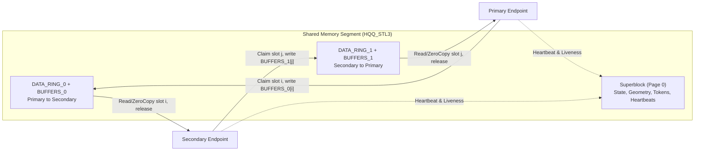

# HQQ: High-Throughput Shared-Memory IPC for Go

**HQQ** (`gosuda.org/hqq`) is a shared-memory inter-process communication (IPC) library for Go, accompanied by C11, C++17, and Rust implementations. It pairs lock-free Vyukov-style multi-producer/multi-consumer (MPMC) packet rings with slot-owned payload buffers and cross-process kernel parking.

Local processes that talk over Unix domain sockets or OS pipes pay for two kernel copies and a scheduler transition on every message. Naive shared-memory rings avoid the kernel copy but burn a full CPU core spinning when traffic goes idle, or wedge permanently when a peer crashes mid-operation. HQQ closes that gap: it delivers **~193 ns 64-byte round trips** and **25 to 101 GB/s throughput** with **zero heap allocations on the hot path**, while parking idle callers in the OS kernel (`futex` on Linux, `__ulock_wait` on macOS, named semaphores on Windows) at **~1% idle CPU** and detecting crashed peers through superblock heartbeats.

---

## Highlights

HQQ is structured around a single page-aligned shared-memory layout (`HQQ_STL3`) that supports both raw zero-copy framing and full-featured RPC:

- **Two composable protocol layers over one shared-memory layout**:
  - **Standard Protocol (`StandardLink`)**: fixed-capacity messages (`Read`, `Write`, `ReadZeroCopy`, `WriteZeroCopy`, `ReserveRead`, `ReserveWrite`, and `net.PacketConn` with datagram `ReadFrom`/`WriteTo` and deadlines) with zero heap allocations on the hot path.
  - **Advanced Protocol (`AdvancedLink`)**: a negotiated overlay adding arbitrary-length messages up to `MaxMessageSize` bytes chunked across the ring (`Send`, `Recv`, pooled `Message` values), concurrent out-of-order RPC with a `net/http`-style server (`Call`, `Serve`, `Handler`, `Mux`), and multiplexed logical streams (`Stream`, `ListenStreams`, `AcceptStream`, `OpenStream`).
  - **Protocol 1.1 (negotiated)**: `FeatureCancel` cancels a running handler when its caller gives up, `FeatureMetadata` propagates the caller's remaining deadline plus `CallOptions` caller and trace IDs, and `Shutdown` drains accepted requests before stopping `Serve`. Peers that negotiate only 1.0 continue to see 1.0 wire behavior.
- **Adaptive cross-process parking (`WaitAdaptive`)**: re-checks the ring in a short tight loop, yields with `runtime.Gosched`, and then parks in the OS kernel (`FUTEX_WAIT` on Linux, `UL_COMPARE_AND_WAIT_SHARED` on macOS, named semaphores for named segments on Windows). All goroutines in a process blocked on the same ring side share a single kernel park through waiter aggregation, so $N$ blocked goroutines pin at most one OS thread.
- **Crash and lifecycle detection (`HQQ_STL3` superblock)**: per-endpoint session tokens and monotonic heartbeats distinguish graceful peer shutdown (`io.EOF` from `Read`, `ErrPeerClosed` elsewhere) from abrupt process termination (`ErrPeerGone`). Segments whose endpoints have all closed or died are safely re-initialized by a new creator, a third endpoint is rejected (`ErrLinkBusy`), a dead initializer is taken over after its progress window expires, and foreign or incompatible objects are never overwritten.
- **Multi-client acceptor (`NewAcceptor`, `Accept`, `Connect`)**: a single listener name serves any number of client processes. Each client allocates its own dedicated link segment and announces it in the listener ring, isolating a crashed or stalled client to its own segment.
- **Model-checked ring and multi-language toolchain**: the MPMC ring (slot claim, completion CAS, FIFO order, progress) is model-checked with TLC ([`internal/mpmc/MPMC.tla`](internal/mpmc/MPMC.tla), bounded model, not an unbounded proof). Beyond Go, the repository ships a C11 reference library (`libhqq`), C++17 and Rust bindings, a normative specification (`spec/`), golden conformance vectors, a two-process interop matrix, `hqq-bindgen` (cgo-free Go-to-C IPC code generation), a `database/sql` SQLite service driver (`sqlite`), and TOCTOU-free binary verification (`secureexec`, `cmd/hqq-manifest`, `launch`). See [Other languages and interoperability](#other-languages-and-interoperability) and [Tools and examples](#tools-and-examples).

---

## Requirements

Building and running HQQ requires the following environment and geometry invariants:

- **Go 1.24 or newer**.
- **`bufferCount`**: power of two, `2 ≤ bufferCount ≤ 1<<24` (default `256` in `hqq.Config`).
- **`bufferSize`**: multiple of 8 bytes, `8 ≤ bufferSize ≤ 1<<30` (default `4096` in `hqq.Config`).
- **Target architecture**: native 64-bit atomic operations that are atomic across processes. `GOARCH=mips`, `GOARCH=mipsle`, and `GOARCH=arm` with `GOARM` below 7 are rejected at compile time (see [Build constraints](#build-constraints)).

---

## Quick Start

The five examples below cover the primary ways to establish and use an HQQ link: point-to-point RPC, multiplexed streams, raw `StandardLink` zero-copy transfers, caller-managed shared memory, and multi-client acceptors.

### 1. Named RPC and messages (`Listen` / `Dial` + `Serve`)

For point-to-point inter-process RPC and large payloads, call `hqq.Listen` on the primary process and `hqq.Dial` on the secondary process. Both create or attach the shared-memory segment and complete Advanced Protocol negotiation. The server answers requests with `Serve` and a `Handler` (modeled after `net/http`); the client dispatches concurrent requests with `Call`:

```go
package main

import (
	"context"
	"fmt"
	"time"

	"gosuda.org/hqq"
)

const MethodEcho uint64 = 1

func main() {
	ctx, cancel := context.WithTimeout(context.Background(), 5*time.Second)
	defer cancel()

	const name = "hqq_quickstart"

	mux := hqq.NewMux()
	mux.HandleFunc(MethodEcho, func(ctx context.Context, w *hqq.ResponseWriter, req *hqq.Request) {
		w.Write([]byte("echo: "))
		w.Write(req.Payload())
	})

	// Primary endpoint: creates the segment and serves requests. Listen also
	// reuses a segment left behind by a crashed listener (both endpoints
	// dead) and fails with ErrLinkBusy if an endpoint is still alive.
	serverErr := make(chan error, 1)
	go func() {
		server, err := hqq.Listen(ctx, name, hqq.Config{})
		if err != nil {
			serverErr <- err
			return
		}
		err = server.Serve(ctx, mux)
		_ = server.Close() // removes the name
		serverErr <- err
	}()

	// Secondary endpoint: Dial retries until the listener has created and
	// initialized the segment, or ctx ends.
	client, err := hqq.Dial(ctx, name, hqq.Config{})
	if err != nil {
		panic(err)
	}
	defer client.Close()

	m, err := client.Call(ctx, MethodEcho, []byte("hello HQQ"))
	if err != nil {
		panic(err)
	}
	fmt.Println(string(m.Bytes())) // Output: echo: hello HQQ
	m.Release()                    // m.Bytes() is invalid from here on

	// Closing the client makes Serve return nil on the listener side, which
	// then closes the server link and removes the name.
	client.Close()
	if err := <-serverErr; err != nil {
		panic(err)
	}
}
```

A handler reports an application error with `w.WriteError(status, payload)`; the caller's `Call` then returns a `hqq.ResponseError` inspectable via `errors.As`. One-way messages without request-response correlation use `Send` and `Recv`; release every `Recv` result with `m.Release()` to return its buffer to the link pool (see [Zero-allocation and buffer ownership](#zero-allocation-and-buffer-ownership)).

### 2. Logical streams (`ListenStreams` / `AcceptStream` / `OpenStream`)

Multiple independent ordered streams can be multiplexed over a single negotiated link (`*hqq.NamedAdvancedLink` returned by `Listen` and `Dial`). The accepting side calls `ListenStreams` before accepting; incoming stream requests that arrive slightly earlier are held up to `StreamListenGrace` (default 2 s) and refused with `ErrConnNotFound` if the acceptor still has not started listening:

```go
// Primary: accept streams opened by the peer.
if err := server.ListenStreams(ctx); err != nil {
	panic(err)
}
go func() {
	s, err := server.AcceptStream(ctx) // visible only after its accept reply is on the ring
	if err != nil {
		return
	}
	_ = s.Send(ctx, []byte("hello on stream"))
}()

// Secondary: open a stream, use it, close it.
s, err := client.OpenStream(ctx) // Secondary IDs are odd, Primary IDs even; 0 is the link itself
if err != nil {
	panic(err)
}
m, err := s.Recv(ctx) // data messages of this stream only
if err != nil {
	panic(err)
}
fmt.Println(m.StreamID() == s.ID(), string(m.Bytes()))
m.Release()
if err := s.Close(); err != nil { // the peer's Recv returns ErrPeerClosed once its queue is empty; the ID is never reused
	panic(err)
}
```

### 3. Named `StandardLink` (`CreateStandardLink` / `OpenStandardLink`)

When every message fits within a single `bufferSize` slot and you want raw `io.ReadWriter` or zero-copy slot access without protocol negotiation, open a `StandardLink` directly:

```go
// The creator removes the name when it closes (if it still refers to this
// segment). An existing name whose endpoints are all gone is reused.
primary, err := hqq.CreateStandardLink("my_std_link", 256, 4096, 0o600, hqq.LinkOptions{})
if err != nil {
	panic(err)
}
defer primary.Close()

secondary, err := hqq.OpenStandardLink("my_std_link", 256, 4096, hqq.LinkOptions{})
if err != nil {
	panic(err)
}
defer secondary.Close()

_, _ = primary.Write([]byte("ping"))

// Zero-copy read directly from the slot-owned shared memory buffer:
_, _ = secondary.ReadZeroCopy(func(payload []byte) error {
	fmt.Println(string(payload))
	return nil
})
```

### 4. In-process or custom shared memory (`NewStandardLink`)

User code never needs `unsafe.Pointer` arithmetic. Pass a page-aligned `[]byte` from `hqq.AlignedBuffer` (or your own `MAP_SHARED` file mapping) to `hqq.NewStandardLink`; the first caller claims the segment as Primary and the second joins as Secondary:

```go
mem := hqq.AlignedBuffer(hqq.SizeStandardLink(128, 4096))

primary, err := hqq.NewStandardLink(mem, 128, 4096, hqq.LinkOptions{})
if err != nil {
	panic(err)
}
defer primary.Close()

secondary, err := hqq.NewStandardLink(mem, 128, 4096, hqq.LinkOptions{})
if err != nil {
	panic(err)
}
defer secondary.Close()
```

`hqq.NewAdvancedLink(mem, 128, 4096, hqq.AdvancedOptions{})` does the same for an `AdvancedLink`; call `Negotiate` on both endpoints before invoking Advanced methods.

### 5. Multi-client acceptor (`NewAcceptor` / `Accept` / `Connect`)

When a service needs to accept connections from an arbitrary number of client processes under one well-known name, use `NewAcceptor` on the server and `Connect` on each client. Every `Connect` call allocates an independent link segment for that client and announces it to the acceptor, which attaches and returns the negotiated `*NamedAdvancedLink` from `Accept`:

```go
// Server process
acc, err := hqq.NewAcceptor("my-service", hqq.AcceptorConfig{})
if err != nil {
	log.Fatal(err)
}
defer acc.Close()

mux := hqq.NewMux()
mux.HandleFunc(MethodEcho, func(ctx context.Context, w *hqq.ResponseWriter, req *hqq.Request) {
	w.Write(req.Payload())
})
for {
	link, err := acc.Accept(ctx) // one link per client
	if err != nil {
		break // ctx ended, or the acceptor was closed (ErrAcceptorClosed)
	}
	go func() {
		defer link.Close()
		_ = link.Serve(ctx, mux)
	}()
}

// Client process (any number of them)
link, err := hqq.Connect(ctx, "my-service", hqq.Config{})
if err != nil {
	panic(err)
}
defer link.Close()

m, err := link.Call(ctx, MethodEcho, []byte("hello"))
```

Because each client owns a separate link segment, a client that crashes or stalls affects only its own connection. See [Acceptor and `Connect` Behavior](#acceptor-and-connect-behavior) for failure modes and configuration defaults.

---

## Architecture Overview

An HQQ shared-memory segment is divided into a first-page superblock (`HQQ_STL3`, layout version 3.0) followed by two independent directional channels:

```text
SUPERBLOCK    layout version, required features, geometry, epoch, init/claim state, creator token, endpoint records (token/PID/heartbeat)
DATA_RING_0   protocol.Packet MPMC ring, Primary -> Secondary
BUFFERS_0     fixed payload buffers for direction 0 (slot i owns BUFFERS_0[i])
DATA_RING_1   protocol.Packet MPMC ring, Secondary -> Primary
BUFFERS_1     fixed payload buffers for direction 1 (slot i owns BUFFERS_1[i])
```



Each data-ring slot `i` owns the corresponding payload buffer `BUFFERS[i]`. A sender claims a producer slot, writes the payload into `BUFFERS[slot]`, and publishes a 64-byte `protocol.Packet`. A receiver claims the consumer slot, copies the payload out (`Read`) or inspects it in place (`ReadZeroCopy` / `ReserveRead`), and releases the slot when finished. Because `BUFFERS[slot]` cannot be claimed by another producer until the consumer releases slot `i`, unread payloads can never be overwritten.

The normative wire and memory rules live in [`spec/SPEC.md`](spec/SPEC.md) and [`spec/MEMORY_MODEL.md`](spec/MEMORY_MODEL.md). [PROTOCOL.md](PROTOCOL.md) provides a concise architectural tour of the wire format and error hierarchy.

---

## Other languages and interoperability

HQQ is a language-neutral shared-memory protocol. Every implementation in this repository is tested against the Go package through golden conformance vectors and a two-process interoperability matrix.

| Component | Location | Status |
| :--- | :--- | :--- |
| C library `libhqq` (C11): Standard, Advanced, acceptor, listener layers, and parent lifeline (`hqq_lifeline.h`) | [`c/`](c/README.md), headers in [`c/include/hqq/`](c/include/hqq) | Unit tests and Go/C interop pairings verified on macOS arm64. CI builds and tests on Linux, macOS, and Windows (`clang-cl` and MSVC). |
| C++17 header-only wrapper (`hqq::`) | [`bindings/cpp/`](bindings/cpp) | Unit tests, examples, and interop verified on macOS arm64. CI in `bindings.yml`: Linux (gcc, clang with sanitizers), macOS, and Windows (`clang-cl`). |
| Rust workspace: `hqq-sys` (FFI), `hqq` (safe API), `hqq-interop` | [`bindings/rust/`](bindings/rust) | Unit tests, examples, and interop verified on macOS arm64. CI in `bindings.yml`: Linux, macOS, and Windows (MSVC with `clang-cl` for C sources). |
| Specification | [`spec/`](spec) | [`SPEC.md`](spec/SPEC.md) (Standard and Advanced Protocol 1.0, normative), [`MEMORY_MODEL.md`](spec/MEMORY_MODEL.md), [`PORTING.md`](spec/PORTING.md), [`ext/`](spec/ext) (Advanced Protocol 1.1 and listener segment), [`constants.json`](spec/constants.json), [`litmus/`](spec/litmus). |
| Conformance vectors | [`conformance/`](conformance) | Golden byte vectors generated by the Go implementation, verified by `go test ./conformance/...`, and checked in CI by `interop.yml`. |
| Interop test suite | [`cmd/hqq-interop`](cmd/hqq-interop), [`interop/`](interop), [`conformance/INTEROP_CLI.md`](conformance/INTEROP_CLI.md) | Two-process test matrix across implementations listed in `HQQ_INTEROP_IMPLS` (for example `go=/path/to/hqq-interop-go,c=/path/to/hqq_interop`). Verified across Go, C, C++, and Rust pairings. |
| Memory-model verification | [`c/verify/`](c/verify) | GenMC model-checking drivers over the C ring, herd7 litmus tests, and weak-memory stress litmus tests. Run in CI. |

Implementations that port the wait/wake protocol must use sequentially consistent accesses (or equivalent full fences) for the four handshake steps `W1`, `W3`, `K1`, and `K2`; see [`spec/MEMORY_MODEL.md`](spec/MEMORY_MODEL.md) §4. Relaxed or acquire/release-only handshakes allow the store-buffer reordering that loses wake-ups.

---

## Tools and examples

Beyond the core transport, the repository provides production packages for running out-of-process C services and SQLite databases without linking cgo into your Go binary.

### SQLite service (`sqlite`)

The `sqlite` package is a pure-Go `database/sql` driver, registered as `hqq-sqlite`, that talks to a SQLite database running in a separate server process over an HQQ listener. The Go client requires no cgo. Each `database/sql` connection maps to one HQQ stream over a shared link, and the server isolates each stream as an independent session with its own `sqlite3` handle, transaction state, and prepared statements. The backing service is either the C server in [`examples/sqlite/server`](examples/sqlite/server) (Linux, macOS, and Windows) or the Go fake server used in unit tests.

```go
import (
	"database/sql"

	_ "gosuda.org/hqq/sqlite" // registers "hqq-sqlite"
)

db, err := sql.Open("hqq-sqlite", "hqq://sqlite-svc?db=main&timeout=5s&fetch=256&busy=5s")
```

The DSN host names the HQQ listener. Supported query parameters are `db` (required: an alias or a file path), `mode` (`rwc`, `rw`, or `ro`), `timeout`, `fetch`, `busy`, `txlock`, and `pragma.<name>`; unknown or repeated keys are rejected. [`sqlite/README.md`](sqlite/README.md) documents the complete parameter set and SQLite type mappings. To construct a connector programmatically or manage the underlying link directly, call `sqlite.NewConnector`:

```go
c, err := sqlite.NewConnector("sqlite-svc", sqlite.Config{
	Database:    "main",
	Timeout:     5 * time.Second,
	FetchSize:   256,
	BusyTimeout: 5 * time.Second,
})
if err != nil {
	return err
}
db := sql.OpenDB(c) // all connections of db share one link
```

SQLite engine errors unmarshal into `*sqlite.Error`, where `Code` is the primary result code and `ExtendedCode` is the extended result code:

```go
if _, err := db.Exec("INSERT INTO users (email) VALUES (?)", email); err != nil {
	var se *sqlite.Error
	switch {
	case errors.As(err, &se) && se.ExtendedCode == sqlite.CodeConstraintUnique:
		return ErrDuplicate
	case sqlite.IsBusy(err):
		return ErrRetryLater
	}
	return err
}
```

If the shared-memory link drops in the middle of `Exec`, the driver returns an error wrapping `sqlite.ErrOutcomeUnknown` rather than `driver.ErrBadConn`, preventing `database/sql` from automatically re-running a mutation that may have already committed. Lost-link errors during `Query` or connection setup wrap `driver.ErrBadConn` so `database/sql` can transparently retry on a fresh connection; always send writes through `Exec` or inside an explicit transaction.

The `database/sql` contract suite (`sqlite/internal/contract`) runs against both the Go fake server (`go test ./sqlite`) and the C server (`sqlite/e2e`). Build and launch the C server with CMake:

```sh
cmake -S c -B build -DHQQ_BUILD_SQLITE_SERVER=ON -DHQQ_WERROR=ON
cmake --build build --target hqq-sqlite-server
build/sqlite-server/hqq-sqlite-server sqlite-svc --alias main=/path/to/app.db
```

The server opens database names registered with `--alias`, and raw filesystem paths only when they resolve inside `--allow-dir`. Its wire protocol is documented in [`sqlite/PROTOCOL.md`](sqlite/PROTOCOL.md).

### Starting the SQLite server from Go (`sqlite/launcher`)

`sqlite/launcher` starts the C SQLite server as a child process, verifies its binary digest before execution, attaches a parent lifeline, and returns a ready `*sql.DB` handle:

```go
want, err := secureexec.ParseHash(digestHex) // 64 hex digits, from the release manifest
if err != nil {
	return err
}
m, err := launcher.OpenManaged(ctx, launcher.Config{
	Binary:  "/opt/app/bin/hqq-sqlite-server",
	SHA256:  want,
	Aliases: map[string]string{"main": "/var/lib/app/app.sqlite"},
}, launcher.WithDatabase("main"))
if err != nil {
	return err
}
defer m.Close() // closes the DB, then stops the server
var one int
err = m.DB.QueryRowContext(ctx, "SELECT 1").Scan(&one)
```

- `Start` hashes and locks the binary with `secureexec` before starting it. The expected digest comes from `Config.SHA256` or from the current platform's entry in a signed release manifest (`Config.Manifest`, whose ed25519 signature is verified before parsing any JSON). A digest mismatch starts nothing and returns an error wrapping `secureexec.ErrHashMismatch`.
- The child server runs with `--parent-stdin`. If the parent Go process exits for any reason, including `SIGKILL`, the kernel closes the pipe write end and the server rolls back open transactions and exits cleanly.
- `Open` returns `*sql.DB` and `*Server` separately (close the DB first, then the server); `OpenManaged` bundles both into a single `Managed` handle.
- The launcher starts a single child instance and does not supervise or auto-restart it. Full details are in [`sqlite/launcher/README.md`](sqlite/launcher/README.md).

### Starting any HQQ server from Go (`launch`)

`launch` is the service-agnostic foundation underneath `sqlite/launcher`. `launch.Start(ctx, cfg, args...)` verifies the server binary via `Config.SHA256` or `Config.Manifest`, attaches a parent lifeline (`--parent-stdin` by default), waits for the child to print `ready <listener>` on standard output, and returns a `*launch.Server` that shuts down gracefully before falling back to `SIGKILL` after `StopTimeout`. Like `sqlite/launcher`, it is a one-shot starter rather than a process supervisor. See [`launch/README.md`](launch/README.md).

### Calling C libraries from Go (`hqq-bindgen`)

`hqq-bindgen` reads an interface description (`.idl`) and generates a pure-Go client package alongside a C server dispatcher. The target C library runs in its own isolated server process; the Go application links zero C code and communicates with the server over HQQ shared memory. Only functions declared in the IDL are exposed, opaque C pointers stay inside server-side generation-checked handle tables, and client and server verify a 256-bit interface digest when opening a session.

```sh
go run gosuda.org/hqq/cmd/hqq-bindgen -go-out client -go-strip ml_ -c-out server mylib.idl
go run gosuda.org/hqq/cmd/hqq-bindgen -check -go-out client -go-strip ml_ -c-out server mylib.idl   # fails on stale output
```

Where `hqq-bindgen` shines, measured on an Apple M1 (full tables and caveats in [`bindgen/README.md`](bindgen/README.md)): coarse calls. Compressing 64 KiB to 1 MiB payloads with zstd 1.5.7 through the generated client, with calls pipelined, runs within 2% of in-process cgo on one goroutine, and two sessions against two cgo threads stay within 2% at 1 MiB. Where it does not compete with cgo: tiny synchronous calls. A no-op synchronous call takes ~335 ns over HQQ versus ~25 ns via cgo (~164 to 178 ns when pipelined). You trade that per-call floor for process isolation (a segfault in C kills the worker process, not the Go runtime), cgo-free cross-compilation and fast Go builds, and asynchronous futures that overlap C execution with Go work. The generated layer does not support call cancellation or C-to-Go callbacks, and the generated C server loop runs on POSIX systems only.

The architecture and wire format are specified in [`spec/toolchain/BINDGEN.md`](spec/toolchain/BINDGEN.md). Working examples live in [`bindgen/examples/zstd`](bindgen/examples/zstd) and [`bindgen/examples/sqlite3`](bindgen/examples/sqlite3) (paired with the `hqq-sqlite-gen` driver in [`sqlite/gendriver`](sqlite/gendriver), which passes the same 107-case `database/sql` contract suite as `hqq-sqlite`). Generated servers can be started directly with [`launch`](#starting-any-hqq-server-from-go-launch).

### Verified executables

`secureexec` verifies the SHA-256 digest of a native executable and launches it without a time-of-check to time-of-use (TOCTOU) window, guaranteeing that the bytes hashed are the exact bytes executed by the kernel. It depends only on the Go standard library.

Threat model: the verifier runs as an unprivileged user, the adversary is another local process or user with write access to the directory or file where the binary resides, and neither a path swap nor an in-place overwrite between verification and execution may alter what runs. Root or kernel compromise and compromised expected digests are out of scope.

```go
want, err := secureexec.ParseHash(expectedHex) // from a signed manifest
if err != nil {
	return err
}
v, err := secureexec.Verify("/opt/app/bin/hqq-sqlite-server", want)
if err != nil {
	return err // *HashMismatchError when the bytes differ
}
defer v.Close() // after Start; the child keeps running

cmd := v.Command(ctx, "app-db", "--parent-stdin")
cmd.Stdout = os.Stdout
cmd.Stderr = os.Stderr
if err := cmd.Start(); err != nil { // start while v is still open
	return err
}
```

`secureexec.Start` combines verification and process start into one call and releases the snapshot when the child exits. Each OS uses its strongest native isolation primitive:

| Platform | `Mechanism()` | How the hashed bytes are protected |
| :--- | :--- | :--- |
| Linux | `memfd` (`vault` when memfd is unavailable) | The binary is copied once into a write-sealed anonymous `memfd` with no filesystem path and executed via `/proc/self/fd/3`. Kernel seals hold against all users, including same-UID processes. |
| macOS, FreeBSD, other POSIX | `vault` | The binary is copied into a fresh `0700` directory owned by the current UID as a `0500` read-only file, and hashed after the copy completes. Other users cannot modify it; same-UID processes can. |
| Windows | `windows-share-lock` | The file is opened with `FILE_SHARE_READ` only, and the handle remains open across `CreateProcess`, preventing any other handle from writing, deleting, or renaming the image. |
| Other platforms | none | `Verify` returns `ErrUnsupported`. |

- `secureexec.Policy{TrustOwnedReadOnly: true}` (`secureexec.WithPolicy`) skips the copy when the file and every ancestor directory are owned by `root` or the current user and are not writable by group or others. Same-UID processes can still modify the file between check and exec under this opt-in policy.
- On POSIX systems, the final path component must not be a symbolic link (`ELOOP`); on Windows, symbolic links are resolved via the opened handle.
- Signed release manifests and `cmd/hqq-manifest` are covered in [Release binaries and manifests](#release-binaries-and-manifests), with full package documentation in [`secureexec/README.md`](secureexec/README.md).

### Parent lifeline

When a parent process crashes or receives `SIGKILL`, child sidecar processes can easily be left behind as orphans holding ports, locks, or shared-memory segments. The `lifeline` package (and its C counterpart in `hqq_lifeline.h`) ties a child's lifetime to its parent through the child's standard input: the parent passes the read end of an OS pipe as the child's `stdin` and retains the write end. When every holder of the write end closes it, whether intentionally or because the kernel tore down the parent process on `SIGKILL`, the child's `stdin` immediately sees `EOF`.

Parent side in Go:

```go
cmd := exec.Command(server, "--parent-stdin")
ll, err := lifeline.Attach(cmd) // sets cmd.Stdin
if err != nil {
	return err
}
defer ll.Close() // ends the child's life when the parent returns
if err := cmd.Start(); err != nil {
	return err
}
```

Child side in Go, called once early in `main`:

```go
ctx, stop := lifeline.Watch(context.Background())
defer stop()
<-ctx.Done() // standard input reached end of file, or failed
```

Passing `lifeline.WithKeepalive(d)` makes the parent write one heartbeat byte every `d` so a child can also detect a parent frozen by `SIGSTOP`; `Watch` drains and discards those bytes automatically.

The C SQLite server exposes the same mechanism under `--parent-stdin` (alias `--exit-on-stdin-eof`). On `EOF` it stops accepting work, rolls back active transactions, and exits with status `0`; if shutdown takes longer than `--lifeline-grace-ms` (default `5000`), it exits with status `70`. Other C services can embed the same behavior via `hqq_lifeline_start` in [`c/include/hqq/hqq_lifeline.h`](c/include/hqq/hqq_lifeline.h).

**Guarantee**: a child service started with a lifeline will not survive as an orphan when its parent terminates in any way that closes file descriptors, including `SIGKILL` and fatal runtime crashes.

**Operational limits**:

- A parent that is stopped (`SIGSTOP` or paused in a debugger) rather than dead still holds its file descriptors open, so the pipe does not reach `EOF` without keepalive timeouts.
- Any other process that inherits the parent's write descriptor keeps the pipe open. Go's `os.Pipe` sets `O_CLOEXEC`, so only a process explicitly given the descriptor can hold it.
- Only the calling thread survives `fork()`, so a child process that forks and continues running in the child loses its lifeline watcher thread. C servers using `hqq_lifeline` must not daemonize via `fork()` after starting the lifeline.
- A grandchild that inherits the child's `stdin` descriptor holds the read side open alongside the child, but `EOF` is still determined by the write side. Ensure grandchildren do not inherit the parent's write descriptor.
- Interactive terminals (`tty`) are ignored unless forced (`lifeline.WatchTerminal` or `--parent-stdin=force`), preventing accidental exits during interactive debugging.
- A child watched by `lifeline.Watch` must dedicate its `stdin` to the lifeline for the life of the process; `Watch` parks a reader goroutine on `os.Stdin` until exit.

### Release binaries and manifests

Every tagged release of `hqq-sqlite-server` publishes platform binaries (`hqq-sqlite-server_<os>_<arch>`), a version 1 release manifest (`manifest.json` containing filenames, byte sizes, SHA-256 digests, and license identifiers), a detached ed25519 signature (`manifest.json.sig`), `licenses.tar.gz`, and `SHA256SUMS`. Build and key-rotation procedures are documented in [`docs/RELEASING.md`](docs/RELEASING.md).

To verify a downloaded binary in Go, embed the release public key in your application and verify `manifest.json.sig` before reading any digest from the manifest:

```go
pub, err := manifest.ParsePublicKey(releasePublicKey) // your copy of the release public key
if err != nil {
	return err
}
data, err := os.ReadFile(filepath.Join(dir, "manifest.json"))
if err != nil {
	return err
}
sig, err := os.ReadFile(filepath.Join(dir, "manifest.json.sig"))
if err != nil {
	return err
}
m, err := manifest.Verify(data, sig, pub) // the signature is checked before the manifest is parsed
if err != nil {
	return err
}
f, ok := m.Find(runtime.GOOS, runtime.GOARCH)
if !ok {
	return fmt.Errorf("no build of %s for %s/%s", m.Name, runtime.GOOS, runtime.GOARCH)
}
v, err := secureexec.Verify(filepath.Join(dir, f.Name), f.SHA256)
if err != nil {
	return err // *HashMismatchError when the bytes differ
}
defer v.Close()
```

From a repository checkout, you can run the same verification from the shell:

```sh
go run ./cmd/hqq-manifest verify -pub release_public_key.hex \
  -in manifest.json -sig manifest.json.sig -dir hqq-sqlite-release
sha256sum -c SHA256SUMS
```

`hqq-manifest` (`cmd/hqq-manifest`) exits with `0` on success, `1` on verification or execution failure, and `2` on invalid command-line flags:

- `keygen -priv FILE -pub FILE`: generates a new ed25519 key pair encoded as hex text. The private key file is created with mode `0600`, and existing files are never overwritten.
- `gen -dir DIR -name NAME -release REL [-license ID]... -out FILE`: scans `DIR` for `NAME_<os>_<arch>[.exe]` binaries and writes an unsigned `manifest.json`.
- `sign -key FILE` or `sign -key-env VAR`, `-in FILE [-out FILE.sig]`: writes the detached ed25519 signature over the exact bytes of `FILE`. `-key-env` reads the secret key from an environment variable for CI signing jobs.
- `verify -pub FILE -in FILE -sig FILE [-dir DIR]`: verifies the ed25519 signature before parsing the manifest, and when `-dir` is given, verifies the byte size and SHA-256 digest of every listed binary.
- `hash FILE...`: prints `sha256sum`-compatible lines.

---

## Benchmarks

All numbers below were measured on `darwin/arm64` (Apple M1, Go 1.27, idle machine, median of 6 runs of `go test . -bench 'Benchmark(StandardLink|AdvancedLink|Compare)' -benchmem`). Idle CPU figures come from `HQQ_PERF_TESTS=1 go test -run 'TestIdleLinkDoesNotBurnCPU|TestMPMCWaitSpinBurnsCPU' ./...`. In the Go benchmarks, both endpoints run in one process on separate goroutines; a two-process Go-client to C-server measurement on the same machine recorded 186–187 ns average for the 64-byte round trip.

### HQQ vs Unix Domain Socket (`SOCK_STREAM`) vs OS Pipe

| Benchmark | HQQ (`WaitAdaptive`) | HQQ (`WaitSpin`) | Unix Domain Socket | OS Pipe | HQQ Speedup |
| :--- | ---: | ---: | ---: | ---: | ---: |
| **64 B Round-Trip Latency** | **192.7 ns/op** | 193.1 ns/op | 3,136 ns/op | 3,396 ns/op | **16.3×–17.6× faster** |
| **4 KiB Unidirectional Throughput** | **25,250 MB/s** (162.2 ns/op) | 25,200 MB/s (162.6 ns/op) | 2,643 MB/s | 4,359 MB/s | **5.8×–9.6× higher** |
| **64 KiB Unidirectional Throughput** | **27,070 MB/s** (2,421 ns/op) | 27,800 MB/s (2,358 ns/op) | 3,088 MB/s | 11,733 MB/s | **2.3×–8.8× higher** |
| **Idle Blocked Callers** | **~1% CPU** (2 blocked calls, incl. heartbeats) | >100% CPU (one core per blocked call) | blocks in the kernel | blocks in the kernel | kernel parking |

### StandardLink & AdvancedLink Microbenchmarks

| Operation | Latency | Throughput | Allocs |
| :--- | ---: | ---: | ---: |
| `StandardLink` Read/Write (`8 B`) | **28.6 ns/op** | **279 MB/s** | `0 B/op`, `0 allocs/op` |
| `StandardLink` Zero-Copy (`4 KiB`) | **40.5 ns/op** | **101,060 MB/s** | `0 B/op`, `0 allocs/op` |
| `StandardLink` Reserve/Commit (`4 KiB`) | **67.7 ns/op** | **60,520 MB/s** | `0 B/op`, `0 allocs/op` |
| `StandardLink` Pipeline (`64 B`) | **37.6 ns/op** | **1,702 MB/s** | `0 B/op`, `0 allocs/op` |
| `StandardLink` Pipeline (`4 KiB`, bimodal: 112–159 ns/op) | **155 ns/op** | **26,370 MB/s** | `0 B/op`, `0 allocs/op` |
| `AdvancedLink` Send/Recv + `Release` (`64 B`, one chunk) | **152.4 ns/op** | **420 MB/s** | `0 B/op`, `0 allocs/op` |
| `AdvancedLink` Send/Recv + `Release` (`4 KiB` over `256 B` chunks) | **1.46 µs/op** | **2,805 MB/s** | `0 B/op`, `0 allocs/op` |
| `AdvancedLink` Call + `Release` via `Serve` (`64 B` req + `64 B` resp) | **553 ns/op** | **232 MB/s** | `0 B/op`, `0 allocs/op` |
| `AdvancedLink` Call + `Release` via `Serve` (`1 KiB` req + `1 KiB` resp, `256 B` chunks) | **1.22 µs/op** | **1,677 MB/s** | `0 B/op`, `0 allocs/op` |

---

## API Guide

The signatures below match `go doc -all .`; the GoDoc comments on each symbol remain the authoritative reference for method-level error conditions.

### Sizing & Opening

```go
// High-level Listen / Dial (create or open a named segment and negotiate AdvancedLink)
func Listen(ctx context.Context, name string, cfg Config) (*NamedAdvancedLink, error)
func Dial(ctx context.Context, name string, cfg Config) (*NamedAdvancedLink, error)
func Unlink(name string) error

// Layout sizing & helpers
func SizeStandardLink(bufferCount int, bufferSize int) uintptr // 0 for an invalid or unaddressable configuration
func AlignedBuffer(size uintptr) []byte                        // page-aligned, heap-backed
func LargeMessageThreshold(bufferSize int) int
func IsLargeMessage(bufferSize int, payloadSize int) bool
func CurrentProtocolVersion() ProtocolVersion

// Caller-owned memory (page-aligned, at least SizeStandardLink bytes)
func NewStandardLink(mem []byte, bufferCount int, bufferSize int, opts LinkOptions) (*StandardLink, error)
func NewAdvancedLink(mem []byte, bufferCount int, bufferSize int, opts AdvancedOptions) (*AdvancedLink, error)

// Named segments: Create* is the creator side, Open* the opener side
func CreateStandardLink(name string, bufferCount int, bufferSize int, perm os.FileMode, opts LinkOptions) (*NamedStandardLink, error)
func OpenStandardLink(name string, bufferCount int, bufferSize int, opts LinkOptions) (*NamedStandardLink, error)
func CreateAdvancedLink(name string, bufferCount int, bufferSize int, perm os.FileMode, opts AdvancedOptions) (*NamedAdvancedLink, error)
func OpenAdvancedLink(name string, bufferCount int, bufferSize int, opts AdvancedOptions) (*NamedAdvancedLink, error)

// Named links (NamedStandardLink and NamedAdvancedLink embed their link type)
func (l *NamedStandardLink) Name() string
func (l *NamedStandardLink) Unlink() error // remove the name now if it still refers to this segment; mappings stay valid
func (l *NamedStandardLink) Close() error  // close, unmap, and remove the name if this endpoint created it and it still refers to this segment
func (l *NamedAdvancedLink) Name() string
func (l *NamedAdvancedLink) Unlink() error
func (l *NamedAdvancedLink) Close() error
```

`NewStandardLink` and `NewAdvancedLink` validate their arguments in a fixed order: empty slice (`ErrMemorySmall`), page alignment (`ErrMemoryAlign`), geometry bounds (`ErrInvalidSize`), and slice length (`ErrMemorySmall`). Attaching with a geometry that differs from an existing segment's superblock returns `*GeometryError` (which matches `ErrInvalidSize` via `errors.Is` and exposes `Want` and `Got` via `errors.As`).

### Acceptor and `Connect`

```go
// Server: one listener name, any number of clients (AcceptorConfig zero value = defaults)
func NewAcceptor(name string, cfg AcceptorConfig) (*Acceptor, error)
func NewAcceptorContext(ctx context.Context, name string, cfg AcceptorConfig) (*Acceptor, error)
func (a *Acceptor) Accept(ctx context.Context) (*NamedAdvancedLink, error) // ErrAcceptorClosed after Close
func (a *Acceptor) Close() error // idempotent; removes the listener name; links already accepted stay open
func (a *Acceptor) Name() string
func (a *Acceptor) Addr() net.Addr
func (a *Acceptor) Stats() AcceptorStats

// Client: one link per call, negotiated as Primary
func Connect(ctx context.Context, listenerName string, cfg Config) (*NamedAdvancedLink, error)
```

`AcceptorConfig` fields: `Perm`, `QueueSize`, `Features`, `Advanced` (`AdvancedOptions` applied to every accepted link), `MaxBufferCount`, `MaxBufferSize`, `MaxLinkSize`, `Backlog`, `MaxHandshakes`, `HandshakeTimeout`, and `StuckSlotTimeout`. Default values are listed under [Acceptor and `Connect` Behavior](#acceptor-and-connect-behavior). `AcceptorStats` exposes `Records`, `Accepted`, `Malformed`, `Unreachable`, `HandshakeFailed`, and `StuckSlots`.

### `StandardLink` Methods

```go
func (l *StandardLink) Read(b []byte) (int, error) // io.EOF after a graceful peer Close
func (l *StandardLink) Write(b []byte) (int, error)
func (l *StandardLink) ReadFrom(p []byte) (n int, addr net.Addr, err error) // datagram semantics
func (l *StandardLink) WriteTo(p []byte, _ net.Addr) (n int, err error)     // addr is ignored
func (l *StandardLink) ReadZeroCopy(fn func(buffer []byte) error) (int, error)
func (l *StandardLink) WriteZeroCopy(fn func(buffer []byte) (int, error)) (int, error)
func (l *StandardLink) ReserveRead() (StandardReadReservation, error)
func (l *StandardLink) ReserveWrite() (StandardWriteReservation, error)
func (l *StandardLink) SetDeadline(t time.Time) error
func (l *StandardLink) SetReadDeadline(t time.Time) error
func (l *StandardLink) SetWriteDeadline(t time.Time) error
func (l *StandardLink) LocalAddr() net.Addr // HQQAddr "hqq-primary" or "hqq-secondary": this endpoint's role
func (l *StandardLink) PeerState() PeerState
func (l *StandardLink) Mode() LinkMode
func (l *StandardLink) Type() LinkType
func (l *StandardLink) BufferCount() int
func (l *StandardLink) BufferSize() int
func (l *StandardLink) Close() error

func (r *StandardWriteReservation) Buffer() []byte // nil once committed/aborted, also through a copy
func (r *StandardWriteReservation) Commit(n int) error
func (r *StandardWriteReservation) Abort(reason ErrorCode) error
func (r *StandardWriteReservation) Slot() uint64
func (r *StandardReadReservation) Buffer() []byte // nil once released, also through a copy
func (r *StandardReadReservation) Release() error
func (r *StandardReadReservation) Slot() uint64
```

- **One read call returns bytes from at most one message.** When a message is larger than the buffer passed to `Read`, its unread tail is queued in per-endpoint FIFO order; subsequent read calls drain queued tails (one per call) before claiming newer ring slots. `ReadZeroCopy` and `ReserveRead` serve the entire oldest queued tail. With concurrent readers, messages and tails may be claimed in any order across goroutines, but bytes from two messages are never coalesced into one call.
- **`ReadFrom` has datagram semantics**: it copies up to `len(p)` bytes, discards any remainder of the message, and returns `n == len(p)` with a `nil` error (an empty `p` consumes and discards one message). If a prior `Read` left a pending tail, `ReadFrom` returns that tail as the next datagram, truncating it if needed. The returned `net.Addr` is the peer's role address (`"hqq-secondary"` on a Primary link, `"hqq-primary"` on a Secondary link); `LocalAddr` returns this endpoint's own role address.
- Empty `Write` calls publish nothing; payloads exceeding `BufferSize` fail with `ErrBufferOverflow`.

> [!WARNING]
> `ReadZeroCopy`, `WriteZeroCopy`, `ReserveRead`, and `ReserveWrite` hold the underlying ring slot until completed. Zero-copy callbacks must return promptly, and reservations must always be finished (`Commit` or `Abort` for writes, `Release` for reads) to prevent head-of-line (HOL) blocking on the ring. Never retain the shared `[]byte` slice after the callback returns, after `Release`/`Commit`/`Abort`, or after `Close`. If a reservation struct is copied by value, completing the slot through one copy invalidates all others: a second `Commit`/`Abort`/`Release` returns `ErrInvalidOp`, `Buffer()` returns `nil`, and the ring slot is neither completed nor woken a second time. If a zero-copy callback panics, HQQ keeps the ring live: `WriteZeroCopy` publishes a tombstone and `ReadZeroCopy` releases the slot before re-raising the panic.
>
> `Close` waits for active zero-copy callbacks to finish, so calling `Close` from inside a zero-copy callback deadlocks. `Close` does not track standalone reservations; finish every reservation before calling `Close`.

### `AdvancedLink`, `Stream` & RPC Methods

```go
// Role-aware one-call negotiation (Primary initiates, Secondary waits)
func (l *AdvancedLink) Negotiate(ctx context.Context, features uint64) error
func (l *AdvancedLink) NegotiateProtocol(ctx context.Context, version ProtocolVersion, features uint64) (bool, error)
func (l *AdvancedLink) WaitForNegotiation(ctx context.Context) (bool, error)
func (l *AdvancedLink) ProtocolState() ProtocolState
func (l *AdvancedLink) NegotiatedVersion() ProtocolVersion
func (l *AdvancedLink) NegotiatedFeatures() uint64 // test with FeatureMessages / FeatureRequestResponse

// The link-level stream (ID 0): Send, Recv and Call are shortcuts for l.Stream().X
func (l *AdvancedLink) Stream() *Stream
func (l *AdvancedLink) Send(ctx context.Context, p []byte) error
func (l *AdvancedLink) Recv(ctx context.Context) (*Message, error) // data messages only; Release the result
func (l *AdvancedLink) Call(ctx context.Context, method uint64, req []byte) (*Message, error) // Release the result
func (l *AdvancedLink) CallWith(ctx context.Context, method uint64, req []byte, opts CallOptions) (*Message, error) // protocol 1.1 metadata
func (l *AdvancedLink) Serve(ctx context.Context, h Handler) error
func (l *AdvancedLink) Shutdown(ctx context.Context) error // refuse new requests, drain accepted ones; Serve then returns nil

// Logical streams (Primary allocates even IDs 2, 4, ...; Secondary odd IDs 1, 3, ...; 0 is the link)
func (l *AdvancedLink) ListenStreams(ctx context.Context) error
func (l *AdvancedLink) AcceptStream(ctx context.Context) (*Stream, error)
func (l *AdvancedLink) OpenStream(ctx context.Context) (*Stream, error)

func (s *Stream) ID() uint64
func (s *Stream) Send(ctx context.Context, p []byte) error
func (s *Stream) Recv(ctx context.Context) (*Message, error)
func (s *Stream) Call(ctx context.Context, method uint64, req []byte) (*Message, error)
func (s *Stream) CallWith(ctx context.Context, method uint64, req []byte, opts CallOptions) (*Message, error) // protocol 1.1 metadata
func (s *Stream) Close() error // no context; ErrInvalidOp on stream 0

// Received messages (pooled)
func (m *Message) Bytes() []byte
func (m *Message) Len() int
func (m *Message) StreamID() uint64
func (m *Message) Release() // at most once; optional

// Server side (like net/http)
type Handler interface {
	ServeHQQ(ctx context.Context, w *ResponseWriter, req *Request)
}
type HandlerFunc func(ctx context.Context, w *ResponseWriter, req *Request)

func (r *Request) Method() uint64
func (r *Request) Payload() []byte // valid only during ServeHQQ
func (r *Request) StreamID() uint64
func (r *Request) Caller() uint64  // protocol 1.1: caller ID from CallOptions, or zero
func (r *Request) Trace() [16]byte // protocol 1.1: trace ID from CallOptions, or zero
func (w *ResponseWriter) Write(p []byte) (int, error)     // appends to the response body
func (w *ResponseWriter) WriteError(status uint64, p []byte) // error response; Call returns ResponseError

func NewMux() *Mux // Mux.NotFound Handler handles unregistered methods
func (m *Mux) Handle(method uint64, h Handler)
func (m *Mux) HandleFunc(method uint64, f func(ctx context.Context, w *ResponseWriter, req *Request))

type ResponseError struct { // returned by value from Call for an error response
	Status  uint64
	Payload []byte // a copy owned by the caller
}

type CallOptions struct { // request metadata, sent with FeatureMetadata
	Caller uint64   // zero: not sent
	Trace  [16]byte // all zero: not sent
}

// Link information and lifecycle
func (l *AdvancedLink) Stats() AdvancedStats
func (l *AdvancedLink) PeerState() PeerState
func (l *AdvancedLink) Mode() LinkMode
func (l *AdvancedLink) Type() LinkType
func (l *AdvancedLink) BufferCount() int
func (l *AdvancedLink) BufferSize() int
func (l *AdvancedLink) Close() error
```

- **Negotiation is terminal on failure.** Once a link enters `ProtocolStateFailed` (due to rejection, malformed negotiation packets, a canceled context, or link closure), all subsequent `Negotiate`, `NegotiateProtocol`, or `WaitForNegotiation` calls return `ErrNegotiationFailed`. `ErrAlreadyNegotiated` is returned only while an attempt is in flight or after negotiation has succeeded. Close the link and open a fresh one after a negotiation failure.
- **Streams, `Serve`, routing, and close semantics** are detailed in [Streams, `Serve`, and routing](#streams-serve-and-routing); buffer lifetimes are covered in [Zero-allocation and buffer ownership](#zero-allocation-and-buffer-ownership).

### Configuration types

```go
type Config struct {
	BufferCount int          // default DefaultBufferCount (256)
	BufferSize  int          // default DefaultBufferSize (4096)
	Perm        os.FileMode  // permission of the created segment (Listen only), default 0o600
	Features    uint64       // default: all supported features (FeatureMessages|FeatureRequestResponse|FeatureCancel|FeatureMetadata)
	Advanced    AdvancedOptions
}

type LinkOptions struct {
	WaitPolicy        WaitPolicy    // WaitAdaptive (default) or WaitSpin
	HeartbeatInterval time.Duration // default 250ms; negative disables heartbeats
	PeerTimeout       time.Duration // default 5s, raised to at least 4 peer heartbeat intervals
	AttachTimeout     time.Duration // default 5s
}

type AdvancedOptions struct {
	MaxMessageSize     uint64 // default 64 MiB
	MaxReassemblyBytes uint64 // default 4 × MaxMessageSize
	IncomingQueueSize  int    // default bufferCount
	IncomingOverflow   OverflowPolicy
	StreamListenGrace  time.Duration // stream requests held before ListenStreams; default 2s, negative refuses at once
	Link               LinkOptions
}
```

Sentinel errors and their `errors.Is` wrapping hierarchy are tabulated in [PROTOCOL.md](PROTOCOL.md#error-hierarchy); packet frame layouts live in [`spec/SPEC.md`](spec/SPEC.md) and [`spec/ext/PROTOCOL_1_1_DRAFT.md`](spec/ext/PROTOCOL_1_1_DRAFT.md).

### Streams, `Serve`, and routing

**Streams**:

- Stream `0` represents the link itself: `l.Stream()` always returns the same `*Stream` pointer, it is permanently open while the link lives, and calling `Close` on it returns `ErrInvalidOp`. `l.Send`, `l.Recv`, and `l.Call` are shorthand for `l.Stream().Send`, `Recv`, and `Call`.
- Additional streams: the accepting side calls `ListenStreams` and then `AcceptStream`; the dialing peer's `OpenStream` blocks until the accept reply arrives. If an `OpConnCreate` frame arrives before the local process calls `ListenStreams`, it is held for `AdvancedOptions.StreamListenGrace` (default 2 s) and accepted in FIFO order as soon as `ListenStreams` is called; requests still waiting when the grace window expires are refused with `ErrConnNotFound`. Calling `ListenStreams` twice returns `ErrAlreadyListening`, and calling `AcceptStream` before `ListenStreams` returns `ErrNotListening`. Primary endpoints allocate even stream IDs (`2, 4, ...`), Secondary endpoints allocate odd IDs (`1, 3, ...`), and stream IDs are never reused on the same link. Because an incoming stream is registered when its `OpConnCreate` arrives, data messages sent immediately after `OpenStream` are queued for the stream even before `AcceptStream` returns it to the caller.
- `Send` publishes `p` as a single logical message of up to `MaxMessageSize` bytes (`ErrBufferOverflow` otherwise, with nothing transmitted), splitting it into ring chunks of at most `BufferSize` bytes; the receiver reassembles and delivers it as one `Message`. The caller may reuse `p` as soon as `Send` returns. `Send` requires `FeatureMessages`; `Call` and `Serve` require `FeatureRequestResponse` (`ErrNotNegotiated` otherwise).
- **Ordering**: sequential `Send` calls on the same stream are delivered in FIFO order. Concurrent `Send` calls on the same stream are not ordered relative to one another, and messages on different streams are independent. Responses to concurrent `Call` invocations may complete in any order.

**Serve**:

- `Serve(ctx, h)` consumes requests across all streams of the link and dispatches each to `h.ServeHQQ(ctx, w, req)`. Each invocation receives a per-request `context.Context`, a `*ResponseWriter`, and a `*Request` (`Method`, `Payload`, `StreamID`, plus `Caller` and `Trace` when `FeatureMetadata` is active). When `ServeHQQ` returns, HQQ transmits the response on the originating stream unless the caller has already canceled or timed out. `Stream.Recv` never returns RPC requests; `Serve` is their sole consumer.
- A handler that writes nothing sends an empty success response (status `0`). `w.Write` appends to the response body (returning `ErrBufferOverflow` without modifying the buffer if the total would exceed `MaxMessageSize`). `w.WriteError(status, p)` converts the reply into an error response, replaces any bytes written so far, and causes the caller's `Call` to return `ResponseError{Status, Payload}` by value (where `Payload` is a caller-owned copy; inspect with `var re hqq.ResponseError; errors.As(err, &re)`). Subsequent `Write` calls append to the error payload. Passing status `0` to `WriteError` is transmitted as `ErrCodeInvalidOp`, and an error payload larger than `MaxMessageSize` is replaced with status `ErrCodeBufferOverflow` and an empty body.
- `Mux` routes requests by `uint64` method ID. Unregistered methods receive status `ErrCodeInvalidOp` with payload `"hqq: unknown method"` unless `Mux.NotFound` is configured. Calling `Serve` with a `nil` handler returns `ErrInvalidOp`.
- **Adaptive inline/worker execution model**: one goroutine at a time acts as the request receiver. When no other handler is running, the receiver executes the incoming request's handler inline on its own goroutine, avoiding a channel hand-off and scheduler wake-up on fast RPCs. If an inline handler runs longer than 200 µs (monitored via a lazily armed timer that fast handlers never touch), a new goroutine takes over the receiver role so subsequent requests are not blocked behind the slow handler. While any handler is in flight, newly arriving requests are dispatched to pooled worker goroutines (spawned on demand up to `BufferCount` and retained until `Serve` exits). As soon as in-flight handlers drain to zero, the next request runs inline again. Total concurrent handlers are bounded by `BufferCount`; `Serve` waits for all running handlers to finish before returning.
- `Serve` returns `ctx.Err()` when its context is canceled, `nil` when the peer closes the link gracefully or `Shutdown` completes, and the underlying receive error otherwise.

**Deadlines, metadata, cancellation, and shutdown (Protocol 1.1)**: negotiated automatically by the default `Config.Features` and by `Negotiate(ctx, 0)`. Against a 1.0-only peer, calls fall back transparently to 1.0 behavior:

- **Deadline propagation**: when a `Call` context carries a deadline, HQQ encodes the remaining time budget in the request metadata block and applies that relative deadline to the server handler's `ctx`. If the caller's deadline has already expired before transmission, `Call` returns `context.DeadlineExceeded` without touching the ring.
- **Request cancellation**: if a waiting caller's `ctx` is canceled, HQQ sends a best-effort `OpCancel` frame. The server cancels the corresponding handler's `ctx` (`ctx.Done()` closes) and suppresses the response frame when the handler exits.
- **Caller and trace metadata**: `Stream.CallWith` and `AdvancedLink.CallWith` accept `CallOptions{Caller, Trace}`, which the handler reads via `req.Caller()` and `req.Trace()`. Zero values are omitted on the wire.
- **Handler context lifetime**: each handler receives a dedicated context that is canceled on caller cancellation, deadline expiry, stream closure (local or remote), `Serve` termination, or link closure. Do not retain the context after `ServeHQQ` returns.
- **Graceful `Shutdown`**: `AdvancedLink.Shutdown(ctx)` causes the link to refuse new incoming requests with status `ErrCodeShuttingDown` (which the caller's `Call` surfaces as an error matching `ErrShuttingDown`), waits for already-accepted handlers to complete or `ctx` to expire, and then causes `Serve` to return `nil`. Outgoing calls and plain stream messages continue to work until `Close`.

```go
// Caller: the remaining time and the caller and trace IDs travel with the request.
ctx, cancel := context.WithTimeout(ctx, 2*time.Second)
defer cancel()
m, err := link.CallWith(ctx, MethodEcho, []byte("hello"), hqq.CallOptions{Caller: 42})
if err != nil {
	panic(err)
}
m.Release()

// Handler: its context ends at the caller's deadline or on cancellation.
mux.HandleFunc(MethodEcho, func(ctx context.Context, w *hqq.ResponseWriter, req *hqq.Request) {
	select {
	case <-time.After(100 * time.Millisecond):
		w.Write(req.Payload())
	case <-ctx.Done():
		// The caller gave up or its deadline passed: no response is sent.
	}
})

// Graceful stop: refuse new requests, drain the accepted ones, then close.
if err := link.Shutdown(ctx); err != nil {
	log.Printf("drain: %v", err)
}
link.Close()
```

**Receive path and routing**:

- A single receive path reassembles incoming chunks and routes completed messages by kind: responses wake the matching pending `Call`, requests enter the request queue for `Serve`, and stream data messages enter that stream's receive queue. When a single goroutine waits with no streams open, it reads from the ring synchronously for minimum latency; when multiple goroutines wait concurrently or streams are opened (`OpenStream`, `AcceptStream`, `ListenStreams`), a background dispatcher goroutine takes over.
- Unmatched responses are dropped and counted in `Stats().DroppedMessages`; late responses to canceled calls are discarded and counted in `AbandonedResponses`. Data frames for unknown or closed streams are dropped and counted in `DroppedMessages`. Aborted multi-chunk messages are discarded without delivery, failing any waiting `Call` with `ErrMessageAborted`. Messages that would push total in-flight reassembly past `MaxReassemblyBytes` are refused without allocating: a refused response fails its `Call` with `ErrReassemblyLimit`, and a refused request receives an automatic `ErrCodeBufferOverflow` error response.
- **Per-queue overflow policies**: `AdvancedOptions.IncomingQueueSize` (default `bufferCount`) sizes each stream receive queue, the `Serve` request queue, and the stream-accept queue independently. Under `OverflowBlock` (default), a full destination queue pauses the receive path until that queue's consumer (`Recv`, `Serve`, or `AcceptStream`) drains a slot, propagating backpressure into the shared-memory ring; always run `Serve` if the peer sends requests, or unread requests will eventually fill the request queue and stall responses as well. Under `OverflowDrop`, excess messages are dropped and counted, excess stream opens are refused with `OpError(ErrCodeBufferOverflow)`, and the receive path never blocks. Under `OverflowFail`, overflowing a queue halts the receive path with `ErrIncomingOverflow`, failing pending calls immediately and returning `ErrIncomingOverflow` from `Recv` once already-queued messages are drained.
- A synchronous reader never blocks directly on a full destination queue under `OverflowBlock`: it hands the completed message to an order-preserving helper goroutine and starts the background dispatcher, ensuring one caller's `Recv` or `Call` timeout cannot drop a message destined for another goroutine.
- **Non-blocking control replies**: the receive path never writes directly to the transmit ring. Stream accepts/refusals and `MaxReassemblyBytes` error replies are queued onto a dedicated control-sender goroutine (bounded at `max(BufferCount, 16)` entries); if that control queue is full, the reply is dropped (and counted in `DroppedMessages` for `OpConnCreate`), leaving the peer's `OpenStream` or `Call` to time out via its context deadline.

**Close and error semantics**:

- After a local `Stream.Close()`, `Send`, `Recv`, `Call`, and subsequent `Close` calls on that stream return `ErrClosed`; unread queued messages are discarded and blocked `Recv`/`Call` callers wake immediately. `Stream.Close()` takes no context: it waits for space in the transmit ring to send `OpConnClose` and marks the stream closed locally even if transmitting the close frame fails. Requests already accepted before `Stream.Close()` still send their responses if the peer remains alive, though their handler contexts are canceled.
- When the remote peer closes a stream (`OpConnClose`), `Recv` drains any already-queued messages before returning `ErrPeerClosed`, while `Send` and `Call` fail immediately with `ErrPeerClosed`. Calling `Close()` once after a remote stream close returns `nil`; subsequent calls return `ErrClosed`.
- Closing the entire link returns `ErrClosed` (whose error string is `"hqq: link closed"` on both link and stream methods), a crashed peer returns `ErrPeerGone`, a graceful remote link close returns `ErrPeerClosed`, and an expired caller context returns `ctx.Err()`. Closed streams always report `ErrClosed` or `ErrPeerClosed`, never `ErrConnNotFound`.

### Zero-allocation and buffer ownership

- **`Message` ownership** (`Recv` and `Call`): the slice returned by `m.Bytes()` remains valid only until `m.Release()` is called. Call `Release` at most once, and never read or retain `m.Bytes()` afterward. Calling `Release` is optional (omitting it merely lets the garbage collector reclaim the buffer instead of recycling it to the link pool). `m.Bytes()` is sliced with `cap == len`, so `append` allocates a new backing array rather than corrupting pooled memory. Never copy a `Message` struct by value; calling `Release` on a `nil` `*Message` is a no-op.
- **`Request` and `ResponseWriter` lifetime**: both structs and `req.Payload()` are pooled and valid only until `ServeHQQ` returns. Do not retain them or mutate `req.Payload()`, and do not access them from background goroutines outliving `ServeHQQ`. `w.Write(p)` copies `p` immediately, so `p` can be reused as soon as `Write` returns.
- **`Send` buffer lifetime**: `Send(ctx, p)` copies `p` into the ring slots before returning and never retains `p`.
- **Steady-state zero allocations**: `Send`, `Recv` + `Release`, and `Call` + `Release` against a `Serve` handler using `w.Write` perform zero heap allocations in steady state across both single-chunk and multi-chunk payloads, with or without a background dispatcher, on stream `0` or numbered streams. This guarantee holds when using a non-cancelable context such as `context.Background()`, or when waits resolve during the adaptive spin/yield phases without parking in the kernel (parking with a cancelable or deadline context registers a `context.AfterFunc` callback, which allocates once per kernel park). Stream setup (`OpenStream`, `AcceptStream`) and error responses (`ResponseError` copies its payload) allocate on the heap.
- **Per-link size-class pools**: every `AdvancedLink` maintains its own buffer pools in power-of-two size classes from `64 B` up to `MaxMessageSize` (with the top class capped at exactly `MaxMessageSize`). Reassembly state and pending-call channels are also pooled per link. While a multi-chunk message is being reassembled, it holds one pooled buffer rounded up to the next power of two (at most `MaxMessageSize`) and charges `announcedSize + 256` bytes against `MaxReassemblyBytes`.

---

## Operational Guide

Running shared-memory IPC in production requires clear rules for thread safety, crash recovery, stale segment cleanup, and OS resource limits.

### Concurrency Contract

- **Goroutine-safe by default**: `Read`, `Write`, `ReadFrom`, `WriteTo`, `ReadZeroCopy`, `WriteZeroCopy`, `ReserveRead`, `ReserveWrite`, and all `AdvancedLink` and `Stream` methods (`Send`, `Recv`, `Call`, `Serve`, `OpenStream`, `AcceptStream`, `Stream.Close`) are safe for concurrent invocation from multiple goroutines. `Serve` bounds concurrent handlers to `BufferCount`.
- **Single receive owner after negotiation**: once `AdvancedLink` negotiation begins, the Advanced receive path owns the receive ring exclusively. Use a `StandardLink` when you want direct `Read`/`Write` access.
- **Safe concurrent `Close()`**: closing a `StandardLink`, `AdvancedLink`, `NamedStandardLink`, or `NamedAdvancedLink` wakes all parked readers and writers (which return `ErrClosed`) and waits for in-flight ring operations and zero-copy callbacks to complete before unmapping shared memory. `Close` and `Unlink` are idempotent and safe to call concurrently; only the first `Close` unmaps the segment. `AdvancedLink.Close` also stops the dispatcher and control sender, failing pending `Call`, `OpenStream`, and `Recv` operations with `ErrClosed`.
- **Standalone reservations**: `Close` does not wait for outstanding `ReserveRead` or `ReserveWrite` handles; finish all reservations before closing the link.
- **Graceful stop vs immediate close**: call `AdvancedLink.Shutdown(ctx)` before `Close()` when you want to refuse new requests while letting running `Serve` handlers finish and send their replies. Calling `Close()` directly cancels running handler contexts immediately.

### Crash Recovery & Liveness Semantics

- **Graceful shutdown**: when an endpoint calls `Close()`, it writes a detached marker into its superblock record and wakes parked waiters. All messages published prior to `Close()` remain readable. Once drained, `StandardLink.Read` and `ReadFrom` return `io.EOF` (integrating cleanly with `io.Copy`, `io.ReadAll`, and `bufio.Scanner`); `Write`, `ReadZeroCopy`, `ReserveRead`, `Send`, `Recv`, and `Call` return `ErrPeerClosed` (which matches `errors.Is(err, io.EOF)`); and `Serve` returns `nil`. Calling `Close()` locally discards any unread partial tail on the local endpoint and causes subsequent local reads to return `ErrClosed`.
- **Abrupt process crash (`ErrPeerGone`)**: each attached endpoint updates a monotonic heartbeat counter in its superblock slot every `LinkOptions.HeartbeatInterval` (default `250ms`). If the peer process crashes (`SIGKILL`) or deadlocks, the surviving endpoint wakes all blocked callers with `ErrPeerGone` once the peer's heartbeat fails to advance for `LinkOptions.PeerTimeout` (default `5s`, raised to at least $4 \times$ the peer's advertised heartbeat interval) as measured on the local monotonic clock. `ErrPeerGone` wraps `ErrConnNotFound` and is also returned if the segment is re-initialized underneath a live endpoint. The PID stored in the superblock is diagnostic only and never used for liveness checks (avoiding PID-reuse hazards). Setting a negative `HeartbeatInterval` disables heartbeats on that endpoint.
- **Initializer crash takeover**: if a process dies mid-initialization before marking the superblock `Ready`, a creator (`Create*`, `Listen`) or caller-owned-memory endpoint (`NewStandardLink`, `NewAdvancedLink`) takes over initialization once neither the initializer's token nor its heartbeat advances for `max(PeerTimeout, 2s)` on the local monotonic clock. Openers (`Open*`, `Dial`) never take over initialization: they wait up to `AttachTimeout` and then return a transient error matching `ErrFailedInit`. A live initializer zeroing a large segment refreshes its heartbeat after every 8 MiB chunk so it is never mistaken for dead.

### Segment Reuse, Names, and Unlink

How HQQ handles an existing shared-memory object depends on whether the caller is a creator, an opener, or using caller-owned memory. **Openers never initialize, re-initialize, or take over a segment**; recovering an abandoned name is exclusively the creator's responsibility.

| Entry point | Role | Empty segment (first page all zero) | Live segment | Segment with no live endpoint |
| :--- | :--- | :--- | :--- | :--- |
| `CreateStandardLink`, `CreateAdvancedLink`, `Listen` | creator | initializes it | never joins: `ErrLinkBusy` | re-initializes it, becomes Primary, owns the name |
| `OpenStandardLink`, `OpenAdvancedLink`, `Dial` | opener | waits up to `AttachTimeout` for the creator to claim it, then fails with a transient error matching `ErrFailedInit` (the segment is left untouched; `Dial` retries) | joins as Secondary, or `ErrLinkBusy` if two live endpoints are attached or the live endpoint's earlier peer already left | fails immediately with a transient error matching `ErrFailedInit` (`hqq: shared memory segment has no live endpoint`; `Dial` retries until a new `Listen` reuses the name) |
| `NewStandardLink`, `NewAdvancedLink` | none (caller-owned memory) | initializes it | joins as Secondary, or `ErrLinkBusy` | re-initializes it, becomes Primary |

- **Foreign data protection**: if the first page of an `Empty` segment is not all zero and does not carry a valid `HQQ_STL3` header, every entry point returns `ErrIncompatibleLayout` without writing a single byte. A `Ready` segment with a foreign magic, a different layout major version (such as `HQQ_STL2`), or an unrecognized `RequiredFeatures` bit is similarly rejected with `ErrIncompatibleLayout` before join or takeover.
- **Creator size and type checks**: when `Create*` or `Listen` opens an existing name, an object smaller than the requested segment fails with `ErrInvalidSize`; a zero-byte object returns a transient `ErrFailedInit` error; and on Linux a symlink, device node, FIFO, or directory fails with `ErrInvalidName`. None of those objects are modified or unlinked. On Windows, kernel section names exist only while at least one handle is open, so an existing name always reports `ErrLinkBusy` to a creator.
- **Safe unlink (`CreatorToken`)**: when a creator calls `Close()`, or when either side calls `NamedStandardLink.Unlink` / `NamedAdvancedLink.Unlink`, HQQ unlinks the OS name only if the name still resolves to this exact segment instance (verified via device/inode plus `CreatorToken` on Linux, and by re-opening read-only and comparing `CreatorToken` on macOS/FreeBSD). If another process already unlinked and recreated the name, `Close` leaves the replacement untouched. Opener `Close()` calls never unlink the name automatically.
- **Standalone cleanup**: `hqq.Unlink(name)` removes a named segment without mapping it (a no-op on Windows, where segments vanish when the last handle closes).

### `Listen` / `Dial` Behavior

- `Listen` creates or reclaims the named segment according to the creator rules above, waits for a Secondary peer to attach, and completes Advanced Protocol negotiation. Its `ctx` bounds both initialization waits and peer-attach waits. Closing the returned link unlinks the name if it still refers to this segment instance.
- **`Dial` retry loop**: `Dial` retries with exponential backoff (1 ms capped at 100 ms) only on transient startup states: `os.ErrNotExist`, an unclaimed or zero-sized segment being set up by the creator, an in-progress initialization, or a segment whose endpoints are all dead (`ErrFailedInit` transients). Permanent errors (`ErrLinkBusy`, `ErrIncompatibleLayout`, `ErrInvalidSize` / `*GeometryError`, `ErrInvalidName`) abort immediately without retry.
- **Context bounds**: every internal wait phase (superblock claim, liveness watch, ring attach, protocol negotiation) observes `ctx.Done()`, so `Listen` and `Dial` return `ctx.Err()` promptly upon cancellation or timeout. Both sides must specify matching `BufferCount` and `BufferSize`.
- **Crash recovery window**: if a listener crashes abruptly (`SIGKILL`), its heartbeat remains fresh for up to `PeerTimeout` (default 5 s). During that window, a new `Listen` fails with `ErrLinkBusy`, and `Dial` either fails with `ErrLinkBusy` (if a previous client was attached) or attaches to the dead segment and waits in negotiation until `ctx` expires. Once `PeerTimeout` elapses, a new `Listen` reclaims and re-initializes the segment, and a retrying `Dial` connects to the new listener.

### Acceptor and `Connect` Behavior

- `NewAcceptor` (and `NewAcceptorContext`) creates a listener segment (`HQQ_LSN1`) and accepts multi-client connections until `Close`. An existing listener name whose previous acceptor closed or died is reclaimed automatically (causing any clients still waiting in the old queue to fail with `ErrListenerGone`); a live acceptor on the name causes `NewAcceptor` to fail with `ErrListenerBusy`; and a non-listener object fails with `ErrIncompatibleLayout` without modification.
- Every client calling `Connect` creates a dedicated per-client link segment as Primary, publishes a connect record into the listener's MPMC queue, and waits for the acceptor to attach as Secondary and finish negotiation. `Accept` returns the negotiated `*NamedAdvancedLink` once the handshake succeeds. A client that stalls or writes a malformed record does not block other clients or `Accept`.
- `Connect` retries with backoff while the listener name does not yet exist, is initializing, or has no live acceptor. Once its connect record is queued, `Connect` fails with `ErrListenerClosed` if the acceptor closes, `ErrListenerGone` if the acceptor stops heartbeating or is replaced, or an `ErrTimeout` error if the acceptor does not attach within `Config.Advanced.Link.AttachTimeout`. On any failure, `Connect` unlinks and cleans up its temporary client segment.
- `Acceptor.Close` stops accepting new records, wakes blocked `Accept` calls with `ErrAcceptorClosed`, fails queued client requests with `ErrListenerClosed`, closes any handshaked links not yet handed to `Accept`, and safely unlinks the listener name. Links already returned by `Accept` remain open and independent.
- **`AcceptorConfig` defaults**: `QueueSize` `64` (power of two from `2` to `65536`), `Backlog` `16`, `MaxHandshakes` `16`, `HandshakeTimeout` `5s`, `StuckSlotTimeout` `2s` (negative disables reclamation of unpublished client queue slots), `MaxBufferCount` `4096`, `MaxBufferSize` `1 MiB`, and `MaxLinkSize` `256 MiB`. `Connect` validates its requested geometry against the listener's advertised limits before creating a client segment. `AcceptorStats` tracks `Records`, `Accepted`, `Malformed`, `Unreachable`, `HandshakeFailed`, and `StuckSlots`.

### Security Model (Trusted Peer Assumption)

Because shared-memory IPC requires both processes to map the same physical memory pages as `PROT_READ | PROT_WRITE`, HQQ operates under an explicit trusted-peer security model:

- **Mutually trusted or sandboxed peers**: use HQQ between processes within the same trust boundary (sidecars, worker processes, parent-launched helpers) and restrict segment permissions (`perm = 0o600`).
- **Defensive bounds checking**: HQQ validates opcodes, slot indices, and chunk offsets on every read. `AdvancedOptions.MaxMessageSize` (default `64 MiB`) caps any single message, and `AdvancedOptions.MaxReassemblyBytes` (default `4 × MaxMessageSize`) caps aggregate memory held by in-flight multi-chunk messages. However, a process with write access to the raw shared mapping can always corrupt ring sequence counters or superblock state; never expose segments with `0o666` permissions on untrusted multi-user hosts.
- **Linux `/dev/shm` hardening**: because `/dev/shm` is typically world-writable sticky (`1777`), another local user could pre-create a symlink, FIFO, or device node under a predictable name. On Linux, HQQ opens named segments with `O_NOFOLLOW | O_CLOEXEC` and verifies via `fstat` that the descriptor refers to a regular file (`ErrInvalidName` otherwise). Creation uses `O_EXCL` and reserves backing pages upfront with `fallocate` so a full tmpfs fails cleanly with `ENOSPC` at creation time rather than delivering `SIGBUS` during ring traffic.
- **Windows DACLs**: `perm` is translated into a Windows security descriptor applied to both the file mapping and its four named semaphores. `SYSTEM` and the creator's own handles always receive full access; owner read/write bits map to the creating user's SID; and "other" bits (`0o006`) map to `Everyone` (granting `0o606` allows a `Global\` segment created by a `SYSTEM` service to be opened by an unprivileged desktop session).

### Platform Notes

| Platform | Named segment backing | Name limit | Allocation | Cross-process parking |
| :--- | :--- | :--- | :--- | :--- |
| **Linux** | `/dev/shm/<name>` (`O_NOFOLLOW`, `O_CLOEXEC`, regular files only) | 255 bytes | `fallocate` (falls back to `ftruncate` only on `EOPNOTSUPP`/`ENOSYS`); a full tmpfs fails with `ENOSPC` at creation | `futex` (`FUTEX_WAIT` / `FUTEX_WAKE`, shared, no `FUTEX_PRIVATE_FLAG`) |
| **macOS** | POSIX `shm_open` (`O_CLOEXEC`) | **31 bytes** (`PSHMNAMLEN`, including the leading `/`) | `ftruncate` (does not reserve storage) | `__ulock_wait` / `__ulock_wake` (`UL_COMPARE_AND_WAIT_SHARED`), raw system calls on a private Darwin interface; if they stop working, waiters degrade to busy re-checking rather than failing |
| **FreeBSD** | POSIX `shm_open` | 1023 bytes | `ftruncate` | none: bounded exponential sleep backoff (`20µs` to `2ms`) |
| **Windows** | `CreateFileMappingW` / `OpenFileMappingW` (`Local\<name>` default, or explicit `Global\<name>`); the name exists only while some process holds a handle, so `Unlink` is a no-op | kernel object name + 9-character semaphore suffix ≤ 259 UTF-16 units | pagefile-backed section | Named segments: four named kernel semaphores per segment (`<object name>.hqq-sem0`…`3`, `CreateSemaphoreW` / `WaitForSingleObject` / `ReleaseSemaphore`). Unnamed memory (`AlignedBuffer`, `NewStandardLink`/`NewAdvancedLink` on caller-owned memory): `WaitOnAddress`, which wakes same-process waiters immediately; cross-process waiters fall back to a bounded backoff step of at most `2ms` |
| **Other OS** | named segments unsupported (`ENOSYS`); in-process links on caller-owned memory still work | none | none | bounded exponential sleep backoff |

**Waiter aggregation**: on every platform with kernel parking, goroutines within the same process that block on the same ring side form a local wait group. The first goroutine becomes the group leader, increments the shared `emptyWaiters` or `fullWaiters` counter once for the entire process, and parks in the kernel (`futex`, `ulock`, semaphore, or `WaitOnAddress`). Subsequent goroutines wait on a process-local Go channel alongside their own context and deadline timers, waking when the leader returns. As a result, $N$ blocked goroutines pin only one OS thread, and the shared waiter counters track parked **processes** rather than goroutines. On Windows, `ReleaseSemaphore` releases `n` tokens matching the parked process count; because semaphore tokens persist, a wake issued between a waiter's ring re-check and `WaitForSingleObject` is never lost.

> [!NOTE]
> In Docker and Kubernetes on Linux, `/dev/shm` defaults to `64 MiB`. For large `2 × bufferCount × bufferSize` configurations, mount an `emptyDir` with `medium: Memory` or pass `--shm-size` to the container runtime. Because HQQ allocates Linux segments with `fallocate`, an undersized `/dev/shm` fails immediately with `ENOSPC` when creating the segment.

### Build constraints

`arch_unsupported.go` rejects compilation on `GOARCH=mips`, `GOARCH=mipsle`, and `GOARCH=arm` with `GOARM=5` or `6` (failing with `undefined: hqq_requires_native_64bit_atomics`). On those architectures, the Go runtime emulates 64-bit atomic operations using process-private spinlocks, which cannot synchronize shared memory across separate processes. `GOARCH=arm GOARM=7`, `386`, and all 64-bit targets with hardware 64-bit atomics build cleanly.

### Tuning Guide

- **`BufferSize`**: size this to cover your 95th-percentile payload so typical messages cross the ring in a single slot without chunking (`4096` for control and RPC workloads, `65536` for media or tensor frames). Must be a multiple of 8 bytes and match on both endpoints.
- **`BufferCount`**: sets how many messages or chunks can be in flight per direction before backpressure stalls the sender. Must be a power of two (`>= 2`); `128` to `1024` fits most workloads. Total segment size is roughly `2 × bufferCount × bufferSize` plus ring headers, and the Primary zeroes all payload buffers during initialization.
- **`WaitPolicy`**:
  - `WaitAdaptive` (default): spins for 256 iterations (~6 µs, four slot reads per step), yields for 256 `runtime.Gosched` steps, and then parks in the OS kernel for up to 100 ms per park. Use this in almost all production services.
  - `WaitSpin`: pure user-space busy-spin with zero kernel transitions, burning one full CPU core per blocked call. Reserve for latency-critical pipelines pinned to dedicated cores.
- **`HeartbeatInterval` and `PeerTimeout`**: shorter intervals detect crashed peers faster (`PeerTimeout` is clamped to at least $4 \times$ the peer's heartbeat interval) at the cost of more frequent superblock writes and higher sensitivity to OS scheduling pauses.
- **`AttachTimeout`**: bounds how long an endpoint waits for another process to finish initializing a segment, how long an opener (`Open*`, `Dial`) waits for a creator to claim an empty segment, and how long ring attachment waits.
- **`AdvancedOptions`**: `MaxMessageSize` and `MaxReassemblyBytes` cap memory used by incoming messages (setting `MaxReassemblyBytes` below `MaxMessageSize` rejects multi-chunk messages while still allowing single-chunk messages). `IncomingQueueSize` sets the depth of each stream queue, the `Serve` request queue, and the stream-accept queue; `IncomingOverflow` selects `OverflowBlock`, `OverflowDrop`, or `OverflowFail`.
- **`StreamListenGrace`** (default `2s`): controls how long incoming `OpenStream` requests are held while waiting for the local process to call `ListenStreams`. Increase it if clients open streams immediately after negotiation before server setup completes; set a negative duration to refuse early requests immediately.

---

## Testing & Verification

Run the static analysis, race, fuzz, end-to-end, and model-checking suites from the repository root:

```bash
# Static analysis (passes default go vet including unsafeptr)
go vet ./...
GOOS=windows go vet ./...
GOOS=linux go vet ./...

# Unit, lifecycle, and multi-process tests with race detector
go test -race ./...

# CPU-ratio performance tests (skipped by default; run on a quiet machine)
HQQ_PERF_TESTS=1 go test ./... -count=1 -run 'TestIdleLinkDoesNotBurnCPU|TestMPMCIdleWaitDoesNotBurnCPU|TestMPMCWaitSpinBurnsCPU'

# Fuzz testing
go test ./internal/protocol -run '^$' -fuzz=FuzzPacketRoundTrip -fuzztime=10s
go test . -run '^$' -fuzz='^FuzzConsumeAdvancedChunk$' -fuzztime=10s
go test . -run '^$' -fuzz='^FuzzOpenOverCorruptSuperblock$' -fuzztime=10s

# SQLite driver, launcher and secureexec (the e2e tests need a built C server)
go test -race -count=1 ./sqlite/... ./secureexec/...
HQQ_SQLITE_SERVER=/path/to/hqq-sqlite-server go test -count=1 ./sqlite/e2e/...

# hqq-bindgen: parser, emitters, runtime, end-to-end suite against the real C server
go test -race -count=1 ./bindgen/... ./cmd/hqq-bindgen
go test -tags zstdcgo ./bindgen/examples/zstd/...   # after: eval "$(bindgen/examples/zstd/build.sh)"

# TLA+ model checking of the MPMC ring (requires a Java runtime)
sh scripts/tlc.sh
JAVA=/path/to/bin/java sh scripts/tlc.sh   # if `java` on PATH is not a working runtime
```

- **`HQQ_PERF_TESTS=1`** enables the CPU-utilization and spin-ratio tests (`TestIdleLinkDoesNotBurnCPU`, `TestMPMCIdleWaitDoesNotBurnCPU`, `TestMPMCWaitSpinBurnsCPU`). They are skipped by default because scheduler noise on a busy host can skew CPU ratios; the CI benchmark workflow runs them.
- **Fuzz targets**: `FuzzPacketRoundTrip` (`internal/protocol`), `FuzzConsumeAdvancedChunk`, and `FuzzOpenOverCorruptSuperblock` (root package).
- **TLC model checking**: `scripts/tlc.sh` downloads `tla2tools.jar` if needed and verifies `internal/mpmc/MPMC.tla` against `MPMC.cfg` (`BufferSize = 2`). It selects Java from `$JAVA`, `$JAVA_HOME/bin/java`, or `PATH` (CI uses Temurin 21). The TLA+ specification models the ring's producer/consumer slot claim and completion CAS protocol; it does not model kernel parking, waiter aggregation, `Format`, process crashes, or copied reservation structs.
- **CI-only verification**: GenMC and herd7 formal memory-model verification (`c/verify`, `memory-model` job of `c.yml`), weak-memory stress litmus tests (Linux arm64), and the Windows test matrix run in GitHub Actions. See [Other languages and interoperability](#other-languages-and-interoperability).
- **`HQQ_SQLITE_SERVER`** points to a compiled `hqq-sqlite-server` binary for the end-to-end suites in `sqlite/e2e` and `sqlite/launcher`. Without it, those end-to-end tests skip while unit and contract tests against the Go fake server still run.
- **`HQQ_BINDGEN_MICROLIB_SERVER`**, **`HQQ_SQLITE3GEN_SERVER`**, and **`HQQ_ZSTD_SERVER`** point to prebuilt C servers for the `hqq-bindgen` end-to-end tests. When unset, the `microlib` and `sqlite3` test suites compile their C servers automatically via CMake and Ninja on first run, while the `zstd` suite requires running `eval "$(bindgen/examples/zstd/build.sh)"` first. Setting `HQQ_BINDGEN_MICROLIB_SANITIZE=address+undefined` runs the `microlib` suite against an ASan+UBSan-instrumented C server.
