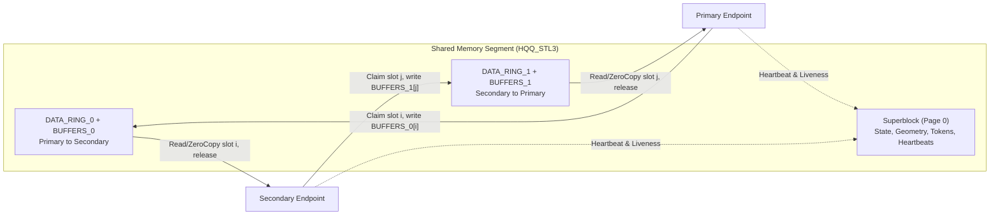

# HQQ Architecture, Operational Guide, and Benchmarks

This document covers the internal shared-memory segment layout (`HQQ_STL3`), multi-language interoperability matrix, routing and zero-allocation mechanics, crash-recovery and liveness rules, OS platform specifics, performance benchmarks, and verification suites of `gosuda.org/hqq`.

---

## 1. Shared-Memory Segment Layout (`HQQ_STL3`)

An HQQ shared-memory segment is divided into a first-page superblock (`HQQ_STL3`, layout version 3.0) followed by two independent directional channels:

```text
SUPERBLOCK    layout version, required features, geometry, epoch, init/claim state, creator token, endpoint records (token/PID/heartbeat)
DATA_RING_0   protocol.Packet MPMC ring, Primary -> Secondary
BUFFERS_0     fixed payload buffers for direction 0 (slot i owns BUFFERS_0[i])
DATA_RING_1   protocol.Packet MPMC ring, Secondary -> Primary
BUFFERS_1     fixed payload buffers for direction 1 (slot i owns BUFFERS_1[i])
```



Each data-ring slot `i` owns the corresponding payload buffer `BUFFERS[i]`. A sender claims a producer slot, writes the payload into `BUFFERS[slot]`, and publishes a 64-byte `protocol.Packet`. A receiver claims the consumer slot, copies the payload out (`Read`) or inspects it in place (`ReadZeroCopy` / `ReserveRead`), and releases the slot when finished. Because `BUFFERS[slot]` cannot be claimed by another producer until the consumer releases slot `i`, unread payloads can never be overwritten.

The normative wire and memory rules live in [`../spec/SPEC.md`](../spec/SPEC.md) and [`../spec/MEMORY_MODEL.md`](../spec/MEMORY_MODEL.md). [`../PROTOCOL.md`](../PROTOCOL.md) provides a concise tour of the wire format and error hierarchy.

---

## 2. Other Languages and Interoperability

HQQ is a language-neutral shared-memory protocol. Every implementation in this repository is tested against the Go package through golden conformance vectors and a two-process interoperability matrix.

| Component | Location | Status |
| :--- | :--- | :--- |
| C library `libhqq` (C11): Standard, Advanced, acceptor, listener layers, and parent lifeline (`hqq_lifeline.h`) | [`../c/`](../c/README.md), headers in [`../c/include/hqq/`](../c/include/hqq) | Unit tests and Go/C interop pairings verified on macOS arm64. CI builds and tests on Linux, macOS, and Windows (`clang-cl` and MSVC). |
| C++17 header-only wrapper (`hqq::`) | [`../bindings/cpp/`](../bindings/cpp) | Unit tests, examples, and interop verified on macOS arm64. CI in `bindings.yml`: Linux (gcc, clang with sanitizers), macOS, and Windows (`clang-cl`). |
| Rust workspace: `hqq-sys` (FFI), `hqq` (safe API), `hqq-interop` | [`../bindings/rust/`](../bindings/rust) | Unit tests, examples, and interop verified on macOS arm64. CI in `bindings.yml`: Linux, macOS, and Windows (MSVC with `clang-cl` for C sources). |
| Specification | [`../spec/`](../spec) | [`SPEC.md`](../spec/SPEC.md) (Standard and Advanced Protocol 1.0, normative), [`MEMORY_MODEL.md`](../spec/MEMORY_MODEL.md), [`PORTING.md`](../spec/PORTING.md), [`ext/`](../spec/ext) (Advanced Protocol 1.1 and listener segment), [`constants.json`](../spec/constants.json), [`litmus/`](../spec/litmus). |
| Conformance vectors | [`../conformance/`](../conformance) | Golden byte vectors generated by the Go implementation, verified by `go test ./conformance/...`, and checked in CI by `interop.yml`. |
| Interop test suite | [`../cmd/hqq-interop`](../cmd/hqq-interop), [`../interop/`](../interop), [`../conformance/INTEROP_CLI.md`](../conformance/INTEROP_CLI.md) | Two-process test matrix across implementations listed in `HQQ_INTEROP_IMPLS`. Verified across Go, C, C++, and Rust pairings. |
| Memory-model verification | [`../c/verify/`](../c/verify) | GenMC model-checking drivers over the C ring, herd7 litmus tests, and weak-memory stress litmus tests. Run in CI. |

---

## 3. Benchmarks

All numbers below were measured on `darwin/arm64` (Apple M1, idle machine, median of 6 runs of `go test . -bench 'Benchmark(StandardLink|AdvancedLink|Compare)' -benchmem`). Idle CPU figures come from `HQQ_PERF_TESTS=1 go test -run 'TestIdleLinkDoesNotBurnCPU|TestMPMCWaitSpinBurnsCPU' ./...`.

### HQQ vs Unix Domain Socket (`SOCK_STREAM`) vs OS Pipe

| Benchmark | HQQ (`WaitAdaptive`) | HQQ (`WaitSpin`) | Unix Domain Socket | OS Pipe | HQQ Speedup |
| :--- | ---: | ---: | ---: | ---: | ---: |
| **64 B Round-Trip Latency** | **192.7 ns/op** | 193.1 ns/op | 3,136 ns/op | 3,396 ns/op | **16.3x-17.6x faster** |
| **4 KiB Unidirectional Throughput** | **25,250 MB/s** (162.2 ns/op) | 25,200 MB/s (162.6 ns/op) | 2,643 MB/s | 4,359 MB/s | **5.8x-9.6x higher** |
| **64 KiB Unidirectional Throughput** | **27,070 MB/s** (2,421 ns/op) | 27,800 MB/s (2,358 ns/op) | 3,088 MB/s | 11,733 MB/s | **2.3x-8.8x higher** |
| **Idle Blocked Callers** | **~1% CPU** (2 blocked calls, incl. heartbeats) | >100% CPU (one core per blocked call) | blocks in the kernel | blocks in the kernel | kernel parking |

### StandardLink & AdvancedLink Microbenchmarks

| Operation | Latency | Throughput | Allocs |
| :--- | ---: | ---: | ---: |
| `StandardLink` Read/Write (`8 B`) | **28.6 ns/op** | **279 MB/s** | `0 B/op`, `0 allocs/op` |
| `StandardLink` Zero-Copy (`4 KiB`) | **40.5 ns/op** | **101,060 MB/s** | `0 B/op`, `0 allocs/op` |
| `StandardLink` Reserve/Commit (`4 KiB`) | **67.7 ns/op** | **60,520 MB/s** | `0 B/op`, `0 allocs/op` |
| `StandardLink` Pipeline (`64 B`) | **37.6 ns/op** | **1,702 MB/s** | `0 B/op`, `0 allocs/op` |
| `StandardLink` Pipeline (`4 KiB`) | **155 ns/op** | **26,370 MB/s** | `0 B/op`, `0 allocs/op` |
| `AdvancedLink` Send/Recv + `Release` (`64 B`, one chunk) | **152.4 ns/op** | **420 MB/s** | `0 B/op`, `0 allocs/op` |
| `AdvancedLink` Send/Recv + `Release` (`4 KiB` over `256 B` chunks) | **1.46 µs/op** | **2,805 MB/s** | `0 B/op`, `0 allocs/op` |
| `AdvancedLink` Call + `Release` via `Serve` (`64 B` req + `64 B` resp) | **553 ns/op** | **232 MB/s** | `0 B/op`, `0 allocs/op` |
| `AdvancedLink` Call + `Release` via `Serve` (`1 KiB` req + `1 KiB` resp, `256 B` chunks) | **1.22 µs/op** | **1,677 MB/s** | `0 B/op`, `0 allocs/op` |

---

## 4. Streams, `Serve`, Routing, and Zero-Allocation Semantics

### Streams and `Serve`

- Stream `0` represents the link itself: `l.Stream()` always returns the same `*Stream` pointer, it is permanently open while the link lives, and calling `Close` on it returns `ErrInvalidOp`. `l.Send`, `l.Recv`, and `l.Call` are shorthand for `l.Stream().Send`, `Recv`, and `Call`.
- Additional streams: the accepting side calls `ListenStreams` and then `AcceptStream`; the dialing peer's `OpenStream` blocks until the accept reply arrives. If an `OpConnCreate` frame arrives before the local process calls `ListenStreams`, it is held for `AdvancedOptions.StreamListenGrace` (default 2 s) and accepted in FIFO order as soon as `ListenStreams` is called. Primary endpoints allocate even stream IDs (`2, 4, ...`), Secondary endpoints allocate odd IDs (`1, 3, ...`), and stream IDs are never reused on the same link.
- **Adaptive inline/worker execution model**: in `Serve`, one goroutine at a time acts as the request receiver. When no other handler is running, the receiver executes the incoming request's handler inline on its own goroutine, avoiding a channel hand-off and scheduler wake-up on fast RPCs. If an inline handler runs longer than 200 µs, a new goroutine takes over the receiver role so subsequent requests are not blocked behind the slow handler. Total concurrent handlers are bounded by `BufferCount`; `Serve` waits for all running handlers to finish before returning.

### Zero-Allocation and Buffer Ownership

- **`Message` ownership** (`Recv` and `Call`): the slice returned by `m.Bytes()` remains valid only until `m.Release()` is called. Call `Release` at most once, and never read or retain `m.Bytes()` afterward.
- **`Request` and `ResponseWriter` lifetime**: both structs and `req.Payload()` are pooled and valid only until `ServeHQQ` returns.
- **`Send` buffer lifetime**: `Send(ctx, p)` copies `p` into the ring slots before returning and never retains `p`.
- **Steady-state zero allocations**: `Send`, `Recv` + `Release`, and `Call` + `Release` against a `Serve` handler using `w.Write` perform zero heap allocations in steady state across both single-chunk and multi-chunk payloads.

---

## 5. Operational Guide and Platform Notes

### Crash Recovery & Liveness Semantics

- **Graceful shutdown**: when an endpoint calls `Close()`, it writes a detached marker into its superblock record and wakes parked waiters. All messages published prior to `Close()` remain readable. Once drained, `StandardLink.Read` and `ReadFrom` return `io.EOF`; `Write`, `ReadZeroCopy`, `ReserveRead`, `Send`, `Recv`, and `Call` return `ErrPeerClosed`; and `Serve` returns `nil`.
- **Abrupt process crash (`ErrPeerGone`)**: each attached endpoint updates a monotonic heartbeat counter in its superblock slot every `LinkOptions.HeartbeatInterval` (default `250ms`). If the peer process crashes (`SIGKILL`) or deadlocks, the surviving endpoint wakes all blocked callers with `ErrPeerGone` once the peer's heartbeat fails to advance for `LinkOptions.PeerTimeout` (default `5s`, clamped to at least $4 \times$ the peer's advertised heartbeat interval).

### Segment Reuse, Names, and Unlink

| Entry point | Role | Empty segment (first page all zero) | Live segment | Segment with no live endpoint |
| :--- | :--- | :--- | :--- | :--- |
| `CreateStandardLink`, `CreateAdvancedLink`, `Listen` | creator | initializes it | never joins: `ErrLinkBusy` | re-initializes it, becomes Primary, owns the name |
| `OpenStandardLink`, `OpenAdvancedLink`, `Dial` | opener | waits up to `AttachTimeout` for the creator to claim it, then fails with `ErrFailedInit` | joins as Secondary, or `ErrLinkBusy` if two live endpoints are attached | fails immediately with `ErrFailedInit` (`Dial` retries until a new `Listen` reuses the name) |
| `NewStandardLink`, `NewAdvancedLink` | none (caller-owned memory) | initializes it | joins as Secondary, or `ErrLinkBusy` | re-initializes it, becomes Primary |

### Platform Notes

| Platform | Named segment backing | Name limit | Allocation | Cross-process parking |
| :--- | :--- | :--- | :--- | :--- |
| **Linux** | `/dev/shm/<name>` (`O_NOFOLLOW`, `O_CLOEXEC`, regular files only) | 255 bytes | `fallocate` (falls back to `ftruncate` only on `EOPNOTSUPP`/`ENOSYS`) | `futex` (`FUTEX_WAIT` / `FUTEX_WAKE`, shared) |
| **macOS** | POSIX `shm_open` (`O_CLOEXEC`) | **31 bytes** (`PSHMNAMLEN`, including the leading `/`) | `ftruncate` | `__ulock_wait` / `__ulock_wake` (`UL_COMPARE_AND_WAIT_SHARED`) |
| **FreeBSD** | POSIX `shm_open` | 1023 bytes | `ftruncate` | bounded exponential sleep backoff (`20µs` to `2ms`) |
| **Windows** | `CreateFileMappingW` / `OpenFileMappingW` (`Local\<name>` default, or explicit `Global\<name>`) | kernel object name + 9-character semaphore suffix <= 259 UTF-16 units | pagefile-backed section | Named segments: four named kernel semaphores per segment (`<object name>.hqq-sem0`..`3`). Unnamed memory: `WaitOnAddress` |

---

## 6. Testing & Verification

Run the static analysis, race, fuzz, end-to-end, and model-checking suites from the repository root:

```bash
# Static analysis
go vet ./...
GOOS=windows go vet ./...
GOOS=linux go vet ./...

# Unit, lifecycle, and multi-process tests with race detector
go test -race ./...

# Fuzz testing
go test ./internal/protocol -run '^$' -fuzz=FuzzPacketRoundTrip -fuzztime=10s
go test . -run '^$' -fuzz='^FuzzConsumeAdvancedChunk$' -fuzztime=10s
go test . -run '^$' -fuzz='^FuzzOpenOverCorruptSuperblock$' -fuzztime=10s

# Process launch, lifeline, and secureexec
go test -race -count=1 ./launch/... ./lifeline/... ./secureexec/...

# hqq-bindgen: header bootstrap, parser, emitters, runtime, end-to-end suite against the real C server
go test -race -count=1 ./bindgen/... ./cmd/hqq-bindgen

# TLA+ model checking of the MPMC ring (requires a Java runtime)
sh scripts/tlc.sh
```
