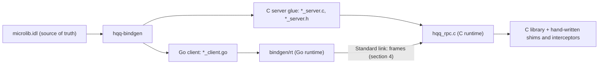

# hqq-bindgen: calling a C library from Go over HQQ shared memory

Status: design, not implemented; second revision, after an independent review (the resolutions are in 12.5). `hqq-bindgen` reads an annotated interface description (IDL) of a C library and generates a Go client and a C server. The C library runs in its own process; the Go client talks to it over one HQQ Standard link per session and never uses cgo. This document is the single contract for four parallel work items: the IDL parser (`bindgen/idl`), the Go runtime (`bindgen/rt`), the C runtime (`c/include/hqq/hqq_rpc.h`, `c/src/hqq_rpc.c`) and the emitters (`bindgen/gen`, `cmd/hqq-bindgen`). Every width, offset, opcode, status and limit is defined once (sections 4.2, 4.3, 4.10 and 5.5) and referenced by name elsewhere.

Normative words (MUST, SHOULD, MAY) follow RFC 2119. Integers on the wire are little-endian, as in [SPEC.md](../SPEC.md) section 0. "Decision" marks a choice made in this document that the project brief did not dictate; they are collected in section 12.3. Statements about existing HQQ APIs cite the file that was read. Anything that is assumed to exist but does not is listed in section 12.1 with its assumed signature.

Related documents: [SPEC.md](../SPEC.md) (segment, ring and Standard protocol), [MEMORY_MODEL.md](../MEMORY_MODEL.md), [BINDINGS.md](BINDINGS.md) (tone and CI conventions), [C_TOOLCHAIN.md](C_TOOLCHAIN.md), [`sqlite/PROTOCOL.md`](../../sqlite/PROTOCOL.md) (a hand-written instance of the same problem), [`spec/ext/LISTENER_DRAFT.md`](../ext/LISTENER_DRAFT.md) (rendezvous).

## 1. Goals, non-goals and cost model

This section states what the generator is for, what it refuses to do, and the measured numbers that drive the wire design.

### 1.1 Goals

| Id | Goal |
| --- | --- |
| G1 | Call a C library from Go without cgo: the Go binary stays `CGO_ENABLED=0`, and a crash or hang in the C library cannot take the Go process down. |
| G2 | Compete with cgo on **throughput**, not on single-call latency: a Go goroutine keeps issuing calls (pipelining) while the C library executes them on another core. |
| G3 | One Standard link per session and one ring message per request and per response (no Advanced RPC, no per-field packets), with a fixed 16-byte frame header (section 4.3). |
| G4 | Zero-copy where possible: the Go stub writes arguments directly into the ring slot payload buffer (`StandardLink.ReserveWrite`), the C server passes pointers into the slot to the C function, and, for responses that fit one frame, the C function writes out-buffers directly into the reserved response slot (`hqq_write_reserve`, 4.7.3). |
| G5 | Default deny: only functions declared in the IDL can be called; hand-written interceptors can veto or rewrite a call. |
| G6 | Session isolation: opaque C pointers never cross the wire (handles are per-session table ids), and session teardown destroys every handle the client left behind. |
| G7 | Reserve a batch envelope in the wire format now (section 4.13). The behavior is not implemented. |
| G8 | Generated files are committed; `hqq-bindgen -check` fails when they are stale, like `c/tools/gen_constants.py --check`. |

### 1.2 Non-goals (v1)

- Importing C headers. The IDL is the source of truth (clang import is out of scope).
- Output languages other than a Go client and a C server.
- Callbacks, varargs, pointers retained by the library after a call, and shared in-process state between client and library (section 3.1).
- Cancellation of a call that already started, and compatibility between different IDL revisions: client and server must be generated from the same IDL (digest equality, section 2.6).
- Remote or cross-host use. The trust model is same-host, like `sqlite/PROTOCOL.md` section 12.
- Dependent calls inside one pipeline (using the handle returned by an earlier, still pending call). The batch envelope reserves room for it (section 4.13).
- Composite in-parameters (a struct, union or variable-element array as an argument, V38).
- Windows servers. The C runtime targets POSIX (Linux, macOS); the Go client has no platform restriction beyond `hqq` itself (section 12.1, item 7).

### 1.3 Measured cost model

The numbers below were measured by the project owner on an Apple M1 with the two ends in **different processes** and a 64-byte payload (the Go client and the C `hqq_echo` tool, or two Go processes). They are inputs to this design and were not re-measured while writing it. Section 10.5 defines the benchmarks that measure this design itself; until they run, no number for generated stubs is promised.

| Operation (M1, cross-process, 64-byte payload) | Cost |
| --- | ---: |
| cgo call, trivial C function | 23 ns |
| Standard link round trip, Go client to C server (`hqq_echo`) | 230 to 237 ns average (p50 250 ns, p99 334 ns) |
| Standard link round trip, Go to Go | 243 to 263 ns |
| The same round trip with `LinkOptions.Exclusive` on the Go end | 238 ns against 234 to 242 ns without: no measurable difference |
| Pipelined one-way cost per message, Standard link, CAS ring | about 43 ns |
| Pipelined one-way cost per message with `LinkOptions.Exclusive` | about 38 ns |
| Hand-written SPSC ring micro-benchmark without HQQ's per-call path | about 175 to 195 ns round trip |
| Advanced `Call`, Go to Go, adaptive wait | 608 ns |
| Advanced path of the C library (`hqq_adv_serve`), per call | 31 to 35 us (every request is handed to a worker thread) |

What the design relies on, and what follows from it:

1. **The Standard link with its own server loop.** The Advanced `Call` costs 608 ns in Go and 31 to 35 us through `hqq_adv_serve`, so the call path uses Standard link messages with the fixed frame of 4.3 and a dedicated session thread in the C server (8.4). Advanced links are used only to bootstrap a session (4.11).
2. **Single-call latency is not competitive and is not a goal.** A synchronous call costs a Standard link round trip, about 230 to 260 ns, which is roughly ten times the 23 ns of a cgo call. **Sub-200 ns synchronous round trips are not expected**: the SPSC micro-benchmark (175 to 195 ns) has no per-call path at all, and `Exclusive` did not change the round trip. Synchronous stubs exist for convenience and for calls whose C side does real work.
3. **Pipelining and zero copy are the advantage.** A pipelined call is two ring messages. At 38 to 43 ns per message the ring-level cost is about 76 to 86 ns per call **[INFERENCE: the per-message figures are one-way costs of a pipelined stream; the call path adds encode, decode and the server's dispatch, which the benchmarks of 10.5 measure]**. With the client's independent work or the C function's own time `w` overlapped, throughput is bounded by the slower of the two cores, not by the round trip. cgo costs `23 ns + w` on the calling thread. For trivial functions (`w` of a few tens of ns) cgo stays faster **[INFERENCE, to be checked by 10.5]**. For payloads of kilobytes the copy that cgo avoids by sharing the address space is replaced here by one write into the slot, and the library reads the argument in place (4.7).
4. **Per-call overhead other than the ring is kept small but not zero.** The honest list for a pipelined call on the Go client, in-order `Wait`, `CallTimeout == 0`: the generated stub (a few stores); `BeginRequest` (flow-control compares, `ReserveWrite`); `Submit` (header stores, `Commit`); `Wait` (`ReserveRead`, header checks, decode, `Release`). `hqq` itself adds two atomic read-modify-writes per `ReserveWrite` or `ReserveRead` (`enterTx`/`exitTx`, `enterRx`/`exitRx`, `standard.go`), which the 38 to 43 ns figures should already contain **[INFERENCE: the figures come from calls through the same `hqq` path]**. `rt` adds no atomic read-modify-write and no allocation of its own in non-race builds (8.2). A `CallTimeout > 0` adds a `SetReadDeadline` per `Wait`, which allocates a `time.Time` and wakes parked waiters (`packetconn.go`), so the allocation-free property holds only with `CallTimeout == 0`. On the server, a call costs one acquisition of the execution lock under `serialize(session)` (4.7.1), a `memchr` over every `str` (at most its bound), and one `memcpy` for a `str` that relies on its NUL (7.2). An out-of-order `Wait` copies a response into a per-call buffer and may allocate (8.3); the allocation test covers in-order use only.
5. **A parked peer costs a wake.** With the default adaptive wait policy a publish into a ring whose consumer is parked pays a futex or ulock wake call. The benchmarks that pin a number for pipelining use `WaitSpin` on both ends (10.5). Interactive use keeps `WaitAdaptive`.
6. **The C server uses the CAS ring.** The C library has no exclusive mode (12.1, item 2), so only the Go end opens its side with `Exclusive`. The two modes interoperate on one segment (SPEC 7.6, `options.go`); the figures above were measured in that mixed configuration or with two CAS ends.

### 1.4 Overview



One service process owns the C library and listens on a listener name (an HQQ acceptor, `c/include/hqq/hqq_listener.h`). Each client session is one Standard link whose segment the server creates during a short bootstrap over the listener (section 4.11). The server runs one thread per session. The Go client owns its session link and issues frames from a single goroutine (section 8).

## 2. The IDL

The IDL describes the callable surface of one C library: types that appear on the wire, handle types with their lifetimes, and functions with their calling convention. It has no expressions, no loops and no includes of other IDL files. Composite operations (for example row batching) are `shim` functions: C code written by hand and linked into the server, declared in the IDL like any function.

### 2.1 Lexical rules

| Item | Rule |
| --- | --- |
| Encoding | UTF-8 without BOM. Identifiers, keywords and punctuation are ASCII. Comments and string literals MAY contain any valid UTF-8 but string literals used by the generator are restricted further (2.5, V35 and V36). |
| Whitespace | Space, tab, CR, LF. Insignificant except as a token separator. |
| Comments | `//` to end of line; `/* ... */`, not nested. A comment is whitespace. |
| Identifier | `[A-Za-z_][A-Za-z0-9_]*`, at most 128 bytes. Case-sensitive. |
| Keywords | `idl service include const handle struct union case fn shim in out inout destroy owned_by ret` and the type names `bool i8 i16 i32 i64 u8 u16 u32 u64 f32 f64 size str bytes`. Keywords cannot be identifiers. |
| Integer literal | `-?(0x[0-9a-fA-F]+\|[0-9]+)`. No suffix, no octal, no `+`. The value MUST fit in the range `[-2^63, 2^64 - 1]`. |
| String literal | `"` then ASCII `0x20..0x7E` except `"` and `\`, with the escapes `\\` and `\"`, then `"`. At most 256 bytes. No newline inside. |
| Punctuation | `{ } ( ) [ ] < > <= , ; : = -> @` |
| Annotation | `@` immediately followed by an identifier (no whitespace between). |

### 2.2 Grammar

The grammar is LL(1) except for `AnnArg`, which needs one extra token to tell `Ident` from `Ident "("`. Terminals are quoted; `Int`, `Ident` and `String` are the lexical classes above.

```ebnf
File        = "idl" Int ";" { Ann } "service" Ident ";" { Decl } EOF ;

Decl        = IncludeDecl | ConstDecl | HandleDecl | StructDecl | UnionDecl | FnDecl ;

IncludeDecl = "include" String ";" ;
ConstDecl   = "const" Ident ":" IntType "=" Int ";" ;

HandleDecl  = { Ann } "handle" Ident [ "owned_by" Ident ] "destroy" Ident ";" ;

StructDecl  = { Ann } "struct" Ident "{" Field { Field } "}" ;
Field       = Ident ":" Type ";" ;

UnionDecl   = { Ann } "union" Ident "{" Case { Case } "}" ;
Case        = "case" Int Ident [ ":" Type ] ";" ;

FnDecl      = { Ann } [ "shim" ] "fn" Ident "(" [ Param { "," Param } ] ")"
              [ "->" Type { Ann } ] ";" ;
Param       = [ Dir ] Ident ":" Type { Ann } ;
Dir         = "in" | "out" | "inout" ;

Type        = Elem [ "[" [ IntRef ] "]" ] [ "<=" IntRef ] ;
Elem        = ScalarType | "str" | "bytes" | Ident ;
ScalarType  = IntType | "bool" | "f32" | "f64" ;
IntType     = "i8" | "i16" | "i32" | "i64" | "u8" | "u16" | "u32" | "u64" | "size" ;
IntRef      = Int | Ident ;                 (* Ident names a const *)

Ann         = "@" Ident [ "(" [ AnnArg { "," AnnArg } ] ")" ] ;
AnnArg      = Int | String | "ret" | Ident [ "(" [ AnnArg { "," AnnArg } ] ")" ] ;
```

Notes:

- `T[N]` is a fixed array, `T[]` a variable array, `T[]<=N` a bounded variable array. `str<=N` and `bytes<=N` are bounded strings and byte strings. `<=` is only valid after `str`, `bytes` or `T[]` (V6).
- `size` is an unsigned 64-bit integer on the wire whose C type is `size_t`. The server checks that the value fits in `size_t` (always true on 64-bit targets).
- The `in`, `out`, `inout` direction keywords and the `owned_by` and `destroy` handle clauses are the "direction", "ownership" and "destroy" annotations of the brief; they are keywords instead of `@` forms because they are structural.
- A parameter without a direction is `in`.

### 2.3 Types

Alignment and size are the wire rules of section 4.5. "Fixed" means the encoded size is known from the type alone.

| IDL type | Meaning | Wire size | Align | Fixed |
| --- | --- | ---: | ---: | :---: |
| `bool` | `u8` that MUST be 0 or 1 | 1 | 1 | yes |
| `i8` `u8` | 8-bit integers | 1 | 1 | yes |
| `i16` `u16` | 16-bit integers | 2 | 2 | yes |
| `i32` `u32` | 32-bit integers | 4 | 4 | yes |
| `i64` `u64` `size` | 64-bit integers (`size` is `size_t` in C) | 8 | 8 | yes |
| `f32` | IEEE 754 binary32 bit pattern, NaN payloads preserved | 4 | 4 | yes |
| `f64` | IEEE 754 binary64 bit pattern, NaN payloads preserved | 8 | 8 | yes |
| `T[N]` | fixed array, `T` fixed, `1 <= N <= 2^20` | `N * stride(T)` | `align(T)` | yes |
| `str`, `str<=N` | byte string without NUL; the wire form carries a terminating NUL that is not part of the length | `4 + n + 1` | 4 | no |
| `bytes`, `bytes<=N` | byte string | `4 + n` | 4 | no |
| `T[]`, `T[]<=N` | variable array of any wire type `T` | `4 + elements` | 4 | no |
| `struct S` | ordered fields, any wire types | sum, C layout if fixed | max field align | if all fields fixed |
| `union U` | tagged union, `u32` tag then the selected payload | variable | 4 | no |
| handle type `H` | per-session id of a C object (4.9) | 4 | 4 | yes |

`stride(T)` is the size of `T` rounded up to `align(T)`. Handles are only allowed as function parameters and returns, never as struct fields, union payloads or array elements (V8).

**Worst-case size `wc(T)`.** The largest number of body bytes one encoding of `T` can consume when it starts at any position, counting alignment padding. It is defined only for bounded types and is used by rules V40 and V41:

| `T` | `wc(T)` |
| --- | --- |
| scalar or `bool`, size `s`, alignment `a` | `s + a - 1` |
| `T[N]` | `align(T) - 1 + N * stride(T)` |
| `str<=N` | `3 + 4 + N + 1` |
| `bytes<=N` | `3 + 4 + N` |
| `T[]<=N` | `3 + 4 + N * wc(T)` |
| fixed `struct S` | `align(S) - 1 + size(S)` (it starts at its alignment and ends with its trailing padding, like `T[N]`) |
| non-fixed `struct` | sum of `wc` of the fields (the fields align themselves; there is no start alignment and no trailing padding) |
| `union` | `3 + 4 + max(wc(payload))` over the cases that have a payload (0 if none) |
| handle | `3 + 4` |

`str`, `bytes` and `T[]` without `<=` have no finite `wc`. Generators compute `wc`, `size` and every sum derived from them in 64-bit arithmetic and reject an overflow (V40).

### 2.4 Annotations

Annotations attach at four places. **Service**: before `service` (`@serialize`). **Declaration**: before `handle`, `struct`, `union` or `fn` (`@c`, `@error`, `@intercept`, `@allow`, `@retain_on_fail`). **Parameter**: after a parameter's type (`@len_of`, `@offset_in`, `@nullable`, `@borrowed`, `@free`, `@c`). **Return**: after the return type (`@len_of`, `@nullable`, `@free`, `@max_out`, `@c`), as the grammar of 2.2 shows (`"->" Type { Ann }`). An annotation in any other place is a syntax error.

| Annotation | Place | Arguments | Meaning |
| --- | --- | --- | --- |
| `in`, `out`, `inout` | parameter (keyword) | none | Data direction. `in`: client to server. `out`: the C function writes through a pointer and the value travels back. `inout`: both. For scalars and handles `in` is by value in C; `out` and `inout` are pointers to a local the glue provides, zero-initialized before the call (4.6.1). |
| `@len_of(p)` | parameter, return | name of a variable-length parameter of the same function | The annotated scalar is the length of `p`. An `in` scalar supplies the length of an `in` buffer or the capacity of an `out` buffer; an `out` scalar or the return value receives the produced length of an `out` buffer or of a returned buffer. Derived scalars are not in the Go API; only the return value is also sent (4.6.1). |
| `@offset_in(p)` | `out` parameter of type `u32` | name of an `in str` parameter | The C parameter is a pointer into the buffer of `p` (for example `const char **pzTail`). The wire value is the byte offset of that pointer from the start of `p`. |
| `@nullable` | `in` handle, `str`, `bytes`, `T[]` parameter; the same types as a return | none | A NULL pointer is a legal value. Handle id 0, or length `0xFFFFFFFF` for variable types (4.5). |
| `@borrowed` | `out bytes`, `out T[]` parameter | none | The C parameter is a pointer-to-pointer to memory owned by the library (it is copied into the response). Without it an `out` buffer is caller-supplied storage with a capacity. `out str` is always borrowed. |
| `@free("sym")` | borrowed `out` parameter or return | C symbol of type `void (*)(void *)` | The server calls `sym(pointer)` after copying the value, inside the execution lock (4.7). |
| `@error(kind, ...)` | declaration (`fn`) | `kind` is `status`, `null` or `predicate(f)`; optional `ok(v, ...)` (status only); optional `detail(f, arg, ...)` | The failure convention (4.6.4, V18 to V23). `ok(...)` is the "ok values" list; `detail(...)` is the "error detail" function. |
| `@intercept` | declaration (`fn`), wire functions | none | The server calls a hand-written hook before the C function and honors its verdict (7.3). For such a function every `str`, `bytes` and array `in` argument is copied into private memory before the hook runs (7.2). |
| `@max_out(N)` | return of a shim | integer or const | Upper bound in bytes of the response body of a composite return. REQUIRED there (V26); at least `wc(T)` of the return type when that is finite (V41). The writer enforces it at run time (4.6.3). |
| `@retain_on_fail` | declaration (`fn`) | none | Only on the `destroy` function of a handle whose `@error` is `status` (V39). If the destroy call returns a status outside `ok`, the C object is assumed to be still alive and the table entry stays live (the `sqlite3_close` answering `SQLITE_BUSY` pattern). Without the annotation the entry is **always consumed**: the C destroy function is assumed to release the object whatever it returns (5.1). |
| `@allow(wire)`, `@allow(server)` | declaration (`fn`) | `wire` (default) or `server` | `wire`: the function has an opcode and a client method. `server`: the function is declared so that the server glue may call it (error predicate, error detail), but it has no opcode and no client method. This is the allowlist of the brief: a C function that is not declared is not callable; a declared function with `@allow(server)` is not callable by clients. |
| `@serialize(session)`, `@serialize(none)` | service | `session` (default) or `none` | Threading contract of the C library (8.1). |
| `@c("ctype")` | handle, struct, scalar parameter, return | C type text, restricted by V36 | The C type used by the generated server code. Required where the glue needs the exact type (`out` scalars, handles, `struct` passed to C). Defaults: `i8..u64` use `int8_t..uint64_t`, `size` uses `size_t`, `f32` `float`, `f64` `double`, `bool` `bool`. A `@c` struct is encoded field by field (4.6.1). |
| `shim` | declaration (keyword before `fn`) | none | The C function is written by hand and linked into the server. It is declared like any function; its C prototype is generated into `<service>_server.h` (9.6). |
| `owned_by P` | handle clause (keyword) | handle type | The handle is a child of `P`: it is created by a function that takes a `P` handle, and it is destroyed before `P` (5.1, 5.2). |
| `destroy f` | handle clause (keyword) | function name | The function that releases the C object. |

### 2.5 Semantic validation

The parser MUST reject a file that violates any rule below. Each diagnostic carries the rule id and the source position. Rule ids are stable labels, not a dense sequence. Rules are grouped by what they protect.

**Names and structure**

| Id | Rule |
| --- | --- |
| V1 | Types (`struct`, `union`, `handle`), functions and consts are three separate namespaces. A name is declared once per namespace. No name is a keyword of the IDL or a C keyword (the C11 keyword list) or contains `__`. |
| V2 | `idl N` has `N == 1`. |
| V3 | There is exactly one `service` and at most one `@serialize` annotation, on it. |
| V4 | Every type name resolves. `struct` and `union` types do not contain themselves, directly or through arrays or other types. |
| V5 | A struct has at least one field and unique field names. A union has at least one case, unique case names and unique case numbers in `[0, 2^32 - 1]`. |
| V6 | `T[N]` needs a fixed `T` and `1 <= N <= 2^20`. `<=` is only valid after `str`, `bytes` or `T[]`; its value is in `[1, 2^30]`. |
| V7 | `destroy f` names a declared function with exactly one parameter, of the handle type, direction `in`, and with return type void or an integer with `@error(status)`. `owned_by P` names a handle type other than itself; the ownership relation is acyclic. |
| V8 | Handle types appear only as function parameter or return types. |
| V30 | Const values fit the declared type. An integer reference (`IntRef`) is a literal or the name of a const. There is no arithmetic. |

**Functions and parameters**

| Id | Rule |
| --- | --- |
| V9 | Parameter names are unique within a function. A function has at most 64 parameters. At most 65535 functions have `@allow(wire)`. |
| V10 | `inout` is not allowed on handles, `str`, `bytes` and arrays. `out` on a variable type is a caller-supplied buffer unless `@borrowed` (or `str`). |
| V11 | `@len_of(b)`: the annotated parameter or return has an integer type; `b` names another parameter of type `str`, `bytes` or `T[]`, or is `ret`. A return value or an `out` scalar may carry `@len_of(b)` only if `b` is an `out` parameter (the target `ret` is allowed for an `out` scalar when the function returns `bytes` or `T[]`). Every `in` buffer, and every `out` caller-supplied buffer, has exactly one `in` scalar bound to it, except `in str`, which MAY have none (the C function relies on the NUL, and the glue then copies the string, 7.2). A buffer has at most one `out` or return scalar bound to it. A borrowed `out` buffer needs exactly one `out` scalar bound to it. |
| V12 | `@offset_in(b)`: the parameter is `out`, of type `u32`; `b` is an `in str` parameter. |
| V13 | `@nullable` appears only on `in` handle, `str`, `bytes` or array parameters, and on returns of those types. |
| V14 | `@borrowed` appears only on `out bytes` or `out T[]`. |
| V15 | `@free("sym")` appears only on a borrowed `out` parameter, an `out str`, or a return of type `str`, `bytes` or `T[]`. |
| V16 | If a function has an `out` parameter or return of a handle type `T` and `T` has `owned_by P`, the function has exactly one `in` parameter of type `P`. |
| V26 | A function whose return type is a `struct`, a `union` or an array with a non-fixed element (a composite return) MUST be a `shim` and MUST have `@max_out(N)` on its return. A `struct` return of a non-shim function is allowed only if the struct has `@c` and all fields are fixed. A **fixed** struct returned by a shim is a fixed value: it is encoded in `G2` (4.6.3), has no `V2` term, and `@max_out` is still required and checked by V41. |
| V27 | A return or borrowed `out` of type `str`, `bytes` or `T[]` MUST carry a `<=` bound, so that the response bound (4.6.3) is known before the call. |
| V28 | A non-shim function returns void, a scalar, a handle, `str`, `bytes`, a scalar array (with a `@len_of` binding), or a fixed `@c` struct. |
| V29 | `@intercept` is only valid on `@allow(wire)` functions. |
| V31 | `@allow(server)` functions have no opcode and are not `@intercept`. V29 and V31 describe the same defect when `@intercept` is on an `@allow(server)` function; a parser MAY report both rule ids for it. |
| V38 | An `in` or `inout` parameter has a scalar, `bool`, handle, `str`, `bytes`, fixed array `T[N]`, or `T[]` with a fixed element type. Composite in-parameters (a struct, a union, an array of variable-size elements) are not supported in this revision (12.2); only returns and `out` values can be composite. |

**Error convention and handle lifetime**

| Id | Rule |
| --- | --- |
| V18 | `@error` has exactly one kind. It is not allowed on a function that returns void. |
| V19 | `status`: the return is an integer type. `ok(...)` lists distinct values that fit the return type; without it the list is `ok(0)`. |
| V20 | `null`: the return is a handle, `str`, `bytes` or array, without `@nullable`. NULL is the failure. |
| V21 | `predicate(f)`: `f` is an `@allow(server)` function with one parameter of the return type and an integer or `bool` return. A nonzero result is the failure. |
| V22 | `detail(f, a1, ...)`: `f` is an `@allow(server)` function whose return is `str<=N`, whose parameters are all `in`, and whose parameter count and types equal the argument list. Each `ai` is the name of an `in` parameter of this function, the name of an `out` handle parameter, or `ret`. On a function that is the `destroy` function of a handle, `detail` MUST NOT name the destroyed handle parameter (the object is gone when the detail would be read). |
| V23 | `ret` may be used as a detail argument only with `status`, `predicate` or `null` kinds and only if the return type equals the detail parameter type. |
| V39 | `@retain_on_fail` appears only on a function that is the `destroy` function of a handle and has `@error(status)`. |

**Sizes and bounds**

| Id | Rule |
| --- | --- |
| V40 | Every fixed type, the fixed groups G1 and G2 of any function (4.6), and the static `RESP_BOUND` of any function (4.6.3, with every caller-chosen `cap` set to its `<=` bound, or excluded when it has none) are at most `2^30` bytes. The generator computes them in 64-bit arithmetic and reports an overflow as a violation. A function whose bound exceeds `HARD_MAX_MESSAGE` could never be called. |
| V41 | `@max_out(N)` has `1 <= N <= 2^30` and, if the return type has a finite `wc` (2.3), `N >= wc(T)`. For a type without a finite `wc` the declared `N` is the contract and the runtime writer enforces it (4.6.3). |

**Strings and names that reach generated code**

| Id | Rule |
| --- | --- |
| V35 | An `include` string has length 1 to 256, consists of `[A-Za-z0-9_./+-]`, does not start with `/`, and contains no `..` component. |
| V36 | A `@c` string and an `@free` symbol have length 1 to 64, start with a letter or `_`, and consist of letters, digits, `_`, space and `*`; an `@free` symbol is a single identifier. |
| V37 | No identifier (type, const, function, parameter, field or case name) begins with `hqq` in any letter case, so generated names (which all begin with `hqq`, `HQQ`, or the reserved forms of 9.2) cannot collide with IDL names. After the Go name transformation of 9.2, the exported Go names the generator emits (types, consts, methods, `<Fn>Async`, `<Fn>Future`, `<Type>Tag`) are pairwise distinct, none of them is `Client`, `Dial`, `Close`, `Kill` or `Conn` (the package surface of 9.4), no union case is named `Tag`, and the capitalized field names of a struct or union are distinct. Go keywords and predeclared identifiers need no check: types and consts are capitalized, parameters are prefixed `p_`, and locals of the generated code are lowercase names that no exported or prefixed name can equal. |

### 2.6 Canonical form and interface digest

The digest identifies the **interface** of a service: everything that changes the wire bytes or the client-visible behavior. Client and server embed it (generated constant) and exchange it in the connect handshake (4.11). A mismatch fails the connect.

**Algorithm.** The digest is the SHA-256 (FIPS 180-4) of the canonical text, a UTF-8 byte sequence that is produced from the validated model, not from the source text. The Go generator computes it with `crypto/sha256` and writes the 32 bytes as a constant into both generated outputs. No runtime ever hashes anything.

**Canonical text.** ASCII only. Lines end with a single `\n`, including the last. No trailing spaces, no empty lines. Tokens within a line are separated by exactly one space. Integers are decimal without leading zeros or `+`. Consts are replaced by their values. These do not appear, because they are server-side details that do not change the interface: comments, `include`, `@c`, `@free`, `@intercept`, `@serialize`, the `shim` keyword (shim functions themselves appear like any other wire function) and the `@allow(server)` functions. `@retain_on_fail` changes the client-visible result of a destroy call and does appear. The lines, in this order:

```text
HQQ-IDL 1
service <name>
handle <Name> parent=<Parent|-> destroy=<fn> retain=<0|1>  one per handle type, sorted by Name (byte order)
struct <Name> <field>:<type> ...                          one per struct, in the same sorted sequence as unions
union <Name> <tag>:<Case>:<type|-> ...                    cases sorted by tag ascending
fn <opcode> <name> <param>... ret=<ret> err=<kind> ok=<list|-> detail=<0|1> max_out=<N|->
```

- Handles come first (sorted by name), then structs and unions merged and sorted by name (byte order), then functions in opcode order. Opcodes are assigned `1, 2, ...` to the `@allow(wire)` functions in declaration order.
- `<type>`: the scalar name, `str`, `bytes`, or a declared type name; a fixed array appends `[N]`; a variable array appends `[]`; a bound appends `<=N` after any array suffix (`Cell[]<=256`). A void `ret` is `-`.
- `<param>` is `p=<dir>:<name>:<type>` followed by zero or more `:<attr>` in this fixed order: `len_of=<name>`, `offset_in=<name>`, `nullable`, `borrowed`. The return is `ret=<type>` with the attrs `len_of=<name>` and `nullable` appended the same way.
- `err=` is `none`, `status`, `null` or `predicate`. `ok=` is the sorted ascending comma list of resolved ok values (no spaces) for `status`, otherwise `-`. `detail=` is `1` if a `detail(...)` clause exists. `max_out=` is the resolved `@max_out` value or `-`.
- Struct fields are in declaration order (wire order). Parameters are in declaration order.

The wire revision is not part of the digest; it is negotiated separately by `proto_major` and `proto_minor` in the handshake (4.11).

### 2.7 Worked example 1: `microlib.idl`

`bindgen/testdata/microlib/microlib.idl` is the interface of the MIT-licensed test library `bindgen/testdata/microlib/microlib.{h,c}`. The C prototypes it declares are listed first, then the IDL.

```c
/* microlib.h */
#define ML_OK 0
#define ML_EMPTY 1
#define ML_PARTIAL 2
int32_t     ml_add(int32_t a, int32_t b);
typedef struct ml_counter ml_counter;
ml_counter *ml_counter_new(int64_t start);                              /* NULL on out of memory */
int32_t     ml_counter_add(ml_counter *c, int64_t delta, int64_t *total); /* 0, or -1 on overflow (total is not written) */
int32_t     ml_counter_check(ml_counter *c, int32_t limit);             /* 0 if the total is at most limit, else -1 */
const char *ml_counter_errmsg(ml_counter *c);                           /* "overflow" after a failed add, "over limit" after a failed check, else ""; never NULL */
void        ml_counter_free(ml_counter *c);
typedef struct ml_cursor ml_cursor;
ml_cursor  *ml_cursor_open(ml_counter *c, int32_t step);                /* NULL on out of memory */
int32_t     ml_cursor_next(ml_cursor *cur, int64_t *value);             /* 0 value written, 1 end (value NOT written) */
int32_t     ml_cursor_free(ml_cursor *cur);                             /* always frees; ML_PARTIAL if values were unread, else ML_OK */
size_t      ml_xor(const uint8_t *src, size_t n, uint8_t key, uint8_t *dst, size_t cap);
                                                                        /* produced length, or SIZE_MAX if cap < n */
int         ml_xor_failed(size_t result);                               /* result == SIZE_MAX */
uint64_t    ml_hash(const char *s);                                     /* FNV-1a over the NUL-terminated string */
```

```idl
idl 1;

@serialize(session)
service microlib;

include "microlib.h";

const ML_OK: i32 = 0;
const ML_EMPTY: i32 = 1;
const ML_PARTIAL: i32 = 2;

@c("ml_counter *")
handle Counter destroy ml_counter_free;

@c("ml_cursor *")
handle Cursor owned_by Counter destroy ml_cursor_free;

union Cell {
    case 1 Int: i64;
    case 2 Text: str<=16;
    case 3 Null;
}

fn ml_add(a: i32, b: i32) -> i32;

@error(null)
fn ml_counter_new(start: i64) -> Counter;

@intercept
@error(status, ok(ML_OK), detail(ml_counter_errmsg, c))
fn ml_counter_add(c: Counter, delta: i64, out total: i64) -> i32;

fn ml_counter_free(c: Counter);

@error(null)
fn ml_cursor_open(c: Counter, step: i32) -> Cursor;

@error(status, ok(ML_OK, ML_EMPTY))
fn ml_cursor_next(cur: Cursor, out value: i64) -> i32;

@error(status, ok(ML_OK))
fn ml_cursor_free(cur: Cursor) -> i32;

@error(predicate(ml_xor_failed))
fn ml_xor(src: bytes<=65536, n: size @len_of(src), key: u8,
          out dst: bytes, cap: size @len_of(dst)) -> size @len_of(dst);

fn ml_hash(s: str<=255) -> u64;

shim fn ml_cells(c: Counter, max: i32) -> Cell[]<=256 @max_out(8192);

@error(status, ok(ML_OK), detail(ml_counter_errmsg, c))
fn ml_counter_check(c: Counter, limit: i32) -> i32;

@allow(server) fn ml_counter_errmsg(c: Counter) -> str<=1024;
@allow(server) fn ml_xor_failed(r: size) -> i32;
```

Opcodes: `ml_add` 1, `ml_counter_new` 2, `ml_counter_add` 3, `ml_counter_free` 4, `ml_cursor_open` 5, `ml_cursor_next` 6, `ml_cursor_free` 7, `ml_xor` 8, `ml_hash` 9, `ml_cells` 10, `ml_counter_check` 11. The two `@allow(server)` functions have none. `ml_cells` is a shim implemented in `bindgen/e2e/microlib/server/microlib_hooks.c`; `ml_counter_add` has an interceptor in the same file. `wc(Cell[]<=256)` is `7 + 256 * 31 = 7943` (2.3), so `@max_out(8192)` is accepted by V41.

Points the example is built to show:

- `ml_cursor_free` is the destroy function of `Cursor` and reports `ML_PARTIAL` when values were unread. The cursor is freed anyway, so the status is a library failure that **consumes** the handle (5.1; vectors R10 and R11).
- `ml_counter_check` has `detail` and a 4-byte `G2`, which fixes where the detail string starts on failure (4.6.4; vector R12).
- `ml_cursor_next` returns `ML_EMPTY` without writing `value`; the glue zero-initializes `value`, so the client sees 0 and not stack contents (4.6.1).

The canonical text of this file is:

```text canon=microlib
HQQ-IDL 1
service microlib
handle Counter parent=- destroy=ml_counter_free retain=0
handle Cursor parent=Counter destroy=ml_cursor_free retain=0
union Cell 1:Int:i64 2:Text:str<=16 3:Null:-
fn 1 ml_add p=in:a:i32 p=in:b:i32 ret=i32 err=none ok=- detail=0 max_out=-
fn 2 ml_counter_new p=in:start:i64 ret=Counter err=null ok=- detail=0 max_out=-
fn 3 ml_counter_add p=in:c:Counter p=in:delta:i64 p=out:total:i64 ret=i32 err=status ok=0 detail=1 max_out=-
fn 4 ml_counter_free p=in:c:Counter ret=- err=none ok=- detail=0 max_out=-
fn 5 ml_cursor_open p=in:c:Counter p=in:step:i32 ret=Cursor err=null ok=- detail=0 max_out=-
fn 6 ml_cursor_next p=in:cur:Cursor p=out:value:i64 ret=i32 err=status ok=0,1 detail=0 max_out=-
fn 7 ml_cursor_free p=in:cur:Cursor ret=i32 err=status ok=0 detail=0 max_out=-
fn 8 ml_xor p=in:src:bytes<=65536 p=in:n:size:len_of=src p=in:key:u8 p=out:dst:bytes p=in:cap:size:len_of=dst ret=size:len_of=dst err=predicate ok=- detail=0 max_out=-
fn 9 ml_hash p=in:s:str<=255 ret=u64 err=none ok=- detail=0 max_out=-
fn 10 ml_cells p=in:c:Counter p=in:max:i32 ret=Cell[]<=256 err=none ok=- detail=0 max_out=8192
fn 11 ml_counter_check p=in:c:Counter p=in:limit:i32 ret=i32 err=status ok=0 detail=1 max_out=-
```

SHA-256 of exactly those bytes (the block above, `\n` line ends, final newline included):

```text digest=microlib
06a738744a1ea9f11fb08cc41afbe48e1891c76e60830a276e98cf8c15944e5c
```

### 2.8 Worked example 2: SQLite excerpt with `fetch_rows`

`bindgen/testdata/sqlite_lowlevel.idl` is an excerpt of the low-level SQLite subset. It exercises an `out` handle with a parent, `@offset_in`, a nullable string, `ok` lists with several values, an error detail function, `@retain_on_fail`, a destructor that is also a client call, and a shim that returns a wire type. Functions that are not declared (`sqlite3_load_extension`, `sqlite3_exec`, `sqlite3_config`, ...) cannot be called (default deny).

```idl
idl 1;

@serialize(session)
service sqlite_lowlevel;

include "sqlite3.h";
include "sqlite_shims.h";

const SQLITE_OK: i32 = 0;
const SQLITE_ROW: i32 = 100;
const SQLITE_DONE: i32 = 101;

@c("sqlite3 *")
handle Db destroy sqlite3_close;

@c("sqlite3_stmt *")
handle Stmt owned_by Db destroy sqlite3_finalize;

union Value {
    case 1 Int: i64;
    case 2 Float: f64;
    case 3 Text: str;
    case 4 Blob: bytes;
    case 5 Null;
}

struct Rows {
    ncols: u32;
    cells: Value[];          // nrows * ncols cells, row-major
}

@intercept
@error(status, ok(SQLITE_OK), detail(sqlite3_errmsg, db))
fn sqlite3_open_v2(filename: str<=4096, out db: Db, flags: i32, zvfs: str<=64 @nullable) -> i32;

// sqlite3_close answers SQLITE_BUSY while statements are unfinalized and then keeps the connection.
@retain_on_fail
@error(status, ok(SQLITE_OK))
fn sqlite3_close(db: Db) -> i32;

@error(status, ok(SQLITE_OK), detail(sqlite3_errmsg, db))
fn sqlite3_prepare_v2(db: Db, sql: str<=1048576, nbyte: i32 @len_of(sql),
                      out stmt: Stmt, out tail: u32 @offset_in(sql)) -> i32;

@error(status, ok(SQLITE_ROW, SQLITE_DONE), detail(stmt_errmsg, stmt))
fn sqlite3_step(stmt: Stmt) -> i32;

// sqlite3_finalize returns the error of the last step but always frees the statement.
@error(status, ok(SQLITE_OK))
fn sqlite3_finalize(stmt: Stmt) -> i32;

fn sqlite3_column_count(stmt: Stmt) -> i32;

@error(status, ok(SQLITE_OK), detail(stmt_errmsg, stmt))
fn sqlite3_bind_int64(stmt: Stmt, index: i32, value: i64) -> i32;

// sqlite3_bind_text takes a destructor callback (unsupported). The shim passes SQLITE_TRANSIENT.
@error(status, ok(SQLITE_OK), detail(stmt_errmsg, stmt))
shim fn bind_text(stmt: Stmt, index: i32, text: str<=1048576, n: i32 @len_of(text)) -> i32;

// Steps up to `max` rows and encodes at most 65536 bytes; rows are copied out of SQLite before the next step.
shim fn fetch_rows(stmt: Stmt, max: i32) -> Rows @max_out(65536);

@allow(server) fn sqlite3_errmsg(db: Db) -> str<=1024;
@allow(server) shim fn stmt_errmsg(stmt: Stmt) -> str<=1024;
```

Notes on the excerpt:

- `sqlite3_prepare_v2` is the out-param example. `stmt` is an `out` handle registered in the session table with `db` as parent (V16). `tail` is the `pzTail` out pointer reduced to an offset into `sql`. SQLite returns `SQLITE_OK` with a NULL statement for empty or comment-only SQL: the response then carries handle id 0, and the Go stub returns the nil `Handle` (4.6.5).
- `sqlite3_open_v2` returns a non-NULL connection even when it fails. The failure rule of 4.6.4 reads the detail with `sqlite3_errmsg(db)` first and then destroys the connection through the handle's destroy adapter, so a failed open leaks nothing.
- `sqlite3_errmsg` is the borrowed-pointer example: the server copies the returned string into the response (at most 1024 bytes) before it leaves the execution lock (4.7).
- `sqlite3_finalize` always frees the statement, so the handle is consumed whatever the status (5.1). `sqlite3_close` is the one function that carries `@retain_on_fail`. Because the server destroys the children of a `Db` first (5.1), a `Db` with finalized or cascaded statements closes without `SQLITE_BUSY`; the annotation covers the remaining cases.
- `fetch_rows` has `@max_out(65536)`: at the default geometry (`S = 16384`, `CHUNK = 16368`) a response of that bound is `rf = 5` frames (4.12), so at `B = 64` about twelve `fetch_rows` calls fit in flight. A bound of 1 MiB would make `rf = 65 > B` and every call synchronous (4.12, 12.2).
- The `Rows` type has no finite `wc` (unbounded `Value[]`); `@max_out` is the contract and the writer enforces it (V41).

Canonical text and digest:

```text canon=sqlite_lowlevel
HQQ-IDL 1
service sqlite_lowlevel
handle Db parent=- destroy=sqlite3_close retain=1
handle Stmt parent=Db destroy=sqlite3_finalize retain=0
struct Rows ncols:u32 cells:Value[]
union Value 1:Int:i64 2:Float:f64 3:Text:str 4:Blob:bytes 5:Null:-
fn 1 sqlite3_open_v2 p=in:filename:str<=4096 p=out:db:Db p=in:flags:i32 p=in:zvfs:str<=64:nullable ret=i32 err=status ok=0 detail=1 max_out=-
fn 2 sqlite3_close p=in:db:Db ret=i32 err=status ok=0 detail=0 max_out=-
fn 3 sqlite3_prepare_v2 p=in:db:Db p=in:sql:str<=1048576 p=in:nbyte:i32:len_of=sql p=out:stmt:Stmt p=out:tail:u32:offset_in=sql ret=i32 err=status ok=0 detail=1 max_out=-
fn 4 sqlite3_step p=in:stmt:Stmt ret=i32 err=status ok=100,101 detail=1 max_out=-
fn 5 sqlite3_finalize p=in:stmt:Stmt ret=i32 err=status ok=0 detail=0 max_out=-
fn 6 sqlite3_column_count p=in:stmt:Stmt ret=i32 err=none ok=- detail=0 max_out=-
fn 7 sqlite3_bind_int64 p=in:stmt:Stmt p=in:index:i32 p=in:value:i64 ret=i32 err=status ok=0 detail=1 max_out=-
fn 8 bind_text p=in:stmt:Stmt p=in:index:i32 p=in:text:str<=1048576 p=in:n:i32:len_of=text ret=i32 err=status ok=0 detail=1 max_out=-
fn 9 fetch_rows p=in:stmt:Stmt p=in:max:i32 ret=Rows err=none ok=- detail=0 max_out=65536
```

```text digest=sqlite_lowlevel
06a17c1abf350b8ba75b1249f05524b638f41c83f9c296326d638ba35c8b5850
```

## 3. Supported C subset

The generator calls a C function with the arguments of its IDL declaration and nothing else. This section lists which C constructs have an IDL form (3.1) and how each parameter shape maps (3.2). The wire consequences are in section 4.6.

### 3.1 Supported and unsupported constructs

| C construct | Status | Reason or IDL form |
| --- | --- | --- |
| Integers `int8_t` to `uint64_t`, `int`, `unsigned`, `size_t`, `bool`, `float`, `double` by value | supported | Scalar types. `int` is assumed 32-bit. `size_t` is `size`. |
| `long`, `unsigned long` | supported on LP64 only | Declare `i64` or `u64` with `@c("long")`. The generated glue contains `_Static_assert(sizeof(long) == 8)`, so an LLP64 build fails to compile instead of truncating. |
| Opaque pointers to library objects (`sqlite3 *`) | supported | `handle` types (4.9). |
| `T **out` that returns a new object | supported | `out h: H`. |
| `const char *` NUL-terminated input | supported | `str`. The wire form carries the NUL, so the server passes a pointer into the request slot (4.7). |
| `(const void *p, size_t n)`, `(const T *p, size_t n)` input | supported | `bytes` or `T[]` with `n: size @len_of(p)`. |
| `(void *dst, size_t cap)` caller-supplied output storage | supported | `out dst: bytes` with `cap @len_of(dst)`; the produced length comes from the return value or an `out` scalar bound by `@len_of`. |
| Pointer to a scalar out-parameter (`int *`, `size_t *`) | supported | `out x: T` or `inout x: T`. |
| `const char **pzTail` pointing into an input buffer | supported | `out tail: u32 @offset_in(sql)`. |
| Returned borrowed `const char *` or `(const void *, size_t *n)` | supported | `-> str<=N`, `-> bytes<=N` with `n: out size @len_of(ret)`. Copied into the response with the IDL length bound. |
| Library-allocated output with a free function (`char **msg` + `sqlite3_free`) | supported | `out msg: str<=N @free("sqlite3_free")`. |
| Fixed arrays `uint8_t key[32]` | supported | `u8[32]` (`in`: pointer to 32 bytes; `out`: pointer to 32 bytes of storage). |
| Small struct returned by value (`ZSTD_bounds`) | supported | `struct` with `@c("ZSTD_bounds")`, all fields fixed. The glue contains `_Static_assert` on `sizeof` and every `offsetof`. |
| Status-code convention (`0` ok, other fails) and an error-text function (`sqlite3_errmsg`) | supported | `@error(status, ok(...), detail(f, ...))`. |
| Error encoded in the result (`ZSTD_isError`), NULL-on-failure | supported | `@error(predicate(f))`, `@error(null)`. |
| Several operations behind one call (row batching, convenience wrappers) | supported through `shim` | Hand-written C declared in the IDL; wire types carry the composite result (2.8). |
| Function pointers and callbacks (`sqlite3_exec`, destructor arguments) | unsupported initially | A code pointer from the client is meaningless in the server, and re-entrant callbacks need a second channel back to the client. Use a `shim` that supplies the callback itself. |
| Variadic functions (`sqlite3_config`, `printf`-like) | unsupported | The glue needs a fixed C prototype. Use a `shim` with fixed arguments. |
| Pointers retained by the library after the call (`SQLITE_STATIC` binds, workspace buffers) | unsupported | Request slots are recycled after the call. Use copying variants (`SQLITE_TRANSIENT`) in a `shim`. |
| `void *user_data` and other untyped pointers that are not handles | unsupported | A client value cannot be a server pointer. |
| Structs with pointer members, C `union`, bit-fields | unsupported | No wire form. Describe the data as an IDL `struct` and unpack it in a `shim`. |
| Arrays of strings (`const char *const *argv`), 2-D arrays, library-returned arrays of pointers (`sqlite3_get_table`) | unsupported initially | The glue would need a call-scoped pointer array. Planned through `hqqrpc_scratch` (9.5); until then a `shim`. |
| `long double`, `_Complex`, `__int128`, `wchar_t` strings | unsupported | No portable wire form. |
| File descriptors, `FILE *`, `mmap` regions | unsupported | They do not cross the shared-memory link. |
| Global state read by the caller (`errno`, `sqlite3_errcode` without a handle) | unsupported | Another client's call would overwrite it; use an `@error(... detail(...))` function that takes the object. |
| Functions that `longjmp`, `exit` or `abort` on bad input | caller beware | The server process ends and every session of it is lost (6.4). |
| Libraries that must be called from one specific thread (OpenGL contexts, interpreters bound to the main thread) | unsupported initially | Calls run on the session threads, one thread per session; a fixed executor thread is not provided (8.1). |

### 3.2 Parameter shape to IDL

| C parameter | IDL | Glue passes |
| --- | --- | --- |
| `int32_t a` | `a: i32` | the decoded value |
| `size_t n` | `n: size` | `(size_t)v` |
| `int *out` | `out x: i32` | `&local` (zero-initialized, 4.6.1), sent back in the response |
| `int *io` | `inout x: i32` | `&local` initialized from the request |
| `const char *s` | `s: str<=N` | pointer to a private copy with a server-written NUL (7.2) |
| `const char *s, int n` | `s: str`, `n: i32 @len_of(s)` | pointer into the request body (private copy if the function is `@intercept`) and the string length |
| `const void *p, size_t n` | `p: bytes`, `n: size @len_of(p)` | pointer into the request body and the length |
| `const int32_t *v, size_t n` | `v: i32[]`, `n: size @len_of(v)` | pointer into the body (aligned to 4, 4.5) and the element count |
| `void *dst, size_t cap` | `out dst: bytes`, `cap: size @len_of(dst)` | pointer into the response slot (or scratch) and the capacity sent by the client |
| `const void **pp, size_t *n` | `out p: bytes<=N @borrowed`, `n: out size @len_of(p)` | `&local_ptr`, `&local_len`; the bytes are copied into the response |
| `char **msg` (library allocates) | `out msg: str<=N @free("sym")` | `&local_ptr`; copied, then `sym(ptr)` |
| `sqlite3 *db` | `db: Db` | the pointer looked up from the handle id |
| `sqlite3 **ppDb` | `out db: Db` | `&local_ptr`; registered after success |
| `const char **pzTail` | `out tail: u32 @offset_in(sql)` | `&local_ptr`; sent as `ptr - sql` |
| `uint8_t key[32]` (in) | `key: u8[32]` | pointer to the 32 bytes in the request body |
| return `const char *` (borrowed) | `-> str<=N` | copied into the response |
| return `int` status | `-> i32` with `@error(status, ok(...))` | evaluated by the glue |

## 4. Wire format

This section is byte-exact. It defines the frame, the encoding of every IDL type, the layout of call bodies, the connect handshake and the rules that keep a pipelined session deadlock-free.

### 4.1 Mapping to the Standard link

**One frame is one Standard link message**, that is one ring slot and its payload buffer.

- A frame is the payload of one `OpStandardLinkCopy` packet ([SPEC.md](../SPEC.md) 9.2, 9.3). Its length is the packet's `DataSize`, `1 <= DataSize <= bufferSize`; every frame here has at least `HDR` bytes. The frame starts at offset 0 of the slot's buffer, so buffer `i` of the pool is frame `i` (SPEC 2.1, 9.4).
- The packet operands (`CopyID`, slot index, `DataSize`) belong to the Standard layer. This protocol reads none of them: the Go API exposes only the buffer and `Commit(n)` (`reservation.go`), and the C API only `data` and `size` (`hqq.h`, `hqq_read_reservation`). All bindgen metadata is inside the payload.
- **Direction.** The server creates the segment and is the Primary, so direction 0 (ring 0, buffer pool 0) carries responses and direction 1 carries requests. Each direction has exactly one producer thread and one consumer thread at any time (8.2, 8.4). The Go end opens its side with `LinkOptions.Exclusive` (12.1, item 1), whose contract that satisfies; the C end uses the CAS ring (12.1, item 2). The two modes interoperate on one segment (SPEC 7.6).
- **Alignment.** `bufferSize` is a multiple of 64 here (4.2) and the pools are page-aligned (SPEC 2.1), so every frame starts on a 64-byte boundary. The body starts at frame offset `HDR = 16`, so the body is 16-byte aligned in memory and any alignment up to 8 relative to the body start is an alignment in memory.
- **Tombstones.** An aborted reservation publishes a tombstone, which readers skip without surfacing it (SPEC 9.4; `StandardLink.ReserveRead` skips them). A request that was reserved and aborted therefore never reaches the server and consumes no request id (the id is assigned when the request is committed, 4.12). A tombstone still occupies a ring slot until the reader skips it, so this protocol never aborts a reservation on a live link, except a request reservation that the client gives up (`Abort`, rare); the server converts a held response reservation into an error response instead (4.7).
- **Ordering.** The ring is FIFO (SPEC 7.4). Frames of one direction are received in the order they were committed.
- **Draining.** A receiver sees every frame committed before the peer closed or died (SPEC 6.4), and only then the peer error. The runtime relies on it (5.3, 6.3).

### 4.2 Constants

All values below are defined here and nowhere else.

| Name | Value | Meaning |
| --- | ---: | --- |
| `HDR` | 16 | Frame header bytes (4.3). |
| `S` | default 16384 | Link `bufferSize`. A multiple of 64, `MIN_S <= S <= MAX_S`. |
| `MIN_S` | 128 | Smallest `S`: a HELLO frame is `HDR + 64 = 80` bytes. |
| `MAX_S` | 1048576 | Largest `S` (the acceptor default `max_buffer_size`, `hqq_listener.h`). |
| `B` | default 64 | Link `bufferCount`: a power of two, `2 <= B <= MAX_B`. |
| `MAX_B` | 4096 | Largest `B` (the acceptor default `max_buffer_count`). |
| `CHUNK` | `S - HDR` | Body bytes that fit in one frame. |
| `MAGIC` | bytes `48 51 42 47` | ASCII `HQBG`, first four bytes of HELLO and HELLO_REPLY bodies. |
| `OPEN_MAGIC` | bytes `48 51 42 4f` | ASCII `HQBO`, first four bytes of the bootstrap request. |
| `PROTO_MAJOR`, `PROTO_MINOR` | 1, 0 | Wire revision of this document. |
| `HARD_MAX_MESSAGE` | 2^30 | Largest body length any peer accepts. |
| `DETAIL_MAX` | 1024 | Largest error detail text in bytes (longer text is truncated). |
| `DETAIL_RESERVE` | 1032 | Response bytes reserved for the detail string, counted from an 8-aligned start: `4 + 1024 + 1 = 1029`, rounded up to a multiple of 8. |
| `MSG_MAX` | 32 | Largest status message text the server sends, in bytes (4.10). A client accepts messages up to this length. |
| `ERRBODY_MAX` | 37 | Largest call-level error response body: `4 + MSG_MAX + 1`. `HDR + ERRBODY_MAX` is below `MIN_S`, so an error response is always one frame. |
| `ALIGN` | 16 | Alignment of every scratch buffer, assembly buffer and request-body copy the runtime provides (4.7). |
| `VAR_SLACK` | 11 | Per variable item in a response bound: `4` length prefix plus `7` alignment padding (4.6.3). |
| `NULL_LEN` | `0xFFFFFFFF` | Length value that encodes NULL for nullable `str`, `bytes` and arrays. |
| `OPEN_MSG_MAX` | 64 | Largest text of a bootstrap error (4.11). |

The session limits (`max_in_flight`, `max_message`, `max_handles`, `max_sessions`) and their defaults are in 5.5.

### 4.3 Frame header

Every frame starts with this 16-byte header.

```text
byte  0         1         2     3     4 ........ 7   8 ........ 11   12 ....... 15
    +---------+---------+-----------+--------------+---------------+--------------+
    |  kind   |  flags  |    op     |      id      |     total     |     aux      |
    |   u8    |   u8    |    u16    |     u32      |      u32      |     u32      |
    +---------+---------+-----------+--------------+---------------+--------------+
```

| Offset | Size | Field | Type | Meaning |
| ---: | ---: | --- | --- | --- |
| 0 | 1 | `kind` | `u8` | Frame kind (4.4). |
| 1 | 1 | `flags` | `u8` | Bit 0 `F_DETAIL` (`0x01`), bit 1 `F_FAIL` (`0x02`). Bits 2 to 7 are reserved and MUST be 0. Only RESPONSE frames carry flags; every other kind sends 0. |
| 2 | 2 | `op` | `u16` | Opcode (1 to 65535) in REQUEST, echoed in RESPONSE; 0 in all other kinds. |
| 4 | 4 | `id` | `u32` | Request id (4.12) in REQUEST, RESPONSE and CONT; 0 in session-level frames. |
| 8 | 4 | `total` | `u32` | Total body length of the whole message in bytes (the sum over all its frames). |
| 12 | 4 | `aux` | `u32` | REQUEST: 0. RESPONSE: status (4.10). CONT: byte offset of this frame's body within the message. HELLO_REPLY: handshake status. CLOSE_ACK: number of handles whose destroy failed. Otherwise 0. |

Fields are little-endian. The header has no checksum and no padding.

### 4.4 Frame kinds

| `kind` | Name | Direction | Body |
| ---: | --- | --- | --- |
| `0x01` | REQUEST | client to server | Arguments (4.6.2). `op` is the opcode. |
| `0x02` | RESPONSE | server to client | Results (4.6.3, 4.6.4), or a status message (4.10). |
| `0x03` | CONT | both | Continuation chunk of the preceding REQUEST or RESPONSE (4.8). |
| `0x04` | HELLO | client to server | 64 bytes (4.11). The first frame of a session. |
| `0x05` | HELLO_REPLY | server to client | 64 bytes (4.11). |
| `0x06` | BATCH_REQUEST | client to server | Reserved (4.13). Not implemented. |
| `0x07` | BATCH_RESPONSE | server to client | Reserved (4.13). Not implemented. |
| `0x08` | CLOSE | client to server | Empty. Orderly end of the session. |
| `0x09` | CLOSE_ACK | server to client | Empty. Sent after the session teardown (5.2). |
| `0x0A` to `0xFF` | | | Reserved. Receiving one is a protocol violation. |

**Frame validity.** A receiver applies these rules to every frame before it looks at the body. A frame that fails any of them is a **protocol violation** (5.4).

1. `DataSize >= HDR`.
2. Reserved `flags` bits are 0; a non-RESPONSE frame has `flags == 0`; `F_DETAIL` implies `F_FAIL`.
3. The kind is allowed in this direction and in the current state: HELLO is first and only once; REQUEST only after a successful handshake; a CONT only while a multi-frame message is being received.
4. For REQUEST, RESPONSE, HELLO, HELLO_REPLY, CLOSE and CLOSE_ACK: `DataSize - HDR == min(total, CHUNK)`; a violation is a protocol violation. CLOSE and CLOSE_ACK additionally need `total == 0`. A HELLO or HELLO_REPLY with consistent framing but `total != 64` is **not** a protocol violation: the server answers a HELLO with BAD_HELLO (4.11), and a client treats a HELLO_REPLY with `total != 64` as a protocol violation of the server.
5. `total <= max_message` (5.5), and `total <= HARD_MAX_MESSAGE`.
6. For CONT: the rules of 4.8.
7. `op`: a REQUEST whose `op` is 0, above `op_count`, or not an `@allow(wire)` opcode is **not** a protocol violation: it is answered with E_UNKNOWN_OP (4.10) and the session continues.
8. **Header copy.** The receiver copies the 16 header bytes **once**, into local variables, before it applies any rule, and uses only the copy afterwards. It derives the body length from the size of the message it received (`DataSize - HDR`), never from a second read of the `total` field in shared memory (7.2).

### 4.5 Value encoding

A **body** is a byte string. Positions are measured from its first byte. To **align(a)** is to append zero bytes until the position is a multiple of `a`. A value of type `T` is encoded by the rule for `T`:

| Type | Encoding |
| --- | --- |
| scalar `i8..u64`, `size`, `f32`, `f64` | `align(size)`, then the little-endian bytes. |
| `bool` | One byte, 0 or 1. A decoder MUST reject any other value (E_BAD_REQUEST on the server, protocol error on the client). |
| `T[N]` | `align(align(T))`, then `N` elements at `stride(T)` spacing (2.3). |
| `str` | `align(4)`, `u32 n`, `n` bytes, one `0x00` byte. `n` excludes the NUL. The `n` bytes MUST NOT contain `0x00`; a decoder MUST check that and that the byte after the data is `0x00`. |
| `bytes` | `align(4)`, `u32 n`, `n` bytes. |
| `T[]` | `align(4)`, `u32 count`, then `count` values of type `T`, each encoded by its own rule (so each element aligns itself). |
| nullable `str`, `bytes`, `T[]` | As above, with `n` or `count` equal to `NULL_LEN` meaning NULL: nothing follows (no data, no NUL). A non-nullable value MUST NOT use `NULL_LEN`. |
| `struct` | A struct whose fields are all fixed starts with `align(a)`, where `a` is its largest field alignment, then encodes the fields in declaration order, each aligned to its own type, and ends with trailing zero bytes up to a multiple of `a`; it has the layout of a C struct with natural alignment and `sizeof == stride`. A struct with a variable field has no start alignment and no trailing padding: its fields in declaration order, each aligning itself. |
| `union` | `align(4)`, `u32 tag` (the case number), then the payload of that case encoded by its type, if the case has one. A tag that names no case MUST be rejected. |
| handle | `align(4)`, `u32 id` (4.9). Nullable handle: id 0. |

Rules for decoders (both sides):

- **Bounds first.** Every length, count and offset is checked against the bytes that remain in the body before any byte is read or any memory is allocated. `n`, `count` and `count * size` use overflow-safe arithmetic (a 64-bit product is compared with the remaining length).
- **Plausibility.** For `T[]` the decoder checks `count * minsize(T) <= remaining` before it allocates, where `minsize` is the smallest possible encoding: scalar size; handle 4; `str` 5; `bytes` 4; `T[]` 4; `T[N]` `N * stride`; struct the sum of its fields' `minsize`; union 4. This bounds the memory a hostile peer can make a decoder allocate by the size of the message itself.
- **Bounds from the IDL.** A value longer than its `<=` bound is rejected.
- **Single fetch.** A decoder reads a length, tag, count or handle id from shared memory once, into a local, and uses only the local afterwards (7.2).
- **Padding.** Senders MUST write padding bytes as zero. Receivers do not inspect them.
- **Exact end.** After the last field of a body, the position MUST equal the body length. Trailing bytes are an error.

### 4.6 Call bodies

The IDL parameter list is lowered to a request body and a response body by the rules below. The Go emitter, the C emitter and the runtimes MUST agree on them; `bindgen/idl` exposes the result as a `Plan` (11.1) so that they cannot diverge. All size arithmetic in this section is done in 64 bits (generators and runtimes alike; `uint64_t` in C), never in `size_t` or `int`.

#### 4.6.1 Parameter classes

For a function `F` with parameters `p1..pn` and return `r`:

- A **derived** parameter is a parameter with `@len_of(b)`. An `in` scalar is never sent: the server computes it (length of `b` if `b` is `in`, capacity of `b` if `b` is an `out` buffer). An `out` scalar (not the return) is never sent: the server sets it from the produced length of `b`, which the length prefix of `b` in the response carries. Derived parameters are not in the Go API.
- The **return value** `r`, if not void, is a wire-out item named `ret`. When `ret` carries `@len_of(b)` it is **still sent** as a field of `G2`, and the length prefix of `b` is sent in `V2` as usual; a decoder MUST reject a success response whose `ret` differs from that length.
- A **wire-in** parameter is a non-derived `in` or `inout` parameter.
- A **wire-out** parameter is a non-derived `out` or `inout` parameter, including an `@offset_in` parameter (a `u32` result).
- **Initialization.** The glue MUST zero-initialize the local of every `out` and `inout` parameter before the call (an `inout` is then loaded from the request), and the buffer of an `out` `T[N]`. A library that leaves an `out` value unset (`ml_cursor_next` answering `ML_EMPTY`) therefore sends zeros, never stack contents.
- **Struct encoding.** A `@c` struct is encoded and decoded **field by field** at the offsets of 4.5; the glue never copies the C object as a whole, so C padding bytes cannot reach the wire. Padding on the wire is written as zero by the runtime writers.

#### 4.6.2 Request body

```text
request body = G1  [pad to 8 if V1 is not empty]  V1
G1 (fixed group), in declaration order of the parameters, each field aligned to its type
    (wire-in fixed values and out-buffer `cap` fields are interleaved in that one order):
    for each wire-in parameter of a fixed type: its value
    for each `out` parameter that is caller-supplied storage (`out bytes`, `out T[]`, not @borrowed):
        a u32 `cap` (bytes for bytes, elements for T[])
V1 (variable group), in declaration order, each value aligned to its type:
    for each wire-in parameter of a variable type: its value
```

`G1` is laid out like a C struct with natural alignment and no trailing padding; its size is the end offset of the last field. A function with no wire-in parameters and no caller-supplied `out` buffers has an empty body (`total == 0`). The `cap` of an `out` buffer MUST NOT exceed its `<=` bound if it has one, and `cap` times the element stride MUST NOT exceed `HARD_MAX_MESSAGE`; otherwise the server answers E_LIMIT.

#### 4.6.3 Response body (success)

```text
response body = G2  [pad to 8 if V2 is statically non-empty]  V2
G2 (fixed group):
    `ret` if its type is fixed
    each wire-out parameter of a fixed type, in declaration order
V2 (variable group):
    `ret` if its type is variable
    each wire-out parameter of a variable type, in declaration order
```

A caller-supplied `out bytes` or `out T[]` is encoded as an ordinary `bytes` or `T[]` whose length is the **produced** length (not the capacity). A borrowed `out` buffer, `out str` and a returned `str`, `bytes` or array are ordinary values of their type; a borrowed `str<=N` longer than `N` is a library result that contradicts the IDL and fails with E_INTERNAL (4.6.6). A composite return is one value of its type. "Statically non-empty" means the function declares at least one variable wire-out item, whatever happens at run time.

**Response bound.** Both sides compute the same upper bound of a success body from the IDL and the request, in 64 bits:

```text
term(item) =
    caller-supplied out bytes with capacity cap:          VAR_SLACK + cap
    caller-supplied out T[] (fixed T) with capacity cap:  VAR_SLACK + cap * stride(T)
    str<=N (return or borrowed out):                      VAR_SLACK + N + 1
    bytes<=N (return or borrowed out):                    VAR_SLACK + N
    T[]<=N, fixed T:                                      VAR_SLACK + N * stride(T)
    composite return:                                     max_out
G2pad       = round_up(size(G2), 8) if V2 is statically non-empty or the function has detail(...), else size(G2)
RESP_BOUND  = max(G2pad + sum(term(item)), G2pad + DETAIL_RESERVE if detail(...) else 0)
```

A server rejects a request whose `RESP_BOUND` exceeds `max_message`, or whose `cap` breaks 4.6.2, with E_LIMIT (4.10), before it calls the C function. A client rejects (as a protocol violation) a response with `aux == 0` and `total > RESP_BOUND`, and a response with `aux != 0` and `total > ERRBODY_MAX`. **Writers.** The runtime writer (`hqqrpc_wr`, 9.5) is created with `body_cap = RESP_BOUND`, takes the IDL bound of every `str`, `bytes` and array it writes, rejects a value that exceeds its bound or the remaining capacity, and rejects a `str` that contains a NUL byte. Any writer rejection after the C call started becomes E_INTERNAL (4.6.6).

#### 4.6.4 Failure responses (the error convention)

A function with `@error(...)` reports library failure in the response, not as a protocol status. The server evaluates the convention **first** after the C call; the produced-length and `@offset_in` checks of 4.7 apply only to successful results. The kinds:

| Kind | Failure when |
| --- | --- |
| `status` | the return value is not in the `ok` list (default `ok(0)`) |
| `null` | the return is NULL (handle, `str`, `bytes`, array) |
| `predicate(f)` | `f(ret)` returns nonzero |

On failure the response has `status == 0` (the call ran) and the flag `F_FAIL`. Its body is exactly:

```text
failure body = G2                                      when there is no detail string
failure body = G2  zero padding to round_up(size(G2), 8)  D      when F_DETAIL is set
D = a `str` value (4.5) of at most DETAIL_MAX bytes, truncated at a byte boundary
```

- Every field of `G2` is zero except `ret`, which carries the library's return value. `V2` is omitted.
- **Padding exists only when `D` is present.** A failure body without `F_DETAIL` is exactly `size(G2)` bytes (no padding after `G2` even if `V2` is statically non-empty). With `F_DETAIL`, `D` starts at `G2pad = round_up(size(G2), 8)`, its `u32` length at offset `G2pad`, and the body ends exactly at the NUL after the text. The detail writer (`hqqrpc_wr_put_detail`, 9.5) pads `w.off` to a multiple of 8 and then writes `D`; when the detail function returned NULL it writes nothing, not even the padding. The client decodes the same way (`Dec.LibError(fn, code, size(G2))`, which derives `G2pad`).
- `F_DETAIL` is set iff the function has `detail(...)` and the detail function returned a non-NULL string (an empty string is a present `D` of length 0). Truncation at `DETAIL_MAX` is by bytes and may split a UTF-8 sequence; the text is informational.
- The detail function runs inside the execution lock, with the arguments named in the IDL (an `out` handle argument is the pointer the C function just returned), and its string is copied before the lock is released (4.7). It runs **before** a failed handle is destroyed.
- **Handles of a failed call.** A non-NULL handle that the failed call produced (`sqlite3_open_v2` returns a connection even when it fails) is **not** registered: the glue destroys it through the handle type's destroy adapter after the detail was read, ignoring the destroy status, and sends id 0.
- `F_FAIL` is only set for a function that has `@error`; a client MUST treat `F_FAIL` on any other function as a protocol violation, and for `status` MUST also check that `F_FAIL` is set exactly when `ret` is outside `ok`. The success path never has `F_DETAIL` or `F_FAIL`. A client MUST check that a failure body has exactly the length above.
- A **destroy** function that fails reports an ordinary `F_FAIL` response; what happens to the handle entry is decided by 5.1.

#### 4.6.5 Handles and NULL

Before it calls a function that can produce `k` handles, the server checks that the table has `k` free entries (`hqqrpc_handle_reserve`, 9.5) and answers E_LIMIT without calling the function if it does not. After a successful call every non-NULL `out` or returned handle pointer is registered (this cannot fail after the reservation) and sent as its id. A NULL pointer is sent as id 0: for `@error(null)` that is the failure; for a `status` function it is a legal success (`sqlite3_prepare_v2` answers `SQLITE_OK` with a NULL statement for SQL that contains no statement), and the client stub returns the nil handle without error. Handle parameters are validated before the C function runs: id 0 is accepted only for `@nullable`, otherwise the index, generation, liveness and type are checked (4.9) and a failure is E_BAD_HANDLE.

#### 4.6.6 Failures after the call started

Once the C function (or the interceptor hook, or a shim) has been entered, the call may have had side effects. Every server-side failure after that point is **E_INTERNAL**, not E_LIMIT or any other status that the client could read as "the function did not run":

- a writer rejected a value (bound, capacity, embedded NUL), or `w->err` was set when the response was committed;
- a produced length exceeded its capacity, an `@offset_in` pointer lies outside its buffer, a borrowed `str<=N` is longer than `N`;
- a shim returned a status that is not `HQQRPC_OK` and not in `0x0100..0xFFFF` (a shim's own failure, such as an application status, is passed through when it is in the application range, 4.10);
- memory for the response ran out.

The runtime then discards the partially built body, destroys the handles that this call registered (they would be unreachable for the client), and sends E_INTERNAL. When a response reservation is held it is rewritten in place (4.7). The client treats E_INTERNAL as an **unknown outcome** (6.3).

### 4.7 Execution order and in-place access

This section fixes the order in which a server handles one request, who owns which memory at each step, and what is read or written in place. The runtime and the generated glue implement it once; implementers MUST NOT reorder it.

#### 4.7.1 Server order

| Step | Action | Failure |
| ---: | --- | --- |
| 1 | Receive the frame; copy the header once (4.4 rule 8); apply the frame rules of 4.4; assemble a multi-frame request (4.8). | protocol violation (5.4) |
| 2 | `op` lookup. | E_UNKNOWN_OP |
| 3 | Decode and bounds-check every field of the body, `str` NUL checks, union tags, `bool` values, `<=` bounds, `cap` (4.5, 4.6.2). Nothing is executed yet. | E_BAD_REQUEST, E_LIMIT |
| 4 | Look up every handle parameter (`hqqrpc_handle_get`); check that the table has room for the handles the call can produce (`hqqrpc_handle_reserve`); compute `RESP_BOUND` in 64 bits and compare it with `max_message`. | E_BAD_HANDLE, E_LIMIT |
| 5 | **Private copies.** Copy the `str` in-arguments that rely on their NUL, and, for an `@intercept` function, every `str`, `bytes` and array in-argument, into session scratch (7.2). | E_INTERNAL (out of memory) |
| 6 | `hqqrpc_resp_begin`: reserve the response (4.7.3). May block while the response ring is full; no lock is held. | link error ends the session |
| 7 | `hqqrpc_exec_begin` (the execution lock, 8.1). **From here to step 13 the lock is held.** | |
| 8 | If the function is `@intercept`: run the hook with the private copies (7.3). A nonzero verdict ends the call. | the verdict |
| 9 | If the function is the destroy function of a handle type: destroy the live descendants of the handle (5.1). The lock is already held; `hqqrpc_handle_destroy_children` does not take it. | |
| 10 | Call the C function (or the shim) with zero-initialized `out` locals (4.6.1). `out` buffers are written directly into the response slot when the response is in place. | |
| 11 | Evaluate the error convention (4.6.4). On failure: build the failure body (detail string, failed handle destroyed) and go to step 13. | |
| 12 | On success: check produced lengths and `@offset_in` pointers; copy borrowed results into the response; call `@free` after the copy; write composite results through the writer. A check or writer failure is E_INTERNAL (4.6.6). | E_INTERNAL |
| 13 | `hqqrpc_exec_end`. | |
| 14 | Register the produced handles (`hqqrpc_handle_put`); `hqqrpc_resp_commit` (it fails and converts the response if the writer is in error). | E_INTERNAL |
| 15 | Release the request slot; release scratch. | |

Rules that follow from the order:

- Steps 1 to 5 execute nothing: a rejected request has **no side effect** and holds no response reservation.
- **Error convention before length checks** (4.6.4, step 11 before 12): a failed result is not checked against the produced-length rules.
- **Who frees what.** `@free` runs after the copy, inside the lock. Scratch obtained by `hqqrpc_scratch`, the private copies of step 5 and the assembly buffer live until step 15. Handle entries registered in step 14 are rolled back (destroyed and freed) if the call ends with a status other than OK after they were registered.
- A destroy function's interceptor (step 8) runs **before** any descendant is destroyed, so a veto leaves the handle and its children untouched. A cascade (step 9) and a session teardown destroy children through the destroy adapters and do **not** run the interceptors of the child destroy functions; a policy that must apply to every destroy has to be enforced in the destroy adapter or in the library.
- With `serialize(session)` the lock is taken once per call. With `serialize(none)` steps 7 and 13 do nothing.

#### 4.7.2 Request memory

- For a **single-frame** request the decoder works on the slot memory: the fixed group is read with one load per field into locals, and `bytes` and fixed-array in-arguments of a non-intercepted function are passed to the C function as pointers into the slot. The slot is released at step 15, after the response was committed. A `str` that relies on its NUL is **not** passed in place (step 5): a racing client could remove the NUL after the check, and the server cannot write a guard byte after the payload because the next bytes belong to the next slot's buffer, which a client may be using. A `str` that has a bound `@len_of` length (`sqlite3_prepare_v2`) is passed in place with that length.
- A **multi-frame** request is assembled into session scratch (4.8). Assembled bodies are private by construction.
- With the server option `copy_request` (5.5) the body of a single-frame request is copied into private scratch first and decoded from the copy, which removes the exposure of 7.2 for every function at the cost of one `memcpy` of at most `CHUNK` bytes. The option does not change assembled bodies.
- **Alignment.** A frame starts on a 64-byte boundary (4.1), so the body of a slot is 16-byte aligned. Scratch, assembly buffers and the `copy_request` copy are allocated with `ALIGN = 16` (the runtime over-allocates and aligns, because `hqq_allocator` has no alignment parameter). A pointer into a body for `i64[]` or `f64[]` is aligned to 8 relative to the body (4.5), hence 8-aligned in memory.

#### 4.7.3 Response memory and the held reservation

The rule is one sentence: **a response whose bound fits one frame (`HDR + RESP_BOUND <= S`, that is `rf == 1`) is built in a reserved response slot, reserved before the call; any larger response is built in session scratch and published after the call.**

*In place (`rf == 1`).* Step 6 calls `hqq_write_reserve` and the C function writes an `out` buffer straight to its final position (`w.p + offset`), so nothing is copied. The reservation is held across the library call and the wait for the execution lock. `reservation.go` and `hqq.h` allow a reservation to be held as long as it is completed before `Close` and as long as the stall of the direction is acceptable: here the session thread is the **only producer** of the response direction and the client cannot receive response `q` before the call finished, so the held slot delays nothing and blocks no other producer. The reservation is **completed on every path**:

| Path | Completion |
| --- | --- |
| success, or `F_FAIL` | `hqqrpc_resp_commit` with the body and flags |
| any other status after step 6 (hook verdict, E_INTERNAL of 4.6.6) | the runtime **rewrites the held buffer as the error response and commits it**: one slot, one frame, no tombstone |
| a nonzero return of `dispatch` while the reservation is held | the same conversion; the runtime tracks the reservation in the `hqqrpc_call` |
| session teardown or link failure with a reservation held | `hqq_write_abort(HQQ_ERRCODE_INVALID_OP)`: a tombstone, because nobody will read the direction again |

Because a live link never sees a tombstone from this path, the slot accounting of 4.12 (`rf == 1` means exactly one slot) holds. An aborted reservation would cost two slots for one request (the tombstone and the error response) and could break the no-deadlock argument of 4.12; the in-place conversion exists for that reason.

*In scratch (`rf > 1`).* No ring slot is held during the call. Step 6 only obtains `RESP_BOUND` bytes of scratch; after step 13 the runtime publishes `rf` frames in order (4.8). The cost is one `memcpy` of the body. Because every response size is bounded before the call (V26, V27, 4.6.3), no growth or spill mechanism exists.

#### 4.7.4 Client side

`BeginRequest(op, bodyLen, respMax)` returns the payload of a reserved request slot when `HDR + bodyLen <= S`, and the generated stub writes the arguments straight into it; a longer body is built in scratch and split at `Submit` (4.8). `Wait` returns the body in the response slot; the stub decodes scalars into locals and copies variable data into caller-supplied destinations; `Release` frees the slot. Strings are copied (a Go string cannot alias shared memory).

### 4.8 Oversize messages

A body longer than `CHUNK` is sent as several frames. The rule is the same in both directions.

```text
n = max(1, ceil(T / CHUNK))                    T = total body length, T <= max_message
frame 0:   kind REQUEST or RESPONSE, header.total = T, body bytes [0, min(T, CHUNK))
frame k:   kind CONT (k = 1 .. n-1), op 0, id = id of the message, flags 0,
           total = T, aux = k * CHUNK, body bytes [k * CHUNK, min(T, (k + 1) * CHUNK))
```

Every frame except the last carries exactly `CHUNK` body bytes. The frames of one message are contiguous in the ring: the sender publishes nothing else in between (it is the only producer, 8.2).

**Receiver.** On the first frame with `T > CHUNK`, check `T <= max_message`, obtain `T` bytes of `ALIGN`-aligned assembly memory (4.7.2), copy the frame's body, release the slot, and then accept only CONT frames. A CONT frame is valid iff its `id` and `total` equal those of the first frame, its `aux` equals the number of body bytes received so far, and `DataSize - HDR == min(T - received, CHUNK)`. The message is complete when `received == T`. Anything else is a protocol violation. There is at most one assembly in progress per direction, so the memory bound is `max_message` per direction and session. An incomplete message at session end is discarded.

**Bounded and correct.** `T` is validated before any allocation. The number of frames is at most `ceil(max_message / CHUNK)`, 1026 for the defaults (`16 MiB / 16368 B`). The assembled body is byte-identical to the body of the single frame that would carry it, and the decoders of 4.5 run on it unchanged. The only cost is one copy per direction. A sender never abandons a message half way: if a frame cannot be published (the peer is gone) the session is broken, which the runtime reports (6.3).

### 4.9 Handle ids

A handle id is a `u32`:

```text
bit 31 ............ 16 | 15 ............ 0
       generation      |      index
```

- `index` is `1 .. max_handles` (at most 65535). `generation` is `1 .. 65535`. Id 0 is NULL and never a live handle (`index >= 1`).
- The server table has one entry per index. Allocating takes the head of the free list (LIFO) or, if it is empty, the next never-used index. Freeing an entry increments its generation (65535 wraps to 1) and pushes the index on the free list. A handle entry is freed when its destroy call was made (5.1), not when it succeeded.
- A lookup validates, in this order: `index` is in `1 .. high_water`; `generation` equals the entry's generation; the entry is live; its type equals the expected handle type. Any failure is E_BAD_HANDLE.
- A stale id is detected unless its index was recycled a multiple of 65535 times since the id was issued. This residual is accepted (**decision**).
- Handle ids are valid only in the session that issued them. The Go client stamps each handle value with its session (`rt.Handle`, 9.3) and refuses a foreign one without a round trip.

### 4.10 Status encoding

The `aux` field of a RESPONSE is a `u32` status. `0` means the function was called (the library may still have failed, see `F_FAIL`). Any other value means the function was **not** called, except E_INTERNAL, which can follow the call (4.6.6) and whose outcome is therefore unknown. The body is a single `str` message of at most `MSG_MAX` bytes (possibly empty).

| Status | Name | Message text the runtime sends | Meaning |
| ---: | --- | --- | --- |
| 0 | OK | none (the body is the result) | The call ran; the body is the result (4.6.3, 4.6.4). |
| 1 | E_UNKNOWN_OP | `unknown op` | The opcode names no function with `@allow(wire)`. |
| 2 | E_BAD_REQUEST | `bad request` | The body is malformed: a length or count out of range, a missing NUL, an embedded NUL, a `bool` other than 0 or 1, an unknown union tag, trailing bytes, a decoded `bytes` longer than its bound. |
| 3 | E_BAD_HANDLE | `bad handle` | Handle id 0 where not nullable, unknown index, stale generation, dead entry, or wrong handle type. |
| 4 | E_LIMIT | `limit exceeded` | A limit was exceeded before the call: `cap` above its bound, `RESP_BOUND` above `max_message`, handle table without room for the handles the call would produce. |
| 5 | E_DENIED | `denied` | An interceptor refused the call (7.3). |
| 6 | E_INTERNAL | `internal error` | The server could not complete the call, possibly after it ran (4.6.6): out of memory, a library result that contradicts the IDL (a produced length above the capacity, an `@offset_in` pointer outside its buffer, a borrowed `str<=N` longer than `N`), a writer rejection, a shim status outside the application range. **Outcome unknown.** |
| 7 | E_PROTOCOL | `protocol violation` | Session-level: the peer violated the protocol (5.4). Sent only with `id == 0`. |
| 8 | E_SHUTTING_DOWN | `shutting down` | Session-level: the server is stopping (5.2). Sent only with `id == 0`. |
| 9 to `0xFF` | reserved | | Never sent. The runtime replaces an interceptor or shim result in this range with E_INTERNAL. A client that receives one has a protocol violation. |
| `0x0100` to `0xFFFF` | application | empty string | Returned by an interceptor (7.3) before the function ran, or by a shim (4.6.6, after it ran). The meaning is the service's. |
| `0x10000` and above | reserved | | MUST NOT be sent. |

The message text is informational and at most `MSG_MAX` bytes: the runtime always sends exactly the text of the table (so that frames are reproducible, 10.1), and a client MUST NOT parse it. **Every nonzero status body is a `str` value (4.5)**, including the empty one: the body of an application status is the empty string, 5 bytes `00000000 00`, and a status response of `total 0` is a protocol violation for the receiver. These strings are normative for the server; the detail text of 4.6.4 is not. The status number is the contract.

A RESPONSE with `id == 0` is a **final frame**: after it the server tears the session down and closes the link. A client that receives one fails every call still in flight (6.3).

### 4.11 Connect

A client reaches a server in two steps: a short bootstrap over the service's listener, which creates the session segment, and a handshake on the session's own Standard link. The listener only hands out negotiated Advanced links (`hqq_acceptor_accept` returns a `hqq_adv`; the connect record has no link-type field and its `flags` MUST be 0, `LISTENER_DRAFT.md` 3.2), so the bootstrap uses one short-lived Advanced link and the session link is a second, plain Standard link.

```mermaid
sequenceDiagram
    participant C as Go client (rt.Dial)
    participant L as Listener / control link (Advanced)
    participant S as C server (hqqrpc)
    C->>L: hqq.Connect(listener), Config{BufferCount: 4, BufferSize: 4096, Features: FeatureRequestResponse}
    L-->>S: hqq_acceptor_accept() returns the control link
    S->>S: hqq_adv_unlink(control link)
    C->>S: ctl.Call(method 1 BG_OPEN): OPEN request (version, B, S)
    S->>S: validate; hqq_standard_create(name, B, S): the server is the Primary
    S-->>C: OPEN response (granted B, S, name)
    C->>S: hqq.OpenStandardLink(name, B, S): Secondary, Exclusive
    C->>S: HELLO (digest, geometry, requested limits)
    S->>S: hqq_link_unlink(session link)
    alt digest, version and geometry match
        S-->>C: HELLO_REPLY status 0 (granted limits, server digest)
        C->>L: close control link
    else mismatch
        S-->>C: HELLO_REPLY status 1..5 (server digest), then close
    end
```

**Bootstrap (control link).** The server publishes the service with `hqq_acceptor_create` (`hqq_listener.h`); a client calls `hqq.Connect` (`listener.go`), which returns a negotiated Advanced link whose creator and Primary is the client (the client creates its own link segment and announces it, `LISTENER_DRAFT.md` 7.3). Only `FeatureRequestResponse` is requested, with `BufferCount 4` and `BufferSize 4096`, which is inside the acceptor's default limits (`max_buffer_count 4096`, `max_buffer_size 1 MiB`); a record the acceptor drops looks to the client like an error matching `ErrTimeout` after the attach timeout, not like a version error. The client sends one request with `ctl.Call(ctx, BG_OPEN = 1, payload)` (`AdvancedLink.Call`, `stream.go`):

```text
OPEN request, 16 bytes
 0  u32  OPEN_MAGIC
 4  u16  proto_major
 6  u16  proto_minor
 8  u32  buffer_count   0 selects the server default B
12  u32  buffer_size    0 selects the server default S

OPEN response (Advanced status 0), 12 + name_len bytes
 0  u32  buffer_count   granted
 4  u32  buffer_size    granted
 8  u16  name_len       1 .. 64
10  u16  reserved       0
12  ...  name           the shared-memory name, ASCII, no NUL
```

An error is an Advanced error response with status `0x50000 + code` and a UTF-8 text payload of at most `OPEN_MSG_MAX` bytes (statuses below `0x10000` are reserved for HQQ itself, as in `sqlite/PROTOCOL.md` section 7): code 1 VERSION (`proto_major != 1`), 2 GEOMETRY, 3 BUSY (`max_sessions` reached), 4 INTERNAL. Code 4 also answers requests that no other code covers, with these texts: `bad open request` (length other than 16 or a wrong `OPEN_MAGIC`), `unknown method` (a method other than `BG_OPEN`), `control link already used` (a second OPEN on one control link), and `shutting down` (an OPEN while the server stops).

**Server-side bounds before OPEN.** The control link is unauthenticated input from any process that can open the listener. The server therefore bounds it:

1. **Unlink at once.** Right after `hqq_acceptor_accept` returns, the server calls `hqq_adv_unlink` on the control link (`hqq_advanced.h`; Go `NamedAdvancedLink.Unlink`). The client created that segment; without this a client that crashes leaves a segment name (about 44 KiB) behind, because nobody else would remove it.
2. **Concurrent control links.** At most `max_control_links` (5.5, default 16) control links are served at a time. A link accepted beyond the cap is closed immediately. Before the server accepts, the acceptor's own bounds apply (`hqq_acceptor_options.max_handshakes`, `backlog`, `queue_size`).
3. **Time.** A control link that has not delivered a valid OPEN within `open_timeout` (5.5) is closed. Each control link costs one server thread.
4. **Total size.** The server validates the request fully before it creates anything: `proto_major == 1` (else code 1); `B` a power of two in `[2, max_buffer_count]` and `S` a multiple of 64 in `[MIN_S, max_buffer_size]` after the defaults of 0 are applied; and **`2 * B * S <= max_segment_bytes`**, computed in `uint64_t` (5.5, default 64 MiB), else code 2. Without the last check the constants `MAX_S` and `MAX_B` would allow a request for a segment of 8 GiB.
5. The session count is checked last (code 3).

**Session segment.** The server chooses the name, so no client text becomes a shared-memory name:

```text
name = first 8 bytes of the listener name, every byte outside [A-Za-z0-9_-] replaced by '_',
       followed by ".s" and 16 lowercase hexadecimal digits from the platform's cryptographic random source
```

The name has at most 26 bytes, within the macOS limit of 30 (SPEC 11.1). The server creates the segment with `hqq_standard_create(name, B, S, perm, ...)` before it answers, so the client finds a published, live Primary. `hqq_standard_create` is not strictly exclusive: it re-initializes an existing name whose endpoints are all gone (`named_link.go`, `createNamed`; SPEC 11.3). With 64 random bits a collision is negligible, and a collision with a live segment is `HQQ_ERR_LINK_BUSY`, which the server retries with a new random part, up to 8 times. The control link then idles; the client closes it after HELLO_REPLY. The server closes its end when the peer closes it, after `open_timeout`, on stop, or when the session thread has read a valid HELLO (whatever reply status follows), whichever is first.

**Cleanup of the session name.** The server unlinks the session name (`hqq_link_unlink`) as soon as it has read a valid HELLO frame (the client has attached by then); the mapping stays valid. A server that dies between the OPEN response and the HELLO leaves the name behind, and the client removes it (`hqq.Unlink(name)`, `named_link.go`) when its attach or its HELLO wait fails. A client that dies in the same window leaves it for the server to remove when the `open_timeout` for HELLO expires (the server closes the link, which removes the name because it is the creator, SPEC 11.4).

**Session link.** The client opens the session link with `hqq.OpenStandardLink(name, B, S, opts)` (`named_link.go`), a **single attempt** (it waits up to `AttachTimeout` for a creator that is still initializing, then returns an error matching `ErrFailedInit`). `rt` therefore wraps it in its own loop: retry while the error matches `hqq.ErrFailedInit` or `os.ErrNotExist`, except that an error matching `hqq.ErrLinkBusy` or `hqq.ErrIncompatibleLayout` is **final** even though both wrap `ErrFailedInit`; the delay doubles from 1 ms to 100 ms, until `ConnectTimeout`; every other error is final. `opts.Exclusive` is set; `opts.PeerTimeout` is set to 2 s explicitly when the caller left it 0, because 0 means 5 s in both `options.go` and `hqq.h` (the C server sets the same value explicitly, 5.5).

**HELLO.** The client's first frame is HELLO (`kind 0x04`, `id 0`, `total 64`, `aux 0`), body:

```text
HELLO body, 64 bytes
 0   4  magic         MAGIC
 4   2  proto_major   1
 6   2  proto_minor   0
 8   4  flags         0 (bit 0 is reserved for the batch envelope, 4.13)
12   4  buffer_size   S as the client sees it
16   4  buffer_count  B as the client sees it
20   4  max_in_flight requested, 0 = default
24   4  max_message   requested, 0 = default
28   4  reserved      0
32  32  digest        interface digest of the client (2.6)

HELLO_REPLY body, 64 bytes
 0   4  magic         MAGIC
 4   2  proto_major   1
 6   2  proto_minor   min(client proto_minor, server proto_minor)
 8   4  flags         granted, 0
12   4  max_in_flight granted
16   4  max_message   granted
20   4  max_handles   the server's table size
24   4  reserved      0
28   4  reserved      0
32  32  digest        interface digest of the server (2.6)
```

The server checks, in this order, and the first failure is the HELLO_REPLY `aux`:

| `aux` | Name | Condition |
| ---: | --- | --- |
| 0 | OK | All checks passed. |
| 5 | BAD_HELLO | `magic` wrong, `flags != 0`, `reserved != 0`, or `total != 64`. |
| 2 | VERSION | `proto_major != 1`. A newer client minor is accepted; the reply's `proto_minor` is the minimum of the two. |
| 1 | DIGEST_MISMATCH | `digest` differs from the server's. |
| 3 | GEOMETRY | `buffer_size != S` or `buffer_count != B` of the link. |
| 4 | LIMIT | `max_message` below 4096 or above `HARD_MAX_MESSAGE`; `max_in_flight` above `B`. |

Granted values: `max_in_flight = min(requested or B, server option, B)`, `max_message = min(requested or default, server option)`; `max_in_flight`, `max_message` and `max_handles` are all 0 in a reply with a nonzero `aux` (vector `HELLO_REPLY_DIGEST`). After a nonzero status the server sends the reply (it carries the server digest so the client can report both) with timeout 0 (5.2) and closes the session. The client turns the reply into `*rt.MismatchError` (6.2). A HELLO that does not arrive within `open_timeout` ends the session and removes the segment.

### 4.12 Pipelining and ordering

- **Request ids.** The client numbers requests `1, 2, 3, ...` per session; after `0xFFFFFFFF` the next id is 1 (0 is never used). The id is assigned when the request is committed. The server requires each REQUEST id to be exactly the successor of the previous one under the same rule (the successor of `0xFFFFFFFF` is 1), and the first request of a session to carry id 1; any other value is a protocol violation. Vectors `WRAP_A_REQ` and `WRAP_B_REQ` (4.14) pin the wrap: they continue a session whose previous request id was `0xFFFFFFFE`, so `WRAP_A_REQ` cannot open a session (test harnesses set the server's "last id" accordingly).
- **FIFO.** The server executes requests in arrival order and sends exactly one RESPONSE (one message, one or more frames) per REQUEST, in the same order, with the request's `id` and `op`. A client that sees a response with another id or op than the oldest unanswered request has a protocol violation (5.4).
- **Pipelining.** The client MAY issue further requests before earlier ones are answered (async API, 8.3). The server needs no knowledge of it.
- **Flow control.** The response frames of request `q` are at most `rf(q) = max(1, ceil(RESP_BOUND(q) / CHUNK))`. This also covers an error response, because `HDR + ERRBODY_MAX` fits one frame (4.2). Let `R` be the sum of `rf` over the unanswered requests. The client MUST NOT commit a request `q` unless both conditions hold:
  1. the number of unanswered requests is below `max_in_flight`;
  2. if `rf(q) <= B`: `R + rf(q) <= B`. If `rf(q) > B`: there is no other unanswered request, and the client reads the response before it commits anything else (the call is synchronous).

  The client enforces these by reading responses until the condition holds. `rf` is a division by `CHUNK`; a client caches it per function for a fixed `RESP_BOUND` and per `(op, cap)` for a caller-chosen `cap`.
- **Why this is sufficient.** At most `B` response slots are occupied at any time (each unanswered request has at most `rf` frames, and the server holds at most one in-place reservation per request, 4.7.3, which is one of those frames), so the server never waits for a free response slot, so it always drains the request ring, so the client's `ReserveWrite` always eventually succeeds. Without the rule, a client that issues requests without reading and a server that cannot publish responses would wait for each other. A tombstone would occupy a slot beyond `rf`, which is why the server never aborts a reservation on a live link (4.7.3). In the `rf(q) > B` case the server may block on the response ring, but the client has committed the whole request and goes straight to reading.
- **Geometry rule.** A function can be pipelined only if `rf <= B`, and `floor(B / rf)` calls of it can be in flight. At `S = 16384` (`CHUNK = 16368`): a bound up to 16368 bytes has `rf = 1`; `@max_out(65536)` has `rf = 5`; a bound of 1 MiB has `rf = 65`, which exceeds the default `B = 64`, so every such call is synchronous. A service whose functions have large bounds picks `B >= rf * depth` for the depth it wants, subject to `max_segment_bytes` (5.5); a caller-chosen `cap` (as in `ml_xor`) lets the client keep `rf` small by asking for no more than it needs.
- **No reordering, no cancellation.** There is no request cancellation and no out-of-order completion in this revision.

### 4.13 Reserved batch envelope

The batch envelope lets a client send several requests in one frame group and receive their results in one frame group. **It is reserved and not implemented.** A client MUST NOT send `BATCH_REQUEST`; a server never grants the flag, and receives `BATCH_REQUEST` only if the client broke the protocol (a protocol violation, 5.4).

- HELLO `flags` bit 0 `F_BATCH` (`0x1`): the client asks for batching; the server grants it in HELLO_REPLY `flags`. This revision's server always answers `flags = 0` and rejects a HELLO with `flags != 0` as BAD_HELLO.
- Frame kinds `0x06` BATCH_REQUEST and `0x07` BATCH_RESPONSE. Header: `op` = entry count (1 to 65535), `id` = the id of the first entry (the entries take consecutive ids), `total` = body length, `aux` 0, `flags` 0. Multi-frame rules of 4.8 apply with kind BATCH_* as the first frame.
- Body: `count` entries in order. Each entry is a 16-byte entry header followed by the entry body and zero padding to a multiple of 8:

```text
entry header, 16 bytes
 0  u16  op           opcode (request) or echoed opcode (response)
 2  u8   flags        F_DETAIL, F_FAIL (response); 0 (request)
 3  u8   reserved     0
 4  u32  body_len     length of the entry body that follows
 8  u32  status       0 (request); status of 4.10 (response)
12  u32  reserved     0
```

- Ordering and flow control follow 4.12 with `rf` summed over the entries. Result references between entries of one batch (using a handle produced by an earlier entry) are the intended use and need an additional design (12.2).

### 4.14 Worked examples

The bytes below are computed from the rules above by a throwaway script, not copied from any implementation, and were then parsed back with an independent decoder. Each block is a frame, in hexadecimal, with `S = 16384` and `B = 64` unless stated. A block labeled `vector=NAME` is a golden vector (10.1). Request ids `1` to `13` form one session in this order (a conformance test replays them in order; the handle ids depend on it):

| Id | Call | Shows |
| ---: | --- | --- |
| 1 | `ml_counter_new` | handle creation |
| 2 | `ml_counter_add` | library failure with detail, `G2` of 16 bytes |
| 3 | `ml_add` | the smallest call |
| 4 | `ml_xor` | in and out buffers, in place |
| 5 | `ml_xor` | library failure without detail, `ret` bound by `@len_of` |
| 6 | `ml_counter_add` | interceptor veto |
| 7 | `ml_counter_add` | stale handle |
| 8 | `ml_cells` | composite result of a shim |
| 9 | `ml_cursor_open` | child handle |
| 10 | `ml_cursor_free` | failed destroy, entry consumed |
| 11 | `ml_cursor_free` | the consumed handle is stale |
| 12 | `ml_counter_check` | failure with detail and `G2` of 4 bytes |
| 13 | `ml_counter_free` | empty response |

**Handshake.** HELLO with the `microlib` digest of 2.7, `buffer_size 16384`, `buffer_count 64`, `max_in_flight 64`, `max_message 16777216`:

```hex vector=HELLO
0400000000000000400000000000000048514247010000000000000000400000
4000000040000000000000010000000006a738744a1ea9f11fb08cc41afbe48e
1891c76e60830a276e98cf8c15944e5c
```

Header `04 00 0000 00000000 40000000 00000000` (kind 4, flags 0, op 0, id 0, total 64, aux 0), then `48514247` (`HQBG`), `0100 0000` (proto 1.0), `00000000` (flags), `00400000` (16384), `40000000` (64), `40000000` (64), `00000001` (16777216), `00000000`, and the 32 digest bytes.

```hex vector=HELLO_REPLY
0500000000000000400000000000000048514247010000000000000040000000
0000000100100000000000000000000006a738744a1ea9f11fb08cc41afbe48e
1891c76e60830a276e98cf8c15944e5c
```

Kind 5, aux 0 (OK), granted `max_in_flight 64`, `max_message 16777216`, `max_handles 4096` (`00100000`), the same digest. A reply to a client with another digest has `aux 1` (DIGEST_MISMATCH), zero granted values, and carries the **server's** digest:

```hex vector=HELLO_REPLY_DIGEST
0500000000000000400000000100000048514247010000000000000000000000
0000000000000000000000000000000006a738744a1ea9f11fb08cc41afbe48e
1891c76e60830a276e98cf8c15944e5c
```

**Request 1: `ml_counter_new(9223372036854775800)`, opcode 2.** The body is the single fixed field `start: i64`.

```hex vector=R1_REQ
01000200010000000800000000000000f8ffffffffffff7f
```

Header `01 00 0200 01000000 08000000 00000000`; body `f8ffffffffffff7f`. The response returns the first handle: `index 1`, `generation 1`, id `0x00010001`.

```hex vector=R1_RESP
0200020001000000040000000000000001000100
```

Header `02 00 0200 01000000 04000000 00000000`; body `01000100`. `ret` is a handle, a fixed `u32`; `@error(null)` did not trigger (id nonzero), so no flags.

**Request 2: `ml_counter_add(c, 100)`, opcode 3, library failure with detail.** `G1` is `c: Counter` at offset 0 and `delta: i64` at offset 8 (padding at 4 to 7); no variable group, so the body is 16 bytes. `total` is an `out` parameter, absent from the request.

```hex vector=R2_REQ
0100030002000000100000000000000001000100000000006400000000000000
```

The interceptor accepts it (7.3) and the C function returns `-1`. `G2` is `ret: i32` at 0 and `total: i64` at 8 (zero on failure), 16 bytes, already a multiple of 8. `D` follows at 16: `08000000 "overflow" 00`. The frame has `flags = 0x03` (`F_FAIL | F_DETAIL`), `status 0`, `total 29`.

```hex vector=R2_RESP
02030300020000001d00000000000000ffffffff000000000000000000000000
080000006f766572666c6f7700
```

**Request 3: `ml_add(7, 35)`, opcode 1.** Two `i32` fields; the response is `ret = 42`. No error convention, so the body is the bare `G2` (4 bytes, no padding because nothing follows).

```hex vector=R3_REQ
010001000300000008000000000000000700000023000000
```

```hex vector=R3_RESP
020001000300000004000000000000002a000000
```

**Request 4: `ml_xor(src = 01 02 03, key = 0xff, cap = 8)`, opcode 8.** `G1` is `key: u8` at 0 and `dst.cap: u32` at 4 (the `out` buffer's capacity); `n` is derived and not sent, and `src` is in `V1` as `bytes`: `03000000 010203`, with no NUL. Body length 15.

```hex vector=R4_REQ
01000800040000000f00000000000000ff0000000800000003000000010203
```

The response: `G2` is `ret: u64 = 3` (the return value, bound to `dst` by `@len_of`, and sent); `V2` is `dst` as `bytes` with produced length 3: `03000000 fefdfc`. `G2` is 8 bytes and `V2` is non-empty, so no extra padding. Body length 15. The server wrote `fefdfc` straight into the response slot at body offset 12, and `RESP_BOUND = 8 + (11 + 8) = 27`. A decoder rejects the response if `ret` differs from the length prefix.

```hex vector=R4_RESP
02000800040000000f00000000000000030000000000000003000000fefdfc
```

**Request 5: `ml_xor` with `cap = 2` for a 3-byte `src`.** The C function returns `SIZE_MAX`, the predicate fires, and the response is a failure without detail: `flags = 0x02`, body exactly `G2` (`ret = 0xffffffffffffffff`, 8 bytes). `V2` is omitted and nothing pads the body.

```hex vector=R5_REQ
01000800050000000f00000000000000ff0000000200000003000000010203
```

```hex vector=R5_RESP
02020800050000000800000000000000ffffffffffffffff
```

**Request 6: `ml_counter_add(c, -1)`, interceptor veto.** The hook of 9.6 returns `HQQRPC_E_DENIED`; the function does not run. `aux = 5`, flags 0, body a `str` `denied`: `06000000 "denied" 00`. The server had reserved the response slot (4.7.3) and rewrote it as this error response.

```hex vector=R6_REQ
010003000600000010000000000000000100010000000000ffffffffffffffff
```

```hex vector=R6_RESP
02000300060000000b000000050000000600000064656e69656400
```

**Request 7: stale handle, protocol-level error.** `ml_counter_add` with handle id `0x00010009` (index 9 was never allocated).

```hex vector=R7_REQ
0100030007000000100000000000000009000100000000000100000000000000
```

The server answers without calling the function: `aux = 3` (E_BAD_HANDLE), flags 0, body a `str` of 10 bytes, `0a000000 "bad handle" 00`.

```hex vector=R7_RESP
02000300070000000f000000030000000a0000006261642068616e646c6500
```

**Request 8: `ml_cells(c, 3)`, opcode 10, composite response.** The shim writes `Cell[]` of three cells (Int -2, Text "hi", Null). There is no `G2` and the body starts with the array count at 0. Cell 0: tag at 4, then `i64` aligned to 8 at 8. Cell 1: aligned to 4 at 16, tag, then `str`: length at 20, `68 69` at 24, NUL at 26. Cell 2: aligned to 4 at 28, tag 3, no payload. Body length 32.

```hex vector=R8_REQ
01000a000800000008000000000000000100010003000000
```

```hex vector=R8_RESP
02000a000800000020000000000000000300000001000000feffffffffffffff
02000000020000006869000003000000
```

**Request 9: `ml_cursor_open(c, 3)`, opcode 5.** The new `Cursor` is the second table entry: id `0x00010002`, parent `Counter` 1.

```hex vector=R9_REQ
010005000900000008000000000000000100010003000000
```

```hex vector=R9_RESP
0200050009000000040000000000000002000100
```

**Request 10: `ml_cursor_free(cursor)`, opcode 7, failed destroy.** The cursor had unread values, so `ml_cursor_free` frees it and returns `ML_PARTIAL (2)`. The status is outside `ok(ML_OK)`, so the response is a library failure: `flags = 0x02`, body `G2` = `ret = 2`, 4 bytes, no detail, no padding. **The entry is consumed** whatever the status (5.1).

```hex vector=R10_REQ
010007000a000000040000000000000002000100
```

```hex vector=R10_RESP
020207000a000000040000000000000002000000
```

**Request 11: `ml_cursor_free` again with the same id.** The entry is gone, so the server answers E_BAD_HANDLE without calling the library:

```hex vector=R11_REQ
010007000b000000040000000000000002000100
```

```hex vector=R11_RESP
020007000b0000000f000000030000000a0000006261642068616e646c6500
```

**Request 12: `ml_counter_check(c, 5)`, opcode 11, failure with detail and a 4-byte `G2`.** The counter is far above 5, the function returns `-1` and `ml_counter_errmsg` returns `over limit`. `G2` is `ret: i32`, 4 bytes; the failure body pads it to `G2pad = 8` because `D` is present, then `D = 0a000000 "over limit" 00`. `D` starts at offset 8 (4-aligned writers would have put it at 4). Body length 23, `flags = 0x03`.

```hex vector=R12_REQ
01000b000c00000008000000000000000100010005000000
```

```hex vector=R12_RESP
02030b000c0000001700000000000000ffffffff000000000a0000006f766572
206c696d697400
```

**Request 13: `ml_counter_free(c)`, opcode 4.** A void function with no outputs answers with an empty body: a 16-byte frame. The server destroyed the descendants first (none are left) and then the counter.

```hex vector=R13_REQ
010004000d000000040000000000000001000100
```

```hex vector=R13_RESP
020004000d0000000000000000000000
```

**Orderly close.** `CLOSE_ACK` carries the number of failed destroys in `aux` (0 here).

```hex vector=CLOSE
08000000000000000000000000000000
```

```hex vector=CLOSE_ACK
09000000000000000000000000000000
```

**Request id wrap.** In a session whose previous request carried `id 0xFFFFFFFE` (a test sets the server's last id to that value), two `ml_add` requests carry `id 0xFFFFFFFF` and then `id 1` (the successor, 4.12). The frames are the same as `R3_REQ` apart from the id and the arguments:

```hex vector=WRAP_A_REQ
01000100ffffffff08000000000000000100000002000000
```

```hex vector=WRAP_B_REQ
010001000100000008000000000000000300000004000000
```

**Oversize request and response (`S = 128`, so `CHUNK = 112`).** `ml_xor` with `key 0x5a`, `cap 110` and a 110-byte `src` of `00 01 02 ... 6d`: the request body is `8 + 4 + 110 = 122` bytes, so two frames. The first has `total 122` and 112 body bytes, the second is a CONT with `aux 112` (the offset of its chunk) and 10 body bytes.

```hex vector=C_REQ_1
01000800010000007a000000000000005a0000006e0000006e00000000010203
0405060708090a0b0c0d0e0f101112131415161718191a1b1c1d1e1f20212223
2425262728292a2b2c2d2e2f303132333435363738393a3b3c3d3e3f40414243
4445464748494a4b4c4d4e4f505152535455565758595a5b5c5d5e5f60616263
```

```hex vector=C_REQ_2
03000000010000007a000000700000006465666768696a6b6c6d
```

The response body is `ret = 110` (8 bytes), `dst` length 110 (4 bytes) and the 110 bytes `src[i] ^ 0x5a`: 122 bytes again. `RESP_BOUND = 8 + 11 + 110 = 129`, which does not fit one frame (`HDR + 129 > 128`, `rf = 2`), so the server builds the body in scratch (4.7.3) and splits it.

```hex vector=C_RESP_1
02000800010000007a000000000000006e000000000000006e0000005a5b5859
5e5f5c5d52535051565754554a4b48494e4f4c4d42434041464744457a7b7879
7e7f7c7d72737071767774756a6b68696e6f6c6d62636061666764651a1b1819
1e1f1c1d12131011161714150a0b08090e0f0c0d02030001060704053a3b3839
```

```hex vector=C_RESP_2
03000000010000007a000000700000003e3f3c3d323330313637
```

**Future generation.** The futures of 8.3 carry the request id; the id is a field of the frames above and no frame changes for it, so there is no separate vector.

## 5. Session model

A session is one client, one Standard link, one server thread and one handle table. Sessions share nothing except the library's own global state and the execution lock of 8.1.

### 5.1 Handle table

The server keeps one table per session. An entry holds: the C pointer, the handle type id, the generation (4.9), the parent index (0 if none), a creation sequence number (a `u64` counter of the session), and the live flag. Id encoding, allocation and reuse are in 4.9; this section adds ownership and the lifetime rules.

**Creation.** A function that produces a handle of type `T` registers it after a successful call (4.7.1 step 14). If `T` has `owned_by P`, the parent is the `in` handle parameter of type `P` of that function (V16 guarantees there is exactly one), and its table entry is live (it was validated in step 4). A child created later than its parent has a larger creation sequence; destroying in descending creation sequence therefore destroys children before parents.

**The destroy adapter.** The generator emits, for every handle type, an adapter `int destroy_T(void *ptr)` that calls the C destroy function and returns 0 if the object was released without error (void function, or status in `ok`) and nonzero otherwise. The adapter is what cascades and teardown call.

**Explicit destroy** (the client calls the destroy function of a handle type, which is a wire function unless it is `@allow(server)`):

1. Validate the handle (4.7.1 steps 1 to 4) and run the interceptor if there is one (step 8).
2. **Cascade.** Destroy every live descendant of the handle, newest creation sequence first, through the descendants' adapters. The **entry of each descendant is consumed** after its adapter returned, whatever it returned (a cascade ignores `@retain_on_fail`). A failing descendant is counted in the session's destroy-failure counter and logged through `on_log`; the cascade continues, and the parent's destroy function still runs afterwards. A descendant's destroy failure is not part of the response.
3. Call the C destroy function of the handle.
4. **The entry is always consumed** (generation + 1, index back on the free list) once the call was made, whatever the status. A failing status is reported to the client as an ordinary library failure (`F_FAIL`, 4.6.4), but the handle is gone: a repeated call gets E_BAD_HANDLE (vectors R10 and R11). The one exception is a destroy function with `@retain_on_fail`: if its status is outside `ok`, the C object is assumed to be alive, the **entry stays live**, and its descendants are already destroyed (a failed parent destroy is not rolled back). The client's descendant handles are stale after any explicit destroy of the parent.

**Why consume by default.** A C destroy function normally releases the object even when it reports an error: `sqlite3_finalize` returns the error of the last failed step and always frees the statement. Keeping such an entry live would let a repeated call (or the session teardown) release the same pointer twice, which can crash the process and with it every session. `@retain_on_fail` is the opt-in for the destroy functions that keep the object on failure (`sqlite3_close` answering `SQLITE_BUSY`).

**Cost.** Finding descendants scans the live entries (at most `max_handles`). Explicit destroy of a parent is rare, so no child lists are kept.

### 5.2 Teardown

A session ends for one of the reasons in this table. Every path runs the same teardown.

| Trigger | Detected by | Final frame to the client |
| --- | --- | --- |
| CLOSE frame | the session loop | CLOSE_ACK after teardown |
| Peer detached (`HQQ_ERR_PEER_CLOSED`), after the request ring was drained | `hqq_read_reserve` | none (the peer is gone) |
| Peer died (`HQQ_ERR_PEER_GONE`) | the link's peer monitor (SPEC 6.3), within `max(peer_timeout, 4 * peer heartbeat interval)` | none |
| Protocol violation (5.4) | the frame rules of 4.4, 4.8, 4.12 | RESPONSE `id 0`, E_PROTOCOL (best effort) |
| Server stop (`hqqrpc_server_stop`) | the cancel token of the server (below) | RESPONSE `id 0`, E_SHUTTING_DOWN (best effort) |
| Write stall (below) | a response write that makes no progress for `write_stall_timeout` | none |
| Idle timeout (below) | no request for `idle_timeout` (disabled by default) | RESPONSE `id 0`, E_SHUTTING_DOWN (best effort) |
| Handshake failure or timeout | 4.11 | HELLO_REPLY with status, if a HELLO arrived |

**Waits, cancellation and bounds.** Every ring wait of the server goes through an `hqq_wait` (`hqq.h`) with the server's `hqq_cancel` token and a bounded timeout, so no session thread can sleep through a stop:

- **Waiting for a request:** `hqq_read_reserve` with `timeout_ns = poll_interval` (250 ms, fixed) and the cancel token. On `HQQ_ERR_TIMEOUT` the thread checks the stop flag and the idle bound and waits again. A signalled token returns `HQQ_ERR_CANCELED` within 10 ms (`hqq.h`).
- **Waiting for response space** (`hqqrpc_resp_begin`, the multi-frame publish, and any other response write): `hqq_wait` with the cancel token and `timeout_ns = write_stall_timeout` (default 10 s). A client that keeps its heartbeat but never reads responses would otherwise hold the thread, and one of `max_sessions`, forever; on expiry the session is torn down with no final frame.
- **Final frames** (CLOSE_ACK, E_PROTOCOL, E_SHUTTING_DOWN, the HELLO_REPLY of a failed handshake) use `timeout_ns = 0`: they are best effort and the server MUST NOT wait for the client at any step after it decided to end the session. A dropped final frame is observed by the client as `hqq.ErrPeerClosed` after the ring drains (6.3).
- **Idle bound:** `idle_timeout` (default 0, disabled: a heartbeating idle client is legitimate). When set, a session that sent no request for that long is ended.

**Teardown**, in this order:

1. Stop reading requests. Discard a partially assembled message. If a response reservation is held (link failure in the middle of a call), complete it with `hqq_write_abort`. The call in progress (if any) has already finished: a session thread is the only executor of its calls.
2. Destroy every live handle in **descending creation sequence** through the type's destroy adapter, under the execution lock when `serialize(session)`. A child is always newer than its parent (5.1), so children go first. Teardown ignores `@retain_on_fail` and interceptors: **every entry is consumed** after its adapter returned. A destroy that reports failure is counted and logged through `on_log`; the process cannot retry, so the object may leak inside the library.
3. Call `on_session_end` (5.5), so hand-written code can release per-session state it attached in `on_session_start`. `on_session_start` runs when the session thread starts, before HELLO, and `on_session_end` always pairs with it, so a session whose handshake failed still calls both.
4. Send CLOSE_ACK if the trigger was CLOSE (`aux` = number of destroy failures: those of step 2 and of explicit destroys that cascaded earlier).
5. `hqq_close` the link. The server is the creator, so this removes the segment name if it is still there (it is normally gone, 4.11).
6. Free the session and decrement the session count.

Teardown runs at most once and completes within the time the library's destroy functions take.

**Server stop.** `hqqrpc_server_stop` signals the cancel token and sets the stop flag. `hqqrpc_server_run` then waits for every session thread and control thread up to `shutdown_timeout`. A thread that is stuck inside the library or waiting for the execution lock cannot be cancelled: after `shutdown_timeout` `hqqrpc_server_run` returns `HQQ_ERR_TIMEOUT` and **leaves those threads running (detached)**. `hqqrpc_server_destroy` then refuses (returns `HQQ_ERR_INVALID_OP`) and frees nothing, because freeing the server, the cancel token or the iface under a live thread is a use-after-free; the embedding program is expected to exit the process (the `hqqrpc_main` entry does). Only a `run` that returned `HQQ_OK` leaves no thread behind, and only then does `destroy` free the memory.

### 5.3 Peer death and detach

The Standard link detects the peer's end by heartbeat and by the detach token (SPEC 6.3, 6.4). Both sides drain before they report: committed frames are still delivered.

| Event | Server | Client |
| --- | --- | --- |
| Client calls `Close` | sends nothing new; reads CLOSE, tears down, answers CLOSE_ACK | writes CLOSE (honoring the write deadline), then **reads and discards responses until CLOSE_ACK** or `CloseTimeout`, then closes the link. Responses of futures that were never waited for are discarded this way, so the server never blocks on a full response ring because of an unread response |
| Client process exits without `Close` (the link is detached) | tears down after draining the request ring (a request already committed is still executed) | not applicable |
| Client process dies (heartbeat stops) | `HQQ_ERR_PEER_GONE` within the peer timeout, then tears down | not applicable |
| Server process exits gracefully | tears down all sessions, then closes links | `hqq.ErrPeerClosed` after draining the responses already published (6.3) |
| Server process dies | not applicable | `hqq.ErrPeerGone` within the peer timeout (default 2 s, 5.5). The server unlinked the session name when it read HELLO (4.11), so nothing is left behind; a failure before HELLO is cleaned up by the client (4.11) |

`Conn.Close` is not safe to call from another goroutine while the owner is blocked in `Wait`: it uses both ring sides, which `LinkOptions.Exclusive` allows to one goroutine each (8.2). `Conn.Kill` (9.3) is the call that may be made from any goroutine to unblock a `Wait`.

A request that was committed but not yet read when the client dies is still executed by the server (draining). This matters for non-idempotent calls: **the client's death does not cancel work that was already committed** (also true for `sqlite/PROTOCOL.md` section 10, where uncommitted SQL transactions are rolled back by teardown).

### 5.4 Protocol violations

A **protocol violation** is any frame that breaks a rule of 4.4, 4.8 or 4.12, or a HELLO that arrives out of order. The server's reaction, in this order:

1. Stop reading. Do not interpret the offending frame further.
2. Best effort: publish a RESPONSE with `id 0`, `op 0`, `aux 7` (E_PROTOCOL) and a short `str` message, using a non-blocking write (`hqq_wait.timeout_ns = 0`). If the ring is full the frame is dropped.
3. Run the teardown of 5.2.
4. Close the link.

The client sees the final frame as `*rt.StatusError` with `Status 7` and the session becomes broken; or, if the frame was dropped, `hqq.ErrPeerClosed` once the ring is drained. Violations that the server detects are: wrong kind for the state or direction; reserved flag bits set; `DataSize - HDR != min(total, CHUNK)`; `total > max_message`; REQUEST id not the successor of the last one; CONT without a first frame, with a wrong `id`, `total`, `aux` or length; BATCH frames; a second HELLO; REQUEST before HELLO.

A **client** that detects a violation by the server (id or op mismatch, `total` above the bound of 4.6.3, malformed frame, `F_FAIL` on a function without `@error`, a reserved status) marks the session broken, fails every call in flight with `*rt.ProtocolError` (unknown outcome), and closes the link; the server then sees the detach and tears down. The client also marks the session broken when the link itself reports `hqq.ErrInvalidSize` or `hqq.ErrUnexpectedPacket` from `ReserveRead` (`standard.go`, `classify`): the link stays usable at the HQQ level after those errors, but a frame was dropped, which breaks the one-response-per-request pairing.

A malformed **body** of a well-framed request is not a violation: the frame boundaries are intact, so the server answers E_BAD_REQUEST (or E_BAD_HANDLE) for that request, executes nothing, and the session continues. The server decodes and validates the whole body, including handle lookups, before it executes anything, so a rejected request has no side effect.

### 5.5 Limits

This table is the single source of the limits. `-` means no hard bound beyond memory.

| Name | Default | Hard max | Go option (`rt.Options`) | C option (`hqqrpc_server_options`) | CLI flag of `hqqrpc_main` | Enforced by |
| --- | ---: | ---: | --- | --- | --- | --- |
| `S` buffer size | 16384 | `MAX_S` | `BufferSize` | `default_buffer_size`, `max_buffer_size` | `--buffer-size` | server (OPEN) |
| `B` buffer count | 64 | `MAX_B` | `BufferCount` | `default_buffer_count`, `max_buffer_count` | `--buffer-count` | server (OPEN) |
| `max_in_flight` | `B` | `B` | `MaxInFlight` | `max_in_flight` | `--max-in-flight` | client (4.12), granted by server (4.11) |
| `max_message` | 16 MiB | `HARD_MAX_MESSAGE` | `MaxMessage` | `max_message` | `--max-message` | both (4.4 rule 5, 4.6.3) |
| `max_handles` | 4096 | 65535 | none (server value is reported) | `max_handles` | `--max-handles` | server (4.6.5) |
| `max_sessions` | 64 | - | none | `max_sessions` | `--max-sessions` | server (OPEN, status 3) |
| `max_control_links` | 16 | - | none | `max_control_links` | `--max-control-links` | server (4.11) |
| `max_segment_bytes` | 64 MiB | - | none | `max_segment_bytes` | `--max-segment-bytes` | server (OPEN: `2 * B * S`, 4.11) |
| `open_timeout` | 5 s | - | `ConnectTimeout` | `open_timeout_ns` | `--open-timeout-ms` | both (4.11) |
| `close_timeout` | 5 s | - | `CloseTimeout` | none | none | client (5.3) |
| `call_timeout` | none | - | `CallTimeout` | none | none | client (6.3) |
| `shutdown_timeout` | 5 s | - | none | `shutdown_timeout_ns` | `--shutdown-timeout-ms` | server (5.2) |
| `write_stall_timeout` | 10 s | - | none | `write_stall_timeout_ns` | `--write-stall-ms` | server (5.2) |
| `idle_timeout` | 0 (off) | - | none | `idle_timeout_ns` | `--idle-timeout-ms` | server (5.2) |
| heartbeat interval | 250 ms | - | `Link.HeartbeatInterval` | `link.heartbeat_interval_ns` | `--heartbeat-ms` | HQQ (`options.go`, `hqq.h`) |
| peer timeout | 2 s, **set explicitly** by both ends (**decision**; a value of 0 means 5 s in `options.go` and `hqq.h`) | - | `Link.PeerTimeout` (0 becomes 2 s in `rt.Dial`) | `link.peer_timeout_ns` (`hqqrpc_server_options_init` sets 2 s) | `--peer-timeout-ms` | HQQ; raised to at least 4 heartbeat intervals |
| wait policy | adaptive | - | `Link.WaitPolicy` | `link.wait_policy` | `--spin` selects `HQQ_WAIT_SPIN` | HQQ (`hqq.h`, `options.go`) |
| `copy_request` | 0 | 1 | none | `copy_request` | `--copy-request` | server (7.2) |
| scratch kept per session | 1 MiB | - | none | `scratch_keep` | none | server: larger assembly or response scratch is freed after use |

The server's ring access is the CAS ring: there is no exclusive flag on the C side (12.1, item 2).

With the defaults a session segment is 2,125,824 bytes with 4 KiB pages (SPEC 2.1: `2 * (512 + 128 * 64)` of ring plus `2 * 64 * 16384` of buffers, page-aligned regions), about 2.0 MiB. The control link is separate and small (`B = 4`, `S = 4096`).

## 6. Errors

An error has exactly one layer: transport, protocol, call (server refused), or library. The Go types make the layer visible with `errors.Is` and `errors.As`.

### 6.1 Layers

| Layer | Source | Go type | C side |
| --- | --- | --- | --- |
| Transport | the Standard link: `hqq.ErrPeerGone`, `hqq.ErrPeerClosed`, `hqq.ErrTimeout`, `hqq.ErrClosed` (`errors.go`) | `*rt.TransportError` wrapping the `hqq` error | `hqq_status` returned by `hqq_read_reserve`, `hqq_write_reserve` |
| Protocol | a frame or body that breaks 4.4 to 4.8 (peer bug or attack) | `*rt.ProtocolError` (matches `hqq.ErrProtocol`) | session ends (5.4) |
| Call | RESPONSE `aux != 0` (4.10) | `*rt.StatusError` | `dispatch` returns the status |
| Library | `F_FAIL` response (4.6.4) | `*rt.LibError` | evaluated by the glue |
| Argument | the client refuses before it commits anything | `rt.ErrInvalidArg`, `rt.ErrForeignHandle`, `rt.ErrConcurrentUse`, `rt.ErrFutureUsed` | not applicable |
| Connect | bootstrap or HELLO | `*rt.OpenError`, `*rt.MismatchError` | OPEN and HELLO replies (4.11) |

### 6.2 Go error types

All are in `bindgen/rt` (signatures in 9.3). Every error is a pointer type or a sentinel; none is a bare string.

| Type or value | Fields | `errors.Is` matches |
| --- | --- | --- |
| `*TransportError` | `Func string` (C name of the call), `Err error` (the `hqq` error), `Unknown bool`, unexported `svc` | `Err` (through `Unwrap`), and `ErrOutcomeUnknown` iff `Unknown` |
| `*ProtocolError` | `Func`, `Reason string`, `Unknown bool`, unexported `svc` | `hqq.ErrProtocol`, `ErrOutcomeUnknown` iff `Unknown` |
| `*StatusError` | `Func`, `Status uint32`, `Msg string`, unexported `svc`; no `Unknown` field | by status: `ErrUnknownOp` (1), `ErrBadRequest` (2), `ErrBadHandle` (3), `ErrLimit` (4), `ErrDenied` (5), `ErrInternal` (6), `hqq.ErrProtocol` (7), `ErrShuttingDown` (8); and `ErrOutcomeUnknown` for statuses 6, 7 and 8 (its `Is` method computes this) |
| `*LibError` | `Func`, `Code int64` (the library's return value, 0 for `null`), `Detail string`, unexported `svc` | nothing by default; use `errors.As` |
| `*MismatchError` | `Reason uint32` (HELLO_REPLY status), `Local`, `Remote [32]byte` | `ErrInterfaceMismatch` for every `Reason` (digest, version, geometry, limit, bad hello): a refused handshake is an interface or configuration mismatch, and `Reason` tells which |
| `*OpenError` | `Code uint32` (bootstrap status minus `0x50000`), `Msg string` | `ErrLimit` for code 3 (BUSY) and 2 (GEOMETRY) |
| `ErrSessionBroken` | sentinel | returned (wrapped in `*TransportError` with `Unknown false`) by every call after the session failed |
| `ErrConcurrentUse` | sentinel | returned when a second `BeginRequest` or `Wait` starts while the first one's `Enc` or `Dec` is still open on the same `Conn` (re-entrancy). Concurrent use from two goroutines is **not** detected in production builds (8.2) |
| `ErrFutureUsed` | sentinel | returned by `Wait` of a future that was already waited for, discarded by `Sync`, abandoned by `Close`, or is the zero future of a failed `Async` call (8.3) |
| `ErrForeignHandle`, `ErrInvalidArg` | sentinels | themselves |

`StatusError`, `LibError`, `TransportError` and `ProtocolError` carry the function name in `Func` and the service name in an unexported field that `rt` sets from `Iface.Service`, so that `err.Error()` reads `microlib: ml_counter_add: library error -1: overflow`.

### 6.3 Unknown outcome and `ErrPeerGone`

A call has a known outcome in only three situations: its response was fully received and released; it was refused by the client before the request was committed (an argument error, `BeginRequest` failure, session already broken); or the server answered a call-level status other than E_INTERNAL (6), in which case the function did not run. **E_INTERNAL is an unknown outcome** (4.6.6): the call may have run before the server detected the problem, so the stub marks the `*StatusError` with `ErrOutcomeUnknown`.

Every other case is an **unknown outcome**: the request was committed to the ring and the response was not completely received when the session failed. This covers `hqq.ErrPeerGone` (the server died or stopped heartbeating), `hqq.ErrPeerClosed` (the server closed; the draining rule delivers responses already published, so a call that got its response is not affected), a final frame with E_PROTOCOL or E_SHUTTING_DOWN, a protocol violation by the server, `CallTimeout`, and `Close` with calls in flight. Those errors match `ErrOutcomeUnknown` (through the `Unknown` field of `*TransportError` and `*ProtocolError`, and through `StatusError.Is` for statuses 6, 7 and 8); the library call may or may not have run, and may still run (the server executes committed requests while it drains).

- **No automatic retry.** The runtime never replays a request. Whether a call is safe to repeat is a property of the C function, which only the caller knows.
- **`CallTimeout`.** A `Wait` that exceeds `CallTimeout` returns `ErrTimeout` (wrapped, `Unknown: true`) and the call stays registered as pending, so the caller MAY `Wait` again; it stays pending, and keeps counting in the flow-control sum `R` of 4.12, until a later `Wait`, `Sync` or `Close`. The synchronous stub does not retry and does not abandon the call (there is no `Abandon` API): it returns the error. The session stays usable because FIFO ids keep it in sync, and the late response is read and buffered by the next `Wait` or `Sync`. The server's call is not interrupted (there is no cancellation, 1.2).
- **Peer death detection.** The client learns of a dead server from the peer monitor of its blocked `ReserveRead`: at most `max(peer_timeout, 4 * the server's heartbeat interval)` after the last heartbeat (SPEC 6.3), 2 s with the defaults. The error is `hqq.ErrPeerGone`; the session is broken.

### 6.4 Crash and panic containment

| Fault | Contained by | Effect |
| --- | --- | --- |
| Decode failure in the Go stub or runtime on hostile or corrupt bytes | all reads are bounds-checked (4.5); the stubs release the read reservation with `defer`; failures return `*rt.ProtocolError` | no panic, session broken |
| A panic caused by a bug in the Go runtime | not contained; `Conn` does not recover | the reservation is released by the deferred `Release`, so the ring is not wedged; the program sees the panic |
| Crash of the C library or of a shim or interceptor (SIGSEGV, `abort`, failed assert) | the process boundary only | the server process ends; every session is lost, with all handles; clients see `hqq.ErrPeerGone` with unknown outcome for calls in flight. No in-process recovery (no `sigsetjmp`) is attempted (**decision**) because the library state is undefined afterwards |
| Library call that never returns | none in v1 | the session thread blocks; with `serialize(session)` the execution lock is held, so **every session** blocks. `CallTimeout` frees the caller but not the server. Operators restart the process. A watchdog is listed in 12.2 |
| Out of memory in the server runtime | allocation failures return E_INTERNAL for the call, or end the session if the handshake cannot allocate | no `abort()` in `hqq_rpc.c` |
| A client that never reads responses | flow control (4.12) bounds the unread responses to `B` frames; the server blocks on the response ring only for that session, outside the execution lock, with `write_stall_timeout` and the cancel token (5.2) | the session is torn down after `write_stall_timeout` (10 s); other sessions continue |
| A shim or hook that misuses the writer | writers enforce the IDL bounds and reject embedded NUL (4.6.3); a rejected write fails the call with E_INTERNAL, an error left in the writer is checked at commit (4.6.6) | the session continues; the client sees an unknown outcome |
| Stop with a thread stuck in the library | `hqqrpc_server_run` returns `HQQ_ERR_TIMEOUT` and detaches the thread; `hqqrpc_server_destroy` refuses (5.2) | the process must exit |

## 7. Security

The server is a process that exposes a C library to local clients. This section lists what the design validates, what it trusts, and what it does not defend.

### 7.1 Default deny

- The only entry points are the `@allow(wire)` functions of the IDL. The generated `dispatch` is a `switch (call->op)` over exactly those opcodes with `default: return HQQRPC_E_UNKNOWN_OP` (4.10). There is no table lookup by name and no symbol resolution at run time.
- A function declared `@allow(server)` (an error predicate, a detail function) has no `case`. A C symbol that the IDL does not mention is not referenced by any generated code.
- Dangerous library functions are denied by not declaring them (`sqlite3_load_extension`, `sqlite3_exec`, `sqlite3_config`). An interceptor (7.3) narrows a declared function further (a path policy on `sqlite3_open_v2`).
- **The server is the enforcement point.** The Go client checks nothing for security; it only avoids sending what the server would refuse. What the server enforces is stated precisely in 7.2 and 7.5: validation of every field, the allowlist, and interceptor verdicts that are applied to **private copies** of the arguments, so that a client cannot change an argument after the hook approved it.

### 7.2 Validation and double fetch

| Input | Check | Where | Failure |
| --- | --- | --- | --- |
| Frame header | copied once; rules of 4.4, 4.8, 4.12; body length from `DataSize`, never from a re-read `total` | server and client runtime | protocol violation |
| `op` | within `1..op_count` and wire-callable | `dispatch` | E_UNKNOWN_OP |
| Every length, count, offset | against the remaining body, with overflow-safe arithmetic, before use (4.5) | decoders | E_BAD_REQUEST |
| `str` NUL terminator and embedded NUL | `memchr` over `n` bytes and the byte at `n` | `hqqrpc_rd_str` | E_BAD_REQUEST |
| `<=` bounds, `cap` | against the IDL bound and `max_message` | glue | E_BAD_REQUEST or E_LIMIT |
| Union tag, `bool` | against the declared cases and 0 or 1 | glue | E_BAD_REQUEST |
| Handle id | index, generation, liveness, type (4.9) | `hqqrpc_handle_get` | E_BAD_HANDLE |
| Handle table and session count | against `max_handles`, `max_sessions` | runtime | E_LIMIT |
| Library results | produced length not above capacity; `@offset_in` pointer inside its buffer; bounds of borrowed values (successful results only) | glue, writers | E_INTERNAL |

**Single fetch.** A request slot is shared memory that a hostile client can keep writing while the server reads it. The runtime copies the 16 header bytes once; the decoders read each length, count, tag and id once into a local and use only the local. Scalars and handle ids are decoded into locals before the C function runs, so a concurrent change cannot alter them.

**What a racing client can and cannot do.** The memory-safety rule of the server is: *no byte that a client can change after validation decides how far the server or the library reads or writes.* The runtime meets it as follows:

| Argument | Handling | A racing client can |
| --- | --- | --- |
| scalars, handle ids, lengths | decoded into locals once | nothing |
| `str` in-parameter that relies on its NUL (no `@len_of` length) | **always copied** into private scratch with a server-written NUL (4.7.1 step 5) | nothing: the library sees a stable, terminated string |
| `str` with a `@len_of` length, `bytes`, fixed arrays, non-intercepted function | passed as a pointer into the slot with the validated length | change the bytes while the library reads them; it cannot move the end of the buffer, because the length is a local |
| every `str`, `bytes` and array argument of an `@intercept` function | **always copied** into private scratch (16-byte aligned) before the hook runs; the hook and the library see the same copies | nothing: an argument cannot change between the verdict and the call |
| any argument, with `copy_request` | the body of a single-frame request is copied first | nothing |
| multi-frame request | assembled in scratch by the runtime | nothing |

A NUL-terminated `str` cannot be protected in place: the server cannot write a guard byte after the payload, because the bytes after the slot's buffer belong to the next slot, which the client may be using, and a `strlen` that lost its NUL could run to the end of the mapping. Copying such strings costs one `memcpy` of at most their bound (the bounded `str<=N` of `ml_hash` is at most 256 bytes).

A function that is not `@intercept` and takes `bytes` or a `str` with a length reads client-controlled memory in place. This is safe for the server's own memory (the library receives a pointer and a length that cannot change), but a library that parses such input twice can see two different inputs. A deployment that feeds untrusted data to such a library (file formats, compressed streams) SHOULD enable `copy_request`. The default is the zero-copy mode (**decision**: the trust model of 7.5 already assumes clients that do not attack the isolation of their own session).

### 7.3 Interceptor contract

A function declared `@intercept` has a hand-written hook with this C signature, declared in the generated `<service>_server.h`:

```c
typedef struct <service>_args_<fn> {      /* one member per `in` C parameter, in C order, including derived ones */
    <ctype> <param>;                       /* handles as their @c pointer type, str as const char *, bytes as const void * */
    ...
} <service>_args_<fn>;

hqqrpc_status <service>_intercept_<fn>(hqqrpc_session *s, <service>_args_<fn> *args);
```

- **When.** Step 8 of 4.7.1: after the request was decoded, every handle resolved, the private copies made and the response reserved, and before the C function. A request that fails decoding never reaches the hook.
- **Private copies.** Every `str`, `bytes` and array member of `args` points into **private scratch**, not into the request slot (7.2). The copies are 16-byte aligned, and the same pointers are passed to the C function unless the hook replaced them. A hook that approves a path therefore approves the bytes the library will open.
- **Verdict.** Return `HQQRPC_OK` (0) to run the call. A nonzero return ends the call and the C function does not run: `HQQRPC_E_DENIED`, or an application status in `0x0100..0xFFFF`. A return in the reserved ranges is replaced by E_INTERNAL. The runtime sends the verdict as the response status, rewriting the held response reservation in place (4.7.3).
- **Modify.** The hook may change the members of `*args` (clamp a numeric argument, replace a path pointer). To substitute a string it uses `hqqrpc_scratch(s, n)`, memory that lives until the end of the current call. `out` parameters are not in the struct.
- **Execution context.** The hook runs on the session thread **inside the execution lock** when `serialize(session)`, and the lock stays held through the C call: there is one acquisition per call (4.7.1 steps 7 to 13). It MUST NOT block for long, call `hqqrpc_*` functions other than `hqqrpc_scratch`, `hqqrpc_session_user` and `hqqrpc_handle_get`, or keep pointers into the request after it returns.
- **Destroy functions.** The hook of a destroy function runs before any descendant is destroyed (4.7.1 step 9 follows step 8), so a veto changes nothing. Cascades and teardown do not run the hooks of the descendants' destroy functions (4.7.1).
- **Enforcement at build time.** The generated glue references the hook symbol. A missing implementation is a link error, so a server cannot be built with an `@intercept` function whose hook was forgotten (the failure mode is "does not build", never "runs unchecked").
- **Post-call hooks** (inspect or rewrite results) do not exist in this revision (12.2).

### 7.4 No pointers on the wire

No wire field is a pointer or an address. Library objects are handle ids; a pointer inside a buffer (`@offset_in`) is sent as an offset relative to a buffer the client itself sent. Handle ids carry an index and a generation, not an address, so a response discloses nothing about the server's address space layout.

### 7.5 Trust model

The trust model is that of `sqlite/PROTOCOL.md` section 12.

- Same-host, trusted clients. Access control is the permission of the listener segment (`hqq_acceptor_options.perm`, default 0600) and of the session segments the server creates (`hqqrpc_server_options.perm`, default 0600). The protocol does not authenticate individual requests; any client that can connect can call every `@allow(wire)` function.
- **Who creates what.** The server creates the session segment (so the server is its Primary and creator, and direction 0 carries responses). A client creates only its control link, as a listener connect makes the connecting client the creator and Primary of its own link segment (`LISTENER_DRAFT.md` 7.3); the server unlinks it at once (4.11). The server chooses the session name from a cryptographic random source. The creation call re-initializes an existing dead name instead of failing, which is harmless with 64 random bits (4.11). No client text becomes a name. A process that is not allowed to open the session segment cannot join it, so it cannot take the Secondary endpoint.
- **What the interceptors guarantee.** A hook decides on private copies (7.3), so a client that rewrites its request slot concurrently cannot change what an interceptor approved. What is **not** guaranteed against a client that writes its own slot while the call runs: the bytes of `bytes` and length-bound `str` arguments of a function without `@intercept` (7.2), which the library reads in place. Isolation of a library that parses such arguments twice against a hostile client needs `copy_request`.
- Limits (5.5) protect the server against accidents and bound the memory a client can make it use. They are **not a security boundary** against a hostile client with write access to its own session memory: such a client can still crash the server through the library's input handling. Under `serialize(session)` a client can also hold the execution lock for the duration of one library call; the runtime provides no fairness between sessions. Unauthenticated control links are bounded by the rules of 4.11.
- **Supply chain.** The server binary is a program that links a C library. Start it with `launch.Start` (`launch/server.go`), which verifies the binary with `secureexec` (a pinned SHA-256 or a signed manifest), starts it with a parent lifeline (`--parent-stdin`), and waits for the ready line (9.6, 11.2).

## 8. Threading

Three rules fix who may run concurrently: the server runs one thread per session (8.1), the client drives one session from one goroutine at a time (8.2), and pipelining happens inside that goroutine through futures (8.3).

### 8.1 `serialize`

`@serialize(...)` on the service states the library's threading contract. The server runs one thread per session in both cases.

| Value | Contract of the library | Server behavior |
| --- | --- | --- |
| `session` (default) | The library is safe if it is entered by one session at a time. | An **execution lock** shared by all sessions of one `hqqrpc_server` (`hqqrpc_exec_begin`, `hqqrpc_exec_end`, 9.5, built on `hqq_plat_mutex_*`, 12.1 item 3) is held around every entry into library code; two servers in one process do not exclude each other, so a process that hosts one library MUST run one server. For a call it is taken **once**, after the response was reserved, and covers the interceptor, the destroy cascade, the C function, the error predicate and detail functions, borrowed-result copies and `@free` (4.7.1 steps 7 to 13). Teardown takes it around the destroy calls. Sessions otherwise run concurrently: ring waits, decoding, publishing and the response reservation happen outside the lock. The lock is a plain mutex, not recursive; the runtime functions documented as "called with the lock held" (`hqqrpc_handle_destroy_children`) never take it themselves. |
| `none` | The library is thread-safe: calls from different sessions may run at the same time. | The lock calls are no-ops. |

The value is the contract, not a mode switch: it is also emitted into `hqqrpc_iface.serialize` and reported by the server at start-up. The name is kept from the brief; the exclusion unit is one call, so with `session` sessions interleave call by call and a session never overlaps another session inside the library (**decision**: the brief fixes the two names but not the exact meaning). Calls of one session are always sequential, on the session's own thread. A library with thread affinity needs a dedicated executor thread, which is not provided (12.2).

### 8.2 Client rule

**One goroutine at a time per link.** The Go end of a session link is opened with `LinkOptions.Exclusive`, which allows at most one goroutine at a time to perform write-side operations and at most one to perform read-side operations (`options.go`; 12.1 item 1). `rt.Conn` therefore is **not safe for concurrent use**. A `Conn` may move between goroutines if the hand-off is synchronized.

**What is detected.**

- `rt` keeps two plain (non-atomic) state fields: `txOpen` (set by `BeginRequest`, cleared by `Submit` or `Abort`) and `rxOpen` (set by `Wait` while a `Dec` is out, cleared by `Dec.Release`). A `BeginRequest` or `Wait` that finds its field set returns `rt.ErrConcurrentUse`. This detects **re-entrancy** on one goroutine (a second `BeginRequest` before `Submit`, a call made while a `Dec` is unreleased) with no atomic operation.
- Concurrent use from **two goroutines** is not detected in production builds: detecting it needs an atomic read-modify-write per call, which the review estimated at 10 to 20 ns on M1 **[INFERENCE, not measured]** against a ring budget of 76 to 86 ns per call (1.3). Under the race detector the plain fields are flagged as data races, and `hqq` panics when two goroutines claim one ring side at the same time (`internal/mpmc/exclusive_race.go`). That guard covers **claims only**: a concurrent `Commit`, `Abort` or `Release` is not detected, and a violation corrupts the link. The tests of 10.3 run under `-race` for this reason.

**`Close` and `Kill`.** `Conn.Close` uses both ring sides (it writes CLOSE and reads until CLOSE_ACK), so it MUST NOT run while another goroutine is blocked in `Wait` or `BeginRequest` of the same `Conn`. `Conn.Kill` (9.3) is the one call that may be made from any goroutine: it closes the link without the CLOSE exchange (`StandardLink.Close` may be called from any goroutine, `options.go`), blocked calls return `hqq.ErrClosed`, and the outcome of calls in flight is unknown. `Kill` MUST NOT be called while the owner holds an open `Enc` or `Dec` (the `hqq` rule that `Close` must not run with an active reservation); it is meant for a goroutine that wants to cancel a session whose owner is blocked.

**Concurrency means more sessions.** The pool pattern: `rt.NewPool` (9.3) dials several sessions (each is its own server thread and handle table) and lends one `Conn` to one goroutine at a time. A handle belongs to the session that created it and is refused on another (`ErrForeignHandle`), so code that shares objects between goroutines serializes them on one session or creates objects per session. With `serialize(session)` the library itself is entered by one session at a time, so sessions overlap only in the ring and codec work, not in the library.

### 8.3 Async API and pipelining

Every wire function has a synchronous method and an async method (9.4). `FooAsync(...)` encodes and commits the request and returns a future; `future.Wait()` returns the results.

1. **Single goroutine.** Issue and wait happen on the goroutine that owns the `Conn` (8.2). The runtime starts no goroutine.
2. **Copy at issue.** `FooAsync` copies the request arguments into the ring slot, so the caller may reuse its `src` slices at once. Destination slices of `out` buffers MUST stay valid and untouched until `Wait` returns.
3. **Wait in any order.** `Wait` on a later future first reads the responses of all earlier unanswered calls and keeps each in a per-call buffer (a copy of that response), then returns its own response decoded in place. An earlier future's `Wait` later decodes from its buffer. Waiting in issue order never copies. **The buffered bytes are bounded by the sum of `RESP_BOUND` over the futures that have been answered but not yet waited for**: every unwaited future keeps its buffer until `Wait`, `Sync` or `Close`, so a caller that issues and never waits holds memory in proportion to the number of futures. Flow control (4.12) bounds only the responses still in the ring, to `B` frames.
4. **Wait once.** A future is single-use and carries the **request id** (`u32`) of its call. `Wait` fails with `rt.ErrFutureUsed`, before it reads anything, unless the `Call` it holds is non-nil, is still pending, and has `call.id == id`; a `Wait` that completes (successfully or not), `Sync`, and `Close` each clear the pending state and recycle the call object, so a second `Wait` and a `Wait` after `Sync` both get `ErrFutureUsed` instead of another request's response. **The zero future of a failed `Async` call** has no `*Client`, so `rt` cannot see it: the generated `Wait` therefore begins with `if f.c == nil { return <zero results>, rt.ErrFutureUsed }` (9.4), before it touches `f.c.c`. A recycled `Call` receives a new, larger id, so a stale future cannot match it again before the id wraps after 2^32 requests (residual, accepted).
5. **Issue can block.** `FooAsync` blocks (by reading and buffering responses) when flow control (4.12) forbids the commit, and while the request ring is full. It does not run without bound: the server always drains.
6. **Futures left unwaited.** `Conn.Sync()` waits for every unanswered call and discards unclaimed results; `Close` abandons them (unknown outcome, 6.3).
7. **No dependent calls.** A handle returned by a pending call cannot be used before its `Wait` (the id is not known). The batch envelope is reserved for this (4.13).
8. **One decoder at a time.** `Wait` hands out the response in place; until `Release`, any other call on the `Conn` returns `rt.ErrConcurrentUse` (re-entrancy check, 8.2). The generated stubs always release before returning.

### 8.4 Server threads

| Thread | Count | Work |
| --- | ---: | --- |
| Acceptor | 1 | `hqq_acceptor_accept` loop; starts a control-link thread per accepted link |
| Control link | one per client during bootstrap, at most `max_control_links` | `hqq_adv_serve` on the control link; answers one OPEN; ends when the client closes it or `open_timeout` passes (4.11) |
| Session | one per session | the loop of 5.2, owns both directions of the session link: one producer and one consumer thread, which is also what the Go client's `Exclusive` mode requires of its own end |
| Heartbeat | one per link (inside libhqq) | `hqq` internal, not a ring user |
| Lifeline | 0 or 1 | `hqq_lifeline_start` of `hqqrpc_main` (`--parent-stdin`) |

## 9. Generated code and runtimes

This section fixes the paths, the command line, the exact Go and C runtime interfaces that generated code calls, and the exact shape of the code generated for `microlib.idl`.

### 9.1 Paths and files

| Path | Content | Written by |
| --- | --- | --- |
| `cmd/hqq-bindgen/` | command line entry point (9.2) | hand |
| `bindgen/idl/` | lexer, parser, validator, model, canonical form, digest, wire plan (11.1) | hand |
| `bindgen/gen/` | Go and C emitters (11.1, 11.2) | hand |
| `bindgen/rt/` | Go runtime, import path `gosuda.org/hqq/bindgen/rt` (9.3) | hand |
| `c/include/hqq/hqq_rpc.h`, `c/src/hqq_rpc.c`, `c/src/hqq_rpc_internal.h` | C runtime (9.5) | hand |
| `c/src/hqq_platform.h`, `c/src/hqq_platform_posix.c`, `c/src/hqq_platform_win32.c` | the added `hqq_plat_mutex_*` primitive (12.1, item 3) | hand |
| `bindgen/testdata/microlib/` | `microlib.h`, `microlib.c`, `microlib.idl`, `LICENSE` (MIT) | hand |
| `bindgen/testdata/sqlite_lowlevel.idl` | the excerpt of 2.8 | hand |
| `bindgen/testdata/vectors.json` | golden vectors extracted from this document (10.1) | extracted |
| `bindgen/e2e/microlib/` | `microlib_client.go` (generated), end-to-end tests | generated, hand |
| `bindgen/e2e/microlib/server/` | `microlib_server.h`, `microlib_server.c` (generated); `microlib_hooks.c`, `main.c`, `CMakeLists.txt` (hand) | generated, hand |
| `bindgen/bench/` | cgo comparison benchmarks (10.5) | hand |
| `c/tests/test_rpc.c`, `c/tests/test_rpc_fuzz.c`, `c/tests/generated/rpc_vectors.h` | C unit tests, vectors | hand, generated |

Changes from the proposal, with reasons:

1. The generated microlib outputs live in `bindgen/e2e/microlib`, not under `bindgen/testdata/microlib`: the Go tool ignores `testdata` directories in `./...`, so generated Go in them would not be vetted, race-tested or built by CI. The MIT library and its IDL stay in `testdata/microlib` as proposed.
2. `c/src/hqq_rpc.c` is added to the `set(HQQ_SOURCES ...)` block of `c/CMakeLists.txt` as proposed. `bindings/rust/hqq-sys/build.rs` parses that block and compiles every listed file, on every platform, including Windows with clang-cl, with `-std=c11 -Wall -Wextra -Wpedantic` and **without** the `_DEFAULT_SOURCE` that `c/cmake/HqqCompilerOptions.cmake` adds for CMake builds. Therefore `hqq_rpc.c`:
   - defines its feature-test macros first, before any include, exactly as `c/src/hqq_lifeline.c` does (`_GNU_SOURCE` on Linux, `_DARWIN_C_SOURCE` on Darwin, `_POSIX_C_SOURCE 200809L` elsewhere, the `WIN32_LEAN_AND_MEAN`, `NOMINMAX` and `_WIN32_WINNT` trio on Windows);
   - is clean under `-Wall -Wextra -Wpedantic` with those macros only;
   - reaches threads, mutexes, events, clocks and random bytes only through `hqq_platform.h` (`hqq_plat_thread_start`, `hqq_plat_mutex_*`, `hqq_plat_event_*`, `hqq_plat_mono_ns`, `hqq_plat_random`), and uses POSIX headers (`signal.h`, `unistd.h`) only inside `#if !defined(_WIN32)` blocks of `hqqrpc_main`, which returns `HQQ_ERR_UNSUPPORTED` on Windows;
   - uses no C11 `<threads.h>` (not available on macOS).

   The platform files compile in the same source list (`hqq_platform_posix.c` or `hqq_platform_win32.c`, selected by `build.rs` from the target), so the mutex added there is visible to `hqq_rpc.c` in both build systems.

### 9.2 Command line

```text
hqq-bindgen [flags] file.idl
  -go-out DIR         write <service>_client.go into DIR
  -go-package NAME    package clause of the Go file (default: the service name)
  -go-strip PREFIX    remove PREFIX from every function name before CamelCasing
  -c-out DIR          write <service>_server.h and <service>_server.c into DIR
  -check              write nothing; exit 1 and name the files if any output differs
  -print-canonical    print the canonical text (2.6) and exit
  -print-digest       print the SHA-256 of the canonical text as 64 hex digits and exit
```

- Generated files begin with `// Code generated by hqq-bindgen from <file.idl> (interface digest <hex>). DO NOT EDIT.` (C files use the same text in a `/* */` comment) so that Go tooling treats them as generated. `<file.idl>` is the **last path element** of the input path (`microlib.idl` even when the command line says `../../testdata/microlib/microlib.idl`), so the output does not depend on where the generator ran.
- Output is deterministic: no timestamps, no host paths, declaration order and sorted tables as specified. Go output passes through `go/format`; C output is produced by the emitter with 4-space indentation.
- A consumer wires it with `//go:generate go run gosuda.org/hqq/cmd/hqq-bindgen -go-out . -go-strip ml_ -c-out server ../../testdata/microlib/microlib.idl`. CI runs the same command with `-check` (10.6), the pattern of `c/tools/gen_constants.py --check`.
- **Go names.** The rules are fixed so that the emitter output is a function of the IDL:
  1. *Methods.* A function name loses the `-go-strip` prefix, then each `_`-separated part is capitalized and the parts are joined (`ml_counter_new` with `-go-strip ml_` becomes `CounterNew`; `sqlite3_open_v2` becomes `Sqlite3OpenV2`). The method set of a function `X` is `X`, `XAsync` and the type `XFuture`.
  2. *Types and consts.* The first letter of a `struct`, `union`, `handle` or `const` name is upper-cased; the rest is unchanged (`Counter`, `ML_OK`). A union adds `<Name>Tag` and one constant `<Name><Case>` per case.
  3. *Fields.* Struct fields and union payload fields are the capitalized IDL names; a union struct has the field `Tag`.
  4. **Parameters.** Every parameter is named `p_<idlname>` in the generated signature (`p_c`, `p_delta`, `p_src`). The IDL name appears only in doc comments. Results are unnamed in the signature; their meaning is listed in the doc comment.
  5. *Locals.* Locals of generated code are lowercase names from this family: `c`, `f`, `e`, `d`, `b`, `err`, `body`, `call`, `off`, `end`, `n`, `v`, `i`, `id`, `ret`, `rc`, `cnt`, `out`, `r`, `s`, with a decimal suffix (`v1`, `i1`, `cnt1`, `out1`, `r1`) when a function needs more than one of a kind. Package-level unexported identifiers all begin with `hqq` (`hqqIface`, `hqqLE`, `hqqOpAdd`). Because parameters carry the `p_` prefix, types and consts begin with a capital letter, and IDL identifiers cannot begin with `hqq` (V37), no generated name can collide with an IDL name or with another generated name, and no Go keyword or predeclared identifier can appear as an identifier.
  6. *Reserved names.* The names `Client`, `Dial`, `Close`, `Kill` and `Conn` are taken by the generated package surface (`Conn` is the accessor method of `Client`), and a function name that maps to one of them is a validation error (V37), as is any collision among `X`, `XAsync`, `XFuture`, type names, tag constants and consts after the transformation.

### 9.3 Go runtime: package `rt`

These are the exact exported names that generated code and users rely on. Anything not listed is internal. Types are shown with the fields that matter; unexported fields are omitted.

```go
package rt // import "gosuda.org/hqq/bindgen/rt"

import (
	"context"
	"errors"
	"time"

	hqq "gosuda.org/hqq"
)

// Wire constants (BINDGEN.md 4.2).
const (
	HeaderSize    = 16
	DetailMax     = 1024
	DetailReserve = 1032
	MsgMax        = 32
	ErrBodyMax    = 37
	VarSlack      = 11
	NullLen       = 0xFFFFFFFF
	Align16       = 16 // ALIGN of 4.2
)

// Iface is the static description of a generated interface.
type Iface struct {
	Service string
	Digest  [32]byte
	Ops     []string // Ops[op-1] is the C name of opcode op, used in errors
}

// Options configures Dial. The zero value selects the defaults of section 5.5.
type Options struct {
	BufferCount    int             // 0: 64
	BufferSize     int             // 0: 16384; a multiple of 64, 128..1<<20
	MaxInFlight    int             // 0: BufferCount
	MaxMessage     int             // 0: 16 MiB; at most 1<<30
	ConnectTimeout time.Duration   // 0: 5s; bootstrap and handshake
	CloseTimeout   time.Duration   // 0: 5s; wait for CLOSE_ACK
	CallTimeout    time.Duration   // 0: none; bound on one Wait
	Link           hqq.LinkOptions // session link options; Dial forces Exclusive to true and, if PeerTimeout is 0, sets it to 2s (0 would mean 5s)
}

// Limits are the values granted by the server in HELLO_REPLY.
type Limits struct {
	BufferCount, BufferSize     int
	MaxInFlight, MaxMessage     int
	MaxHandles                  int
}

// Conn is one session. It is NOT safe for concurrent use (8.2).
type Conn struct{ /* unexported */ }

// Dial runs the bootstrap and the handshake of 4.11 and returns a ready Conn.
func Dial(ctx context.Context, listener string, iface *Iface, opts Options) (*Conn, error)

func (c *Conn) Close() error     // writes CLOSE, reads and discards responses until CLOSE_ACK or CloseTimeout, closes the link; idempotent; not concurrent with a blocked Wait (8.2)
func (c *Conn) Kill()            // closes the link without the CLOSE exchange; the one call that is safe from any goroutine; calls in flight have an unknown outcome (8.2)
func (c *Conn) Err() error       // the sticky failure of a broken session, or nil
func (c *Conn) Limits() Limits
func (c *Conn) Sync() error      // waits for every unanswered call and discards unclaimed results

// Handle is a session-stamped handle id.
type Handle struct{ /* id, session */ }

func (h Handle) ID() uint32
func (h Handle) IsNil() bool
func (c *Conn) NewHandle(id uint32) Handle                   // stamps id with this session; id 0 gives the nil Handle
func (c *Conn) CheckHandle(h Handle, nullable bool) error    // ErrForeignHandle, or ErrInvalidArg for a nil handle that is not nullable

// Enc is a request being built. At most one exists per Conn.
type Enc struct{ /* unexported */ }

// BeginRequest applies flow control (4.12), then reserves the request slot (or scratch for a body
// longer than S - HeaderSize). bodyLen is the exact length of the request body; respMax is the
// RESP_BOUND of 4.6.3. respMax is 64-bit so that the stub's bound arithmetic cannot wrap on 32-bit targets. It fails with ErrInvalidArg if bodyLen or respMax exceeds MaxMessage.
func (c *Conn) BeginRequest(op uint16, bodyLen int, respMax int64) (*Enc, error)

// Body is the request body, exactly bodyLen bytes: slot memory or scratch. Its previous content is
// undefined, so the stub MUST write every byte including padding. Valid until Submit or Abort.
func (e *Enc) Body() []byte

// Submit writes the header, assigns the request id, commits the frame (frames for an oversize body)
// and registers the call as pending.
func (c *Conn) Submit(e *Enc) (*Call, error)

// Abort publishes a tombstone for a reserved, unsubmitted request (consumes no id). It costs a ring
// slot until the server skips it, so it is for programming errors, not for normal control flow.
func (c *Conn) Abort(e *Enc)

// Call is a committed request. Wait, Sync and Close recycle it.
type Call struct{ /* id, pending flag, buffered response */ }

// ID is the request id of the call (4.12). A future stores it and passes it back to Wait.
func (c *Call) ID() uint32

// Dec is a response body in place (or in a per-call buffer).
type Dec struct {
	Body   []byte // response body; valid until Release
	Detail bool   // F_DETAIL
	Fail   bool   // F_FAIL
}

// Wait returns the response of call. It first checks, before it reads anything, that call != nil,
// call is pending and call.ID() == id, and returns ErrFutureUsed otherwise (8.3). A nonzero status
// becomes *StatusError; E_INTERNAL also matches ErrOutcomeUnknown; transport failures become
// *TransportError; a link error ErrInvalidSize or ErrUnexpectedPacket marks the session broken
// (5.4). Responses of earlier calls are buffered (8.3). On success the caller MUST call Release.
func (c *Conn) Wait(call *Call, id uint32) (Dec, error)

func (d *Dec) Release()                                            // idempotent
func (d *Dec) Malformed() error                                    // marks the session broken, returns *ProtocolError
func (d *Dec) LibError(fn string, code int64, g2Size int) error // *LibError; g2Size is size(G2). If d.Detail it decodes the detail string at round_up(g2Size, 8) (G2pad, 4.6.4) and requires it to end the body; otherwise it requires len(Body) == g2Size. Either violation is Malformed

// Encoding helpers (4.5). Offsets are positions in the body; Put* write at off (already aligned) and return the end.
func Align(off, n int) int
func BytesWire(n int) int // 4 + n
func StrWire(n int) int   // 4 + n + 1
func CheckStr(s string, max int) error // no NUL byte, len <= max; max 0 means no bound
func PutStr(b []byte, off int, s string) int
func PutBytes(b []byte, off int, p []byte) int

// Decoding helpers (4.5). Get* align off themselves and validate against len(b).
func GetStr(b []byte, off int, max int) (s string, end int, err error)
func GetBytesInto(dst, b []byte, off int) (n, end int, err error) // err if the length exceeds len(dst), the capacity the request sent (4.6.2); copies into dst[:n]
func GetCount(b []byte, off int, max, minsize int) (count uint32, end int, err error)

// Errors (6.2).
var (
	ErrInterfaceMismatch = errors.New("hqqbg: interface digest mismatch")
	ErrSessionBroken     = errors.New("hqqbg: session is broken")
	ErrConcurrentUse     = errors.New("hqqbg: re-entrant use of a Conn")
	ErrFutureUsed        = errors.New("hqqbg: future already waited for or discarded")
	ErrForeignHandle     = errors.New("hqqbg: handle belongs to another session")
	ErrInvalidArg        = errors.New("hqqbg: invalid argument")
	ErrOutcomeUnknown    = errors.New("hqqbg: outcome unknown")
	ErrUnknownOp, ErrBadRequest, ErrBadHandle, ErrLimit, ErrDenied, ErrInternal, ErrShuttingDown error
)

type TransportError struct{ Func string; Err error; Unknown bool }
type ProtocolError  struct{ Func, Reason string; Unknown bool }
type StatusError    struct{ Func string; Status uint32; Msg string }
type LibError       struct{ Func string; Code int64; Detail string }
type MismatchError  struct{ Reason uint32; Local, Remote [32]byte }
type OpenError      struct{ Code uint32; Msg string }

// Pool lends one Conn-like value to one goroutine at a time (8.2).
type Pool[T any] struct{ /* unexported */ }

func NewPool[T any](max int, dial func(ctx context.Context) (T, error), closeFn func(T) error) *Pool[T]
func (p *Pool[T]) Get(ctx context.Context) (T, error) // reuses an idle value or dials a new one while fewer than max exist; after Close it returns an error matching net.ErrClosed
func (p *Pool[T]) Put(v T)                            // returns a healthy value
func (p *Pool[T]) Discard(v T)                        // closes a broken value and frees its slot
func (p *Pool[T]) Close() error
```

Facts about the HQQ API this relies on, each checked in the source: `hqq.StandardLink.ReserveWrite` returns a `StandardWriteReservation` with `Buffer()`, `Commit(n)` and `Abort(reason)`, and `ReserveRead` a `StandardReadReservation` with `Buffer()` and `Release()` (`reservation.go`); a stale copy fails with `ErrInvalidOp`; `SetReadDeadline` and `SetWriteDeadline` bound blocked calls, store a new `time.Time` and wake the ring each time they are called (`packetconn.go`); `OpenStandardLink` and `hqq.Connect` exist with the shown meaning (`named_link.go`, `listener.go`); `NamedStandardLink.Unlink` removes the name if it still refers to the instance (`named_link.go`, SPEC 11.4); `AdvancedLink.Call` is the link-level request (`stream.go`). `LinkOptions.Exclusive` exists in the working tree only (12.1, item 1); `StandardLink.Close` and the deadline setters may be called from any goroutine, and `OpenStandardLink` is a single attempt (`options.go`, `named_link.go`).

`rt` implements these behaviors that the signatures do not show: `Dial` retries the session open as 4.11 says; every `ReserveRead` error other than a timeout marks the session broken (`ErrSessionBroken` for later calls); `Wait` with `CallTimeout > 0` calls `SetReadDeadline` once per `Wait`; the flow-control quotient `rf` is cached per function for a fixed bound and per `(op, cap)` otherwise; the misuse check is the plain-field check of 8.2.

Starting a generated server is not part of `rt`: use `launch.Start` (`launch/server.go`), see 9.6 and 12.1 item 5.

### 9.4 Generated Go client for `microlib`

`bindgen/e2e/microlib/microlib_client.go`, generated with `-go-strip ml_` and the naming rules of 9.2. The listing is complete for the API surface, and complete in bodies for the functions that show every encoding case (`Add`, `CounterAdd`, `CounterCheck`, `CursorOpen`, `CursorFree`, `Xor`, `Cells`). The remaining bodies follow the same templates. Parameters are `p_<idlname>`; generated package-level unexported names begin with `hqq`.

```go
// Code generated by hqq-bindgen from microlib.idl (interface digest 06a738744a1ea9f11fb08cc41afbe48e1891c76e60830a276e98cf8c15944e5c). DO NOT EDIT.

package microlib

import (
	"context"
	"encoding/binary"

	"gosuda.org/hqq/bindgen/rt"
)

const (
	ML_OK      int32 = 0
	ML_EMPTY   int32 = 1
	ML_PARTIAL int32 = 2
)

const (
	hqqOpAdd uint16 = iota + 1
	hqqOpCounterNew
	hqqOpCounterAdd
	hqqOpCounterFree
	hqqOpCursorOpen
	hqqOpCursorNext
	hqqOpCursorFree
	hqqOpXor
	hqqOpHash
	hqqOpCells
	hqqOpCounterCheck
)

var hqqIface = &rt.Iface{
	Service: "microlib",
	Digest: [32]byte{
		0x06, 0xa7, 0x38, 0x74, 0x4a, 0x1e, 0xa9, 0xf1,
		0x1f, 0xb0, 0x8c, 0xc4, 0x1a, 0xfb, 0xe4, 0x8e,
		0x18, 0x91, 0xc7, 0x6e, 0x60, 0x83, 0x0a, 0x27,
		0x6e, 0x98, 0xcf, 0x8c, 0x15, 0x94, 0x4e, 0x5c,
	},
	Ops: []string{"ml_add", "ml_counter_new", "ml_counter_add", "ml_counter_free", "ml_cursor_open",
		"ml_cursor_next", "ml_cursor_free", "ml_xor", "ml_hash", "ml_cells", "ml_counter_check"},
}

var hqqLE = binary.LittleEndian

// Handles. The zero value is the nil handle.
type Counter struct{ rt.Handle }
type Cursor struct{ rt.Handle }

// Cell is the union Cell: Tag selects the field that is set.
type CellTag uint32

const (
	CellInt  CellTag = 1
	CellText CellTag = 2
	CellNull CellTag = 3
)

type Cell struct {
	Tag  CellTag
	Int  int64  // CellInt
	Text string // CellText, at most 16 bytes
}

// Client is one session of the service. Not safe for concurrent use; see rt.Pool.
type Client struct{ c *rt.Conn }

// Dial connects to the service listening on listener and checks the interface digest.
func Dial(ctx context.Context, listener string, opts rt.Options) (*Client, error) {
	c, err := rt.Dial(ctx, listener, hqqIface, opts)
	if err != nil {
		return nil, err
	}
	return &Client{c: c}, nil
}

func (c *Client) Close() error   { return c.c.Close() }
func (c *Client) Kill()          { c.c.Kill() }
func (c *Client) Conn() *rt.Conn { return c.c }
```

The method set. Each function has a synchronous method and an `Async` method returning a future; `Wait` on a future returns the same results as the synchronous method. Results are unnamed in the signatures and listed in the comments.

```go
// ml_add(a, b)
func (c *Client) Add(p_a, p_b int32) (int32, error)
func (c *Client) AddAsync(p_a, p_b int32) (AddFuture, error)
func (f AddFuture) Wait() (int32, error)

// ml_counter_new(start): @error(null). A NULL result is *rt.LibError{Code: 0}.
func (c *Client) CounterNew(p_start int64) (Counter, error)
func (c *Client) CounterNewAsync(p_start int64) (CounterNewFuture, error)
func (f CounterNewFuture) Wait() (Counter, error)

// ml_counter_add(c, delta, out total): results (total, error). Failure: *rt.LibError{Code: -1, Detail: "overflow"}.
func (c *Client) CounterAdd(p_c Counter, p_delta int64) (int64, error)
func (c *Client) CounterAddAsync(p_c Counter, p_delta int64) (CounterAddFuture, error)
func (f CounterAddFuture) Wait() (int64, error)

// ml_counter_free(c): destroy of Counter. Children (Cursors) are destroyed by the server first.
func (c *Client) CounterFree(p_c Counter) error
func (c *Client) CounterFreeAsync(p_c Counter) (CounterFreeFuture, error)
func (f CounterFreeFuture) Wait() error

// ml_cursor_open(c, step): owned_by Counter.
func (c *Client) CursorOpen(p_c Counter, p_step int32) (Cursor, error)
func (c *Client) CursorOpenAsync(p_c Counter, p_step int32) (CursorOpenFuture, error)
func (f CursorOpenFuture) Wait() (Cursor, error)

// ml_cursor_next(cur, out value): ok(0, 1) has two values, so the return is a result. Results: (rc, value, error).
func (c *Client) CursorNext(p_cur Cursor) (int32, int64, error)
func (c *Client) CursorNextAsync(p_cur Cursor) (CursorNextFuture, error)
func (f CursorNextFuture) Wait() (int32, int64, error)

// ml_cursor_free(cur): destroy of Cursor. ML_PARTIAL is *rt.LibError{Code: 2}; the handle is consumed either way.
func (c *Client) CursorFree(p_cur Cursor) error
func (c *Client) CursorFreeAsync(p_cur Cursor) (CursorFreeFuture, error)
func (f CursorFreeFuture) Wait() error

// ml_xor(src, n, key, out dst, cap): src is copied at issue. p_dst is the caller-supplied output storage
// (len(p_dst) is the capacity sent to the server); the result is p_dst[:n]. The ml_xor_failed failure is *rt.LibError.
func (c *Client) Xor(p_src []byte, p_key uint8, p_dst []byte) ([]byte, error)
func (c *Client) XorAsync(p_src []byte, p_key uint8, p_dst []byte) (XorFuture, error)
func (f XorFuture) Wait() ([]byte, error)

// ml_hash(s)
func (c *Client) Hash(p_s string) (uint64, error)
func (c *Client) HashAsync(p_s string) (HashFuture, error)
func (f HashFuture) Wait() (uint64, error)

// ml_cells(c, max): shim with a composite result. Cells are appended to p_dst[:0].
func (c *Client) Cells(p_c Counter, p_max int32, p_dst []Cell) ([]Cell, error)
func (c *Client) CellsAsync(p_c Counter, p_max int32, p_dst []Cell) (CellsFuture, error)
func (f CellsFuture) Wait() ([]Cell, error)

// ml_counter_check(c, limit): failure with detail "over limit".
func (c *Client) CounterCheck(p_c Counter, p_limit int32) error
func (c *Client) CounterCheckAsync(p_c Counter, p_limit int32) (CounterCheckFuture, error)
func (f CounterCheckFuture) Wait() error
```

Rules the emitter follows (the Go signature is a function of the IDL signature):

1. Parameters are the non-derived `in` and `inout` parameters in C order, plus caller-supplied `out` buffers (as `[]byte` or `[]T`, in their C position), plus, for a composite return, a trailing destination slice.
2. Results are: the return value (omitted when it is bound by `@len_of`, when it is a `status` code with a single `ok` value, or when it is void); then each non-derived `out` or `inout` parameter in C order (a caller-supplied buffer is returned as `dst[:n]`); then `error`.
3. A `status` return with several `ok` values is the first result. A `null` or `predicate` convention reports failure as `*rt.LibError`; the success value is returned as usual.
4. `str` becomes `string`, `bytes` becomes `[]byte`, `T[]` becomes `[]T`, a union becomes a struct with a `Tag` and one field per payload, a struct becomes a struct, a handle type becomes a struct embedding `rt.Handle`. **Nullable values:** a `@nullable` `str` is `*string` (nil is NULL); a `@nullable` `bytes` or `T[]` is a slice where nil is NULL and an empty non-nil slice is a present empty value; a `@nullable` handle uses the nil `Handle` for NULL. `str`, `bytes` and arrays that come back are fresh copies, never views of shared memory.
5. A future is `struct { c *Client; call *rt.Call; id uint32 }` plus the destination slice where the result is written into caller storage; `Async` stores `call.ID()` in `id`, and `Wait` passes `(call, id)` to `rt.Conn.Wait`, which rejects reuse (8.3).
6. An `out` handle with `@error(status)` that comes back as id 0 (success with a NULL object) is returned as the nil `Handle` without error (4.6.5).

Bodies of the representative functions:

```go
type AddFuture struct {
	c    *Client
	call *rt.Call
	id   uint32
}

func (c *Client) Add(p_a, p_b int32) (int32, error) {
	f, err := c.AddAsync(p_a, p_b)
	if err != nil {
		return 0, err
	}
	return f.Wait()
}

func (c *Client) AddAsync(p_a, p_b int32) (AddFuture, error) {
	e, err := c.c.BeginRequest(hqqOpAdd, 8, 4)
	if err != nil {
		return AddFuture{}, err
	}
	body := e.Body()
	hqqLE.PutUint32(body[0:], uint32(p_a))
	hqqLE.PutUint32(body[4:], uint32(p_b))
	call, err := c.c.Submit(e)
	if err != nil {
		return AddFuture{}, err
	}
	return AddFuture{c, call, call.ID()}, nil
}

func (f AddFuture) Wait() (int32, error) {
	if f.c == nil {
		return 0, rt.ErrFutureUsed
	}
	d, err := f.c.c.Wait(f.call, f.id)
	if err != nil {
		return 0, err
	}
	defer d.Release()
	if len(d.Body) != 4 || d.Fail {
		return 0, d.Malformed()
	}
	return int32(hqqLE.Uint32(d.Body[0:])), nil
}
```

```go
type CounterAddFuture struct {
	c    *Client
	call *rt.Call
	id   uint32
}

func (c *Client) CounterAddAsync(p_c Counter, p_delta int64) (CounterAddFuture, error) {
	if err := c.c.CheckHandle(p_c.Handle, false); err != nil {
		return CounterAddFuture{}, err
	}
	// G1: c u32 @0, delta i64 @8; no variable group. RESP_BOUND = G2pad 16 + DETAIL_RESERVE (4.6.3).
	e, err := c.c.BeginRequest(hqqOpCounterAdd, 16, 16+rt.DetailReserve)
	if err != nil {
		return CounterAddFuture{}, err
	}
	body := e.Body()
	hqqLE.PutUint32(body[0:], p_c.ID())
	clear(body[4:8])
	hqqLE.PutUint64(body[8:], uint64(p_delta))
	call, err := c.c.Submit(e)
	if err != nil {
		return CounterAddFuture{}, err
	}
	return CounterAddFuture{c, call, call.ID()}, nil
}

func (f CounterAddFuture) Wait() (int64, error) {
	if f.c == nil {
		return 0, rt.ErrFutureUsed
	}
	d, err := f.c.c.Wait(f.call, f.id)
	if err != nil {
		return 0, err
	}
	defer d.Release()
	b := d.Body
	// G2: ret i32 @0, total i64 @8 (size 16). On failure a detail string follows at round_up(16, 8).
	if len(b) < 16 {
		return 0, d.Malformed()
	}
	rc := int32(hqqLE.Uint32(b[0:]))
	if (rc == 0) == d.Fail { // ok(0) <=> not F_FAIL
		return 0, d.Malformed()
	}
	if d.Fail {
		return 0, d.LibError("ml_counter_add", int64(rc), 16)
	}
	if len(b) != 16 || d.Detail {
		return 0, d.Malformed()
	}
	return int64(hqqLE.Uint64(b[8:])), nil
}
```

```go
// CounterCheck: G2 is ret i32 (size 4). A failure with detail is G2, zero padding to 8, then D (4.6.4).
func (f CounterCheckFuture) Wait() error {
	if f.c == nil {
		return rt.ErrFutureUsed
	}
	d, err := f.c.c.Wait(f.call, f.id)
	if err != nil {
		return err
	}
	defer d.Release()
	b := d.Body
	if len(b) < 4 {
		return d.Malformed()
	}
	rc := int32(hqqLE.Uint32(b[0:]))
	if (rc == 0) == d.Fail {
		return d.Malformed()
	}
	if d.Fail {
		return d.LibError("ml_counter_check", int64(rc), 4)
	}
	if len(b) != 4 || d.Detail {
		return d.Malformed()
	}
	return nil
}

// CursorFree: destroy with @error(status, ok(ML_OK)). The server consumed the handle whatever the status (5.1).
func (f CursorFreeFuture) Wait() error {
	if f.c == nil {
		return rt.ErrFutureUsed
	}
	d, err := f.c.c.Wait(f.call, f.id)
	if err != nil {
		return err
	}
	defer d.Release()
	b := d.Body
	if len(b) != 4 || d.Detail {
		return d.Malformed()
	}
	rc := int32(hqqLE.Uint32(b[0:]))
	if (rc == 0) == d.Fail {
		return d.Malformed()
	}
	if d.Fail {
		return d.LibError("ml_cursor_free", int64(rc), 4)
	}
	return nil
}
```

```go
func (c *Client) CursorOpenAsync(p_c Counter, p_step int32) (CursorOpenFuture, error) {
	if err := c.c.CheckHandle(p_c.Handle, false); err != nil {
		return CursorOpenFuture{}, err
	}
	e, err := c.c.BeginRequest(hqqOpCursorOpen, 8, 4)
	if err != nil {
		return CursorOpenFuture{}, err
	}
	body := e.Body()
	hqqLE.PutUint32(body[0:], p_c.ID())
	hqqLE.PutUint32(body[4:], uint32(p_step))
	call, err := c.c.Submit(e)
	if err != nil {
		return CursorOpenFuture{}, err
	}
	return CursorOpenFuture{c, call, call.ID()}, nil
}

func (f CursorOpenFuture) Wait() (Cursor, error) {
	if f.c == nil {
		return Cursor{}, rt.ErrFutureUsed
	}
	d, err := f.c.c.Wait(f.call, f.id)
	if err != nil {
		return Cursor{}, err
	}
	defer d.Release()
	if len(d.Body) != 4 || d.Detail {
		return Cursor{}, d.Malformed()
	}
	id := hqqLE.Uint32(d.Body[0:])
	if (id == 0) != d.Fail { // @error(null): F_FAIL <=> NULL
		return Cursor{}, d.Malformed()
	}
	if d.Fail {
		return Cursor{}, d.LibError("ml_cursor_open", 0, 4)
	}
	return Cursor{f.c.c.NewHandle(id)}, nil
}
```

```go
func (c *Client) XorAsync(p_src []byte, p_key uint8, p_dst []byte) (XorFuture, error) {
	if len(p_src) > 65536 { // src: bytes<=65536
		return XorFuture{}, rt.ErrInvalidArg
	}
	// G1: key u8 @0, dst.cap u32 @4; V1: src = u32 len + bytes at 8.
	// RESP_BOUND = G2pad 8 + VarSlack + cap, in 64 bits.
	e, err := c.c.BeginRequest(hqqOpXor, 8+rt.BytesWire(len(p_src)), 8+rt.VarSlack+int64(len(p_dst)))
	if err != nil {
		return XorFuture{}, err
	}
	body := e.Body()
	body[0] = p_key
	clear(body[1:4])
	hqqLE.PutUint32(body[4:], uint32(len(p_dst)))
	rt.PutBytes(body, 8, p_src)
	call, err := c.c.Submit(e)
	if err != nil {
		return XorFuture{}, err
	}
	return XorFuture{c, call, call.ID(), p_dst}, nil
}

func (f XorFuture) Wait() ([]byte, error) {
	if f.c == nil {
		return nil, rt.ErrFutureUsed
	}
	d, err := f.c.c.Wait(f.call, f.id)
	if err != nil {
		return nil, err
	}
	defer d.Release()
	b := d.Body
	// G2: ret u64 @0 (bound to dst by @len_of, and sent). V2: dst = u32 len + bytes at 8.
	if len(b) < 8 || d.Detail {
		return nil, d.Malformed()
	}
	ret := hqqLE.Uint64(b[0:])
	if d.Fail { // @error(predicate): V2 is omitted and no padding follows G2
		return nil, d.LibError("ml_xor", int64(ret), 8)
	}
	n, end, err := rt.GetBytesInto(f.dst, b, 8)
	if err != nil || end != len(b) || uint64(n) != ret {
		return nil, d.Malformed()
	}
	return f.dst[:n], nil
}
```

```go
func (f CellsFuture) Wait() ([]Cell, error) {
	if f.c == nil {
		return nil, rt.ErrFutureUsed
	}
	d, err := f.c.c.Wait(f.call, f.id)
	if err != nil {
		return nil, err
	}
	defer d.Release()
	b := d.Body
	if d.Fail || d.Detail {
		return nil, d.Malformed()
	}
	cnt, off, err := rt.GetCount(b, 0, 256, 4) // Cell[]<=256, minsize(Cell) = 4
	if err != nil {
		return nil, d.Malformed()
	}
	out := f.dst[:0]
	for i := uint32(0); i < cnt; i++ {
		var v Cell
		off = rt.Align(off, 4)
		if off+4 > len(b) {
			return nil, d.Malformed()
		}
		v.Tag = CellTag(hqqLE.Uint32(b[off:]))
		off += 4
		switch v.Tag {
		case CellInt:
			off = rt.Align(off, 8)
			if off+8 > len(b) {
				return nil, d.Malformed()
			}
			v.Int = int64(hqqLE.Uint64(b[off:]))
			off += 8
		case CellText:
			if v.Text, off, err = rt.GetStr(b, off, 16); err != nil {
				return nil, d.Malformed()
			}
		case CellNull:
		default:
			return nil, d.Malformed()
		}
		out = append(out, v)
	}
	if off != len(b) {
		return nil, d.Malformed()
	}
	return out, nil
}
```

A future type for a function whose result is written into caller storage also holds that slice (`XorFuture{c, call, id, dst}`, `CellsFuture{c, call, id, dst}`).

Usage:

```go
c, err := microlib.Dial(ctx, "microlib-svc", rt.Options{})
if err != nil {
	return err // *rt.MismatchError, *rt.OpenError, *rt.TransportError, ...
}
defer c.Close()

ctr, err := c.CounterNew(0)
total, err := c.CounterAdd(ctr, 100)
var lerr *rt.LibError
if errors.As(err, &lerr) {
	log.Printf("library said %d: %s", lerr.Code, lerr.Detail)
}

// Pipelined: 32 calls in flight, one goroutine.
futs := make([]microlib.AddFuture, 0, 32)
for i := 0; i < 32; i++ {
	f, err := c.AddAsync(int32(i), 1)
	if err != nil {
		return err
	}
	futs = append(futs, f)
}
for _, f := range futs {
	v, err := f.Wait()
	_ = v
}

// Concurrency: one session per goroutine.
pool := rt.NewPool(8, func(ctx context.Context) (*microlib.Client, error) {
	return microlib.Dial(ctx, "microlib-svc", rt.Options{})
}, (*microlib.Client).Close)
```

### 9.5 C runtime: `c/include/hqq/hqq_rpc.h`

This is the complete public header. Generated code and hand-written hooks include it and nothing else of the runtime.

```c
#ifndef HQQ_RPC_H
#define HQQ_RPC_H

#include <stddef.h>
#include <stdint.h>

#include "hqq/hqq.h"
#include "hqq/hqq_listener.h"

#ifdef __cplusplus
extern "C" {
#endif

/* ---- Constants (BINDGEN.md 4.2, 4.3, 4.10) ----------------------------- */
#define HQQRPC_PROTO_MAJOR 1u
#define HQQRPC_PROTO_MINOR 0u
#define HQQRPC_HEADER_SIZE 16u
#define HQQRPC_MIN_BUFFER_SIZE 128u
#define HQQRPC_MAX_BUFFER_SIZE 1048576u
#define HQQRPC_MAX_BUFFER_COUNT 4096u
#define HQQRPC_HARD_MAX_MESSAGE 1073741824u
#define HQQRPC_DETAIL_MAX 1024u
#define HQQRPC_DETAIL_RESERVE 1032u
#define HQQRPC_MSG_MAX 32u
#define HQQRPC_ERRBODY_MAX 37u
#define HQQRPC_ALIGN 16u
#define HQQRPC_OPEN_MSG_MAX 64u
#define HQQRPC_VAR_SLACK 11u
#define HQQRPC_NULL_LEN 0xFFFFFFFFu
#define HQQRPC_OPEN_METHOD 1u            /* control-link method BG_OPEN */

#define HQQRPC_K_REQUEST 0x01u
#define HQQRPC_K_RESPONSE 0x02u
#define HQQRPC_K_CONT 0x03u
#define HQQRPC_K_HELLO 0x04u
#define HQQRPC_K_HELLO_REPLY 0x05u
#define HQQRPC_K_BATCH_REQUEST 0x06u     /* reserved, never accepted */
#define HQQRPC_K_BATCH_RESPONSE 0x07u    /* reserved, never sent */
#define HQQRPC_K_CLOSE 0x08u
#define HQQRPC_K_CLOSE_ACK 0x09u

#define HQQRPC_F_DETAIL 0x01u
#define HQQRPC_F_FAIL 0x02u

/* Response status (wire u32, 4.10). */
typedef uint32_t hqqrpc_status;
#define HQQRPC_OK 0u
#define HQQRPC_E_UNKNOWN_OP 1u
#define HQQRPC_E_BAD_REQUEST 2u
#define HQQRPC_E_BAD_HANDLE 3u
#define HQQRPC_E_LIMIT 4u
#define HQQRPC_E_DENIED 5u
#define HQQRPC_E_INTERNAL 6u
#define HQQRPC_E_PROTOCOL 7u
#define HQQRPC_E_SHUTTING_DOWN 8u
#define HQQRPC_E_RESERVED_MAX 0xFFu      /* 9..0xFF: never sent; replaced by E_INTERNAL */
#define HQQRPC_E_APP_MIN 0x0100u         /* 0x0100..0xFFFF: interceptor- or shim-defined */
#define HQQRPC_E_APP_MAX 0xFFFFu

/* ---- Opaque and public types ------------------------------------------- */
typedef struct hqqrpc_server hqqrpc_server;
typedef struct hqqrpc_session hqqrpc_session;

/* One request in progress. Valid only during dispatch. */
typedef struct hqqrpc_call {
    hqqrpc_session *session;
    uint16_t op;
    uint32_t id;
    const uint8_t *body;     /* request body: slot memory (16-byte aligned) or an ALIGN-aligned private copy */
    size_t body_len;
    void *priv;              /* runtime private */
} hqqrpc_call;

/* Response body writer. p points into the reserved response slot or into scratch. */
typedef struct hqqrpc_wr {
    uint8_t *p;
    uint64_t cap;            /* body_cap given to hqqrpc_resp_begin */
    uint64_t off;            /* bytes written so far; the body length at commit */
    hqqrpc_status err;       /* first writer failure (HQQRPC_E_INTERNAL, sticky), 0 if none */
    void *priv;
} hqqrpc_wr;

/* Request body reader. */
typedef struct hqqrpc_rd {
    const uint8_t *p;
    size_t len;
    size_t off;
} hqqrpc_rd;

/* ---- Description of a generated interface ------------------------------ */
typedef struct hqqrpc_handle_type {
    const char *name;
    uint16_t parent;                 /* handle type id of the owner, 0 for none; ids are 1-based array indices */
    int (*destroy)(void *ptr);       /* destroys the C object; 0 on success */
} hqqrpc_handle_type;

#define HQQRPC_SERIALIZE_SESSION 0u
#define HQQRPC_SERIALIZE_NONE 1u

typedef struct hqqrpc_iface {
    const char *service;
    uint8_t digest[32];                          /* BINDGEN.md 2.6 */
    uint16_t op_count;
    const char *const *op_names;                 /* op_count entries, for logs */
    uint16_t handle_type_count;
    const hqqrpc_handle_type *handle_types;
    /* Decodes call->body, runs the call, and either commits exactly one response (returns
     * HQQRPC_OK) or returns a nonzero status without having committed anything. The runtime then
     * sends the error response itself: it rewrites the held response reservation in place if there
     * is one (4.7.3), rolls back the handles this call registered, and replaces a status in
     * 9..0xFF or above 0xFFFF with HQQRPC_E_INTERNAL. The glue MUST release the execution lock
     * before it returns. */
    hqqrpc_status (*dispatch)(hqqrpc_call *call);
    unsigned serialize;                          /* HQQRPC_SERIALIZE_* */
} hqqrpc_iface;

/* ---- Request decoding (all return HQQRPC_OK or HQQRPC_E_BAD_REQUEST) ---- */
void hqqrpc_rd_init(hqqrpc_rd *r, const hqqrpc_call *call);
/* Aligns, then returns a pointer to `size` bytes of the body: the fixed group. When a variable group
 * follows, the glue takes the padded size (G1pad of 4.6.2) so that the reader ends at the start of V1. */
hqqrpc_status hqqrpc_rd_take(hqqrpc_rd *r, size_t align, size_t size, const uint8_t **out);
hqqrpc_status hqqrpc_rd_u32(hqqrpc_rd *r, uint32_t *v);                 /* align 4: tags, handle ids */
hqqrpc_status hqqrpc_rd_count(hqqrpc_rd *r, size_t minsize, uint32_t max, uint32_t *count);
hqqrpc_status hqqrpc_rd_str(hqqrpc_rd *r, int nullable, uint32_t max, const char **s, uint32_t *n);
hqqrpc_status hqqrpc_rd_bytes(hqqrpc_rd *r, int nullable, uint32_t max, const void **p, uint32_t *n);
/* Fixed-size elements: *p is aligned to elem_align, count <= max, and count * elem_size fits the body. */
hqqrpc_status hqqrpc_rd_array(hqqrpc_rd *r, size_t elem_size, size_t elem_align, int nullable,
                              uint32_t max, const void **p, uint32_t *count);
hqqrpc_status hqqrpc_rd_end(const hqqrpc_rd *r);                         /* OK iff off == len */

/* ---- Response encoding -------------------------------------------------- */
/* Reserves the response (4.7.3). body_cap is RESP_BOUND (4.6.3), computed in uint64_t. In place
 * (w->p in the reserved response slot) iff HQQRPC_HEADER_SIZE + body_cap <= S, else ALIGN-aligned
 * scratch. HQQRPC_E_LIMIT if body_cap > max_message. May block while the response ring is full
 * (cancel token and write_stall_timeout, 5.2); call it outside the execution lock. */
hqqrpc_status hqqrpc_resp_begin(hqqrpc_call *call, uint64_t body_cap, hqqrpc_wr *w);
/* If w->err != 0 it returns w->err and publishes nothing (the reservation stays held and the
 * dispatch return converts it). Otherwise it writes the header (status 0, `flags`, id and op of the
 * call, total = w->off), publishes the frame(s), registers nothing, releases scratch, and returns
 * HQQRPC_OK, or HQQRPC_E_INTERNAL if the link failed (the session then ends). */
hqqrpc_status hqqrpc_resp_commit(hqqrpc_call *call, hqqrpc_wr *w, uint8_t flags);

/* Writer. Every function aligns first (zero-filled padding), checks the capacity in uint64_t, and on
 * failure sets w->err = HQQRPC_E_INTERNAL (sticky) and returns NULL or HQQRPC_E_INTERNAL. */
uint8_t *hqqrpc_wr_fixed(hqqrpc_wr *w, size_t align, size_t size);   /* claims `size` zero-filled bytes, advances */
uint8_t *hqqrpc_wr_span(hqqrpc_wr *w, size_t align, size_t n);       /* aligns, returns n bytes, does NOT advance */
hqqrpc_status hqqrpc_wr_advance(hqqrpc_wr *w, size_t n);             /* advances by n <= the last span */
hqqrpc_status hqqrpc_wr_pad(hqqrpc_wr *w, size_t align);             /* zero padding up to a multiple of align */
hqqrpc_status hqqrpc_wr_put_u32(hqqrpc_wr *w, uint32_t v);
hqqrpc_status hqqrpc_wr_put_u64(hqqrpc_wr *w, uint64_t v);
/* len, bytes, NUL. Rejects n > max (the IDL bound, UINT32_MAX if none) and a NUL byte inside s[0..n). */
hqqrpc_status hqqrpc_wr_put_str(hqqrpc_wr *w, const char *s, uint32_t n, uint32_t max);
hqqrpc_status hqqrpc_wr_put_bytes(hqqrpc_wr *w, const void *p, uint32_t n, uint32_t max); /* len, bytes */
hqqrpc_status hqqrpc_wr_put_null(hqqrpc_wr *w);                      /* NULL_LEN, for a nullable value */
hqqrpc_status hqqrpc_wr_array_begin(hqqrpc_wr *w, size_t *mark);     /* aligns, writes a placeholder count */
hqqrpc_status hqqrpc_wr_array_end(hqqrpc_wr *w, size_t mark, uint32_t count, uint32_t max); /* rejects count > max */
/* Detail string D of 4.6.4: pads w->off to a multiple of 8 (G2pad), then writes D, truncated at
 * HQQRPC_DETAIL_MAX. Returns HQQRPC_F_DETAIL if msg != NULL and D was written; else returns 0 and
 * writes nothing, not even the padding. */
uint8_t hqqrpc_wr_put_detail(hqqrpc_wr *w, const char *msg);

/* ---- Handles (4.9, 5.1) ------------------------------------------------- */
hqqrpc_status hqqrpc_handle_get(hqqrpc_session *s, uint32_t id, uint16_t type, int nullable, void **ptr);
/* Checks that `n` more handles fit in the table and holds their entries until the end of the call.
 * HQQRPC_E_LIMIT otherwise. Called before the C function runs (4.6.5). */
hqqrpc_status hqqrpc_handle_reserve(hqqrpc_session *s, unsigned n);
/* Registers ptr in a reserved entry. parent_id is the id of the parent handle or 0. Cannot fail after
 * hqqrpc_handle_reserve; HQQRPC_E_INTERNAL if the call made no reservation or the parent is dead.
 * The runtime remembers the entries a call registered and rolls them back (destroys the objects
 * through the type adapters, frees the entries) if the call ends with a status other than OK. */
hqqrpc_status hqqrpc_handle_put(hqqrpc_session *s, uint16_t type, void *ptr, uint32_t parent_id, uint32_t *id);
/* Destroys the live descendants of id, newest creation first, through their adapters, and consumes
 * their entries whatever the adapters return (5.1). The CALLER HOLDS the execution lock; this function
 * does not take it. Failures are counted and logged, not returned. */
void hqqrpc_handle_destroy_children(hqqrpc_session *s, uint32_t id);
/* Consumes the entry of id (generation + 1, index to the free list). A destroy glue calls it after
 * the C destroy function ran, always, except when the function has @retain_on_fail and failed (5.1). */
void hqqrpc_handle_consume(hqqrpc_session *s, uint32_t id);

/* ---- Execution lock and scratch (8.1) ----------------------------------- */
void hqqrpc_exec_begin(hqqrpc_session *s);   /* no-op for HQQRPC_SERIALIZE_NONE */
void hqqrpc_exec_end(hqqrpc_session *s);
void *hqqrpc_scratch(hqqrpc_session *s, size_t n);  /* call-scoped, ALIGN-aligned, NULL on failure */
void *hqqrpc_session_user(hqqrpc_session *s);

/* ---- Server ------------------------------------------------------------- */
typedef struct hqqrpc_server_options {
    size_t struct_size;                  /* set by hqqrpc_server_options_init() */
    unsigned perm;                       /* listener and session segments; 0: 0600 */
    uint32_t default_buffer_count;       /* 0: 64 */
    uint32_t default_buffer_size;        /* 0: 16384 */
    uint32_t max_buffer_count;           /* 0: 4096 */
    uint32_t max_buffer_size;            /* 0: 1048576 */
    uint32_t max_sessions;               /* 0: 64 */
    uint32_t max_handles;                /* 0: 4096; at most 65535 */
    uint32_t max_control_links;          /* 0: 16 (4.11) */
    uint64_t max_segment_bytes;          /* 0: 64 MiB; limit for 2 * B * S (4.11) */
    uint32_t max_in_flight;              /* 0: the session's buffer count */
    uint32_t max_message;                /* 0: 16 MiB; at most 1 << 30 */
    int64_t open_timeout_ns;             /* 0: 5 s */
    int64_t shutdown_timeout_ns;         /* 0: 5 s */
    int64_t write_stall_timeout_ns;      /* 0: 10 s (5.2) */
    int64_t idle_timeout_ns;             /* 0: disabled (5.2) */
    uint32_t scratch_keep;               /* 0: 1 MiB */
    int copy_request;                    /* 0: zero-copy request bodies; 1: copy first (7.2) */
    hqq_options link;                    /* options of session links; hqqrpc_server_options_init sets
                                          * peer_timeout_ns = 2 s explicitly (0 would mean 5 s). The C library
                                          * has no exclusive flag: sessions use the CAS ring. */
    hqq_acceptor_options acceptor;       /* the control listener */
    void *user;                          /* passed to the callbacks below */
    void *(*on_session_start)(void *user, hqqrpc_session *s);              /* may be NULL */
    void (*on_session_end)(void *user, void *session_user, hqqrpc_session *s); /* may be NULL */
    void (*on_log)(void *user, int level, const char *msg);                 /* may be NULL */
} hqqrpc_server_options;

void hqqrpc_server_options_init(hqqrpc_server_options *opts);

/* Creates the listener `listener_name`. */
hqq_status hqqrpc_server_create(const hqqrpc_iface *iface, const char *listener_name,
                                const hqqrpc_server_options *opts, hqqrpc_server **out);
/* Accepts and serves until hqqrpc_server_stop(). HQQ_OK after every session and control thread ended.
 * HQQ_ERR_TIMEOUT if some thread was still running after shutdown_timeout_ns (stuck in the library or
 * waiting for the execution lock): those threads stay detached and running (5.2). */
hqq_status hqqrpc_server_run(hqqrpc_server *s);
void hqqrpc_server_stop(hqqrpc_server *s);       /* thread-safe, idempotent; signals the cancel token */
/* Frees the server. Returns HQQ_ERR_INVALID_OP and frees NOTHING if run did not return HQQ_OK (a
 * thread may still use the server); the caller then exits the process. */
hqq_status hqqrpc_server_destroy(hqqrpc_server *s);

/* The process entry point used by generated servers: parses
 *   <listener-name> [--perm OCTAL] [--max-sessions N] [--max-handles N] [--max-in-flight N]
 *   [--max-message BYTES] [--buffer-count N] [--buffer-size BYTES] [--heartbeat-ms N]
 *   [--peer-timeout-ms N] [--open-timeout-ms N] [--shutdown-timeout-ms N] [--write-stall-ms N]
 *   [--idle-timeout-ms N] [--max-control-links N] [--max-segment-bytes N] [--copy-request]
 *   [--spin] [--parent-stdin[=force]] [--lifeline-grace-ms N]
 * (the shape of hqq-sqlite-server), prints "ready <listener-name>" on stdout once the listener
 * exists, handles SIGINT and SIGTERM as hqqrpc_server_stop(), and returns the exit code (nonzero, without
 * freeing the server, if run returned HQQ_ERR_TIMEOUT).
 * `defaults` carries the callbacks and the defaults the flags override. */
int hqqrpc_main(const hqqrpc_iface *iface, const hqqrpc_server_options *defaults, int argc, char **argv);

/* Status filters for results of hand-written code (4.6.6, 7.3). */
hqqrpc_status hqqrpc_hook_status(hqqrpc_status st);  /* OK, E_DENIED and 0x0100..0xFFFF pass; others become E_INTERNAL */
hqqrpc_status hqqrpc_shim_status(hqqrpc_status st);  /* OK and 0x0100..0xFFFF pass; others become E_INTERNAL */

const char *hqqrpc_strerror(hqqrpc_status status);   /* static text, never NULL */

#ifdef __cplusplus
}
#endif
#endif /* HQQ_RPC_H */
```

Statements about the existing C API this relies on, checked in `c/include/hqq/hqq.h`, `hqq_listener.h`, `hqq_advanced.h` and `c/src/hqq_platform.h`: `hqq_standard_create`, `hqq_write_reserve`/`hqq_write_commit`/`hqq_write_abort`, `hqq_read_reserve`/`hqq_read_release`, `hqq_wait` with a `cancel` token (`hqq_cancel_init`, `hqq_cancel_signal`; a signalled token returns `HQQ_ERR_CANCELED` within 10 ms) and `timeout_ns == 0` meaning "never block", `hqq_peer_state`, `hqq_link_unlink`, `hqq_close`; `hqq_acceptor_create`/`hqq_acceptor_accept`; `hqq_adv_unlink`, `hqq_adv_serve` with `hqq_handler_fn`, `hqq_response_write`, `hqq_response_error`, and `hqq_msg_*`; `hqq_plat_thread_start`, `hqq_plat_event_*`, `hqq_plat_mono_ns`, `hqq_plat_random`. The C library has no exclusive (store-based SPSC) flag and no mutex primitive: the first is not used (12.1, item 2), the second is added by this work item (12.1, item 3).

### 9.6 Generated C server for `microlib`

The generator writes two files; the consumer writes `microlib_hooks.c` and `main.c`. The glue follows the order of 4.7.1 exactly; it is complete for `microlib` (the digest constant is written out, no function is elided).

**`microlib_server.h`** (generated):

```c
/* Code generated by hqq-bindgen from microlib.idl (interface digest 06a738744a1ea9f11fb08cc41afbe48e1891c76e60830a276e98cf8c15944e5c). DO NOT EDIT. */
#ifndef MICROLIB_SERVER_H
#define MICROLIB_SERVER_H

#include "hqq/hqq_rpc.h"
#include "microlib.h"

#define MICROLIB_H_COUNTER 1u              /* handle type ids = indices into microlib_iface.handle_types, 1-based */
#define MICROLIB_H_CURSOR 2u

extern const hqqrpc_iface microlib_iface;

/* Interceptors, required: ml_counter_add is declared @intercept (7.3). The args hold no str/bytes member
 * here; for a function that has them the members point into private scratch. */
typedef struct microlib_args_ml_counter_add {
    ml_counter *c;
    int64_t delta;
} microlib_args_ml_counter_add;
hqqrpc_status microlib_intercept_ml_counter_add(hqqrpc_session *s, microlib_args_ml_counter_add *args);

/* Shims, required. A shim with a composite return gets the writer as its last parameter and returns
 * a response status (HQQRPC_OK, or an application status in 0x0100..0xFFFF; anything else becomes
 * E_INTERNAL, 4.6.6). */
hqqrpc_status ml_cells(ml_counter *c, int32_t max, hqqrpc_wr *ret);

/* Writers for the variants of union Cell (4.5). Text carries the bound of the IDL (str<=16). */
hqqrpc_status microlib_Cell_put_Int(hqqrpc_wr *w, int64_t v);
hqqrpc_status microlib_Cell_put_Text(hqqrpc_wr *w, const char *s, uint32_t n);
hqqrpc_status microlib_Cell_put_Null(hqqrpc_wr *w);

#endif
```

The C prototype of a shim is a function of its IDL signature: `in` parameters in C order with their C types (derived `@len_of` scalars included, as the C function takes them), `out` parameters as pointers, the return as the IDL return type; a composite return is replaced by a trailing `hqqrpc_wr *ret` (variable composite) or `<ctype> *ret` (fixed `@c` struct) and the C return type becomes `hqqrpc_status`.

**`microlib_server.c`** (generated):

```c
/* Code generated by hqq-bindgen from microlib.idl (interface digest 06a738744a1ea9f11fb08cc41afbe48e1891c76e60830a276e98cf8c15944e5c). DO NOT EDIT. */
#include <string.h>
#include "microlib_server.h"

static int destroy_Counter(void *p) { ml_counter_free((ml_counter *)p); return 0; }
static int destroy_Cursor(void *p) { return ml_cursor_free((ml_cursor *)p) != ML_OK; }

/* op 1: ml_add. G1: a i32 @0, b i32 @4. G2: ret i32. RESP_BOUND 4. */
static hqqrpc_status op_ml_add(hqqrpc_call *c) {
    hqqrpc_session *s = c->session;
    hqqrpc_rd r;
    const uint8_t *g;
    uint8_t *o;
    hqqrpc_status st;
    hqqrpc_wr w;
    int32_t a, b, ret;

    hqqrpc_rd_init(&r, c);
    if ((st = hqqrpc_rd_take(&r, 4, 8, &g)) != HQQRPC_OK || (st = hqqrpc_rd_end(&r)) != HQQRPC_OK)
        return st;
    memcpy(&a, g + 0, 4);
    memcpy(&b, g + 4, 4);
    if ((st = hqqrpc_resp_begin(c, 4, &w)) != HQQRPC_OK)
        return st;
    hqqrpc_exec_begin(s);
    ret = ml_add(a, b);
    hqqrpc_exec_end(s);
    if ((o = hqqrpc_wr_fixed(&w, 4, 4)) == NULL)
        return w.err;
    memcpy(o, &ret, 4);
    return hqqrpc_resp_commit(c, &w, 0);
}

/* op 2: ml_counter_new. @error(null). G1: start i64 @0. G2: ret u32. */
static hqqrpc_status op_ml_counter_new(hqqrpc_call *c) {
    hqqrpc_session *s = c->session;
    hqqrpc_rd r;
    const uint8_t *g;
    uint8_t *o;
    hqqrpc_status st;
    hqqrpc_wr w;
    int64_t start;
    ml_counter *ret;
    uint32_t id = 0;
    uint8_t flags = 0;

    hqqrpc_rd_init(&r, c);
    if ((st = hqqrpc_rd_take(&r, 8, 8, &g)) != HQQRPC_OK || (st = hqqrpc_rd_end(&r)) != HQQRPC_OK)
        return st;
    memcpy(&start, g + 0, 8);
    if ((st = hqqrpc_handle_reserve(s, 1)) != HQQRPC_OK || (st = hqqrpc_resp_begin(c, 4, &w)) != HQQRPC_OK)
        return st;
    hqqrpc_exec_begin(s);
    ret = ml_counter_new(start);
    if (ret == NULL) {
        flags = HQQRPC_F_FAIL;
    } else if (hqqrpc_handle_put(s, MICROLIB_H_COUNTER, ret, 0, &id) != HQQRPC_OK) {
        destroy_Counter(ret);
        hqqrpc_exec_end(s);
        return HQQRPC_E_INTERNAL;
    }
    hqqrpc_exec_end(s);
    if ((o = hqqrpc_wr_fixed(&w, 4, 4)) == NULL)
        return w.err;
    memcpy(o, &id, 4);
    return hqqrpc_resp_commit(c, &w, flags);
}

/* op 3: ml_counter_add. @intercept, detail. G1: c u32 @0, delta i64 @8. G2: ret i32 @0, total i64 @8 (16). */
static hqqrpc_status op_ml_counter_add(hqqrpc_call *c) {
    hqqrpc_session *s = c->session;
    hqqrpc_rd r;
    const uint8_t *g;
    uint8_t *o;
    hqqrpc_status st;
    hqqrpc_wr w;
    microlib_args_ml_counter_add a;
    uint32_t h_c;
    void *p;
    int64_t delta, total = 0;
    int32_t ret;
    uint8_t flags = 0;

    hqqrpc_rd_init(&r, c);
    if ((st = hqqrpc_rd_take(&r, 8, 16, &g)) != HQQRPC_OK || (st = hqqrpc_rd_end(&r)) != HQQRPC_OK)
        return st;
    memcpy(&h_c, g + 0, 4);
    memcpy(&delta, g + 8, 8);
    if ((st = hqqrpc_handle_get(s, h_c, MICROLIB_H_COUNTER, 0, &p)) != HQQRPC_OK)
        return st;
    if ((st = hqqrpc_resp_begin(c, (uint64_t)16 + HQQRPC_DETAIL_RESERVE, &w)) != HQQRPC_OK)
        return st;
    a.c = (ml_counter *)p;
    a.delta = delta;
    hqqrpc_exec_begin(s);
    if ((st = microlib_intercept_ml_counter_add(s, &a)) != HQQRPC_OK) {
        hqqrpc_exec_end(s);
        return hqqrpc_hook_status(st);
    }
    ret = ml_counter_add(a.c, a.delta, &total);
    if ((o = hqqrpc_wr_fixed(&w, 8, 16)) == NULL) {
        hqqrpc_exec_end(s);
        return w.err;
    }
    memcpy(o + 0, &ret, 4);
    if (ret == ML_OK)
        memcpy(o + 8, &total, 8);
    else /* borrowed message: copied before the lock is released */
        flags = HQQRPC_F_FAIL | hqqrpc_wr_put_detail(&w, ml_counter_errmsg(a.c));
    hqqrpc_exec_end(s);
    return hqqrpc_resp_commit(c, &w, flags);
}

/* op 4: ml_counter_free, destroy of Counter. G1: c u32 @0. Empty response. Step 9: cascade. */
static hqqrpc_status op_ml_counter_free(hqqrpc_call *c) {
    hqqrpc_session *s = c->session;
    hqqrpc_rd r;
    const uint8_t *g;
    hqqrpc_status st;
    hqqrpc_wr w;
    uint32_t h_c;
    void *p;

    hqqrpc_rd_init(&r, c);
    if ((st = hqqrpc_rd_take(&r, 4, 4, &g)) != HQQRPC_OK || (st = hqqrpc_rd_end(&r)) != HQQRPC_OK)
        return st;
    memcpy(&h_c, g + 0, 4);
    if ((st = hqqrpc_handle_get(s, h_c, MICROLIB_H_COUNTER, 0, &p)) != HQQRPC_OK)
        return st;
    if ((st = hqqrpc_resp_begin(c, 0, &w)) != HQQRPC_OK)
        return st;
    hqqrpc_exec_begin(s);
    hqqrpc_handle_destroy_children(s, h_c); /* the lock is held; Cursors go first */
    ml_counter_free((ml_counter *)p);
    hqqrpc_handle_consume(s, h_c);          /* void destroy: always consumed */
    hqqrpc_exec_end(s);
    return hqqrpc_resp_commit(c, &w, 0);
}

/* op 5: ml_cursor_open. owned_by Counter, @error(null). G1: c u32 @0, step i32 @4. G2: ret u32. */
static hqqrpc_status op_ml_cursor_open(hqqrpc_call *c) {
    hqqrpc_session *s = c->session;
    hqqrpc_rd r;
    const uint8_t *g;
    uint8_t *o;
    hqqrpc_status st;
    hqqrpc_wr w;
    uint32_t h_c, id = 0;
    int32_t step;
    void *p;
    ml_cursor *ret;
    uint8_t flags = 0;

    hqqrpc_rd_init(&r, c);
    if ((st = hqqrpc_rd_take(&r, 4, 8, &g)) != HQQRPC_OK || (st = hqqrpc_rd_end(&r)) != HQQRPC_OK)
        return st;
    memcpy(&h_c, g + 0, 4);
    memcpy(&step, g + 4, 4);
    if ((st = hqqrpc_handle_get(s, h_c, MICROLIB_H_COUNTER, 0, &p)) != HQQRPC_OK ||
        (st = hqqrpc_handle_reserve(s, 1)) != HQQRPC_OK ||
        (st = hqqrpc_resp_begin(c, 4, &w)) != HQQRPC_OK)
        return st;
    hqqrpc_exec_begin(s);
    ret = ml_cursor_open((ml_counter *)p, step);
    if (ret == NULL) {
        flags = HQQRPC_F_FAIL;
    } else if (hqqrpc_handle_put(s, MICROLIB_H_CURSOR, ret, h_c, &id) != HQQRPC_OK) {
        destroy_Cursor(ret);
        hqqrpc_exec_end(s);
        return HQQRPC_E_INTERNAL;
    }
    hqqrpc_exec_end(s);
    if ((o = hqqrpc_wr_fixed(&w, 4, 4)) == NULL)
        return w.err;
    memcpy(o, &id, 4);
    return hqqrpc_resp_commit(c, &w, flags);
}

/* op 6: ml_cursor_next. ok(0, 1). G1: cur u32 @0. G2: ret i32 @0, value i64 @8 (16). value is zero-initialized. */
static hqqrpc_status op_ml_cursor_next(hqqrpc_call *c) {
    hqqrpc_session *s = c->session;
    hqqrpc_rd r;
    const uint8_t *g;
    uint8_t *o;
    hqqrpc_status st;
    hqqrpc_wr w;
    uint32_t h_cur;
    void *p;
    int64_t value = 0;
    int32_t ret;
    uint8_t flags = 0;

    hqqrpc_rd_init(&r, c);
    if ((st = hqqrpc_rd_take(&r, 4, 4, &g)) != HQQRPC_OK || (st = hqqrpc_rd_end(&r)) != HQQRPC_OK)
        return st;
    memcpy(&h_cur, g + 0, 4);
    if ((st = hqqrpc_handle_get(s, h_cur, MICROLIB_H_CURSOR, 0, &p)) != HQQRPC_OK ||
        (st = hqqrpc_resp_begin(c, 16, &w)) != HQQRPC_OK)
        return st;
    hqqrpc_exec_begin(s);
    ret = ml_cursor_next((ml_cursor *)p, &value);
    hqqrpc_exec_end(s);
    if (ret != ML_OK && ret != ML_EMPTY)
        flags = HQQRPC_F_FAIL;
    if ((o = hqqrpc_wr_fixed(&w, 8, 16)) == NULL)
        return w.err;
    memcpy(o + 0, &ret, 4);
    memcpy(o + 8, &value, 8);
    return hqqrpc_resp_commit(c, &w, flags);
}

/* op 7: ml_cursor_free, destroy of Cursor, @error(status, ok(ML_OK)), no @retain_on_fail. G2: ret i32. */
static hqqrpc_status op_ml_cursor_free(hqqrpc_call *c) {
    hqqrpc_session *s = c->session;
    hqqrpc_rd r;
    const uint8_t *g;
    uint8_t *o;
    hqqrpc_status st;
    hqqrpc_wr w;
    uint32_t h_cur;
    void *p;
    int32_t ret;
    uint8_t flags = 0;

    hqqrpc_rd_init(&r, c);
    if ((st = hqqrpc_rd_take(&r, 4, 4, &g)) != HQQRPC_OK || (st = hqqrpc_rd_end(&r)) != HQQRPC_OK)
        return st;
    memcpy(&h_cur, g + 0, 4);
    if ((st = hqqrpc_handle_get(s, h_cur, MICROLIB_H_CURSOR, 0, &p)) != HQQRPC_OK ||
        (st = hqqrpc_resp_begin(c, 4, &w)) != HQQRPC_OK)
        return st;
    hqqrpc_exec_begin(s);
    ret = ml_cursor_free((ml_cursor *)p);
    hqqrpc_handle_consume(s, h_cur); /* always: the object is gone whatever ret says (5.1) */
    hqqrpc_exec_end(s);
    if (ret != ML_OK)
        flags = HQQRPC_F_FAIL;
    if ((o = hqqrpc_wr_fixed(&w, 4, 4)) == NULL)
        return w.err;
    memcpy(o, &ret, 4);
    return hqqrpc_resp_commit(c, &w, flags);
}

/* op 8: ml_xor. G1: key u8 @0, dst.cap u32 @4. V1: src. G2: ret u64 @0. V2: dst, length at @8, data at @12. */
static hqqrpc_status op_ml_xor(hqqrpc_call *c) {
    hqqrpc_session *s = c->session;
    hqqrpc_rd r;
    const uint8_t *g;
    uint8_t *o, *v;
    hqqrpc_status st;
    hqqrpc_wr w;
    const void *src;
    uint32_t cap, srcn;
    uint8_t key, flags = 0;
    size_t ret;
    uint64_t ret64;
    int failed;

    hqqrpc_rd_init(&r, c);
    if ((st = hqqrpc_rd_take(&r, 4, 8, &g)) != HQQRPC_OK)
        return st;
    key = g[0];
    memcpy(&cap, g + 4, 4);
    if ((st = hqqrpc_rd_bytes(&r, 0, 65536, &src, &srcn)) != HQQRPC_OK || (st = hqqrpc_rd_end(&r)) != HQQRPC_OK)
        return st;
    if ((st = hqqrpc_resp_begin(c, (uint64_t)8 + HQQRPC_VAR_SLACK + cap, &w)) != HQQRPC_OK)
        return st; /* HQQRPC_E_LIMIT if RESP_BOUND exceeds max_message */
    hqqrpc_exec_begin(s);
    o = hqqrpc_wr_fixed(&w, 8, 8);                  /* G2 */
    v = hqqrpc_wr_span(&w, 4, (size_t)4 + cap);     /* V2: length, then the buffer the library fills */
    if (o == NULL || v == NULL) {
        hqqrpc_exec_end(s);
        return w.err;
    }
    ret = ml_xor((const uint8_t *)src, srcn, key, v + 4, cap); /* writes straight into the response */
    failed = ml_xor_failed(ret);
    hqqrpc_exec_end(s);
    ret64 = (uint64_t)ret;
    memcpy(o, &ret64, 8);
    if (failed) {
        flags = HQQRPC_F_FAIL; /* V2 omitted; the body is G2 */
    } else {
        uint32_t n32;
        if (ret > cap)
            return HQQRPC_E_INTERNAL; /* library result contradicts the IDL */
        n32 = (uint32_t)ret;
        memcpy(v, &n32, 4);
        if (hqqrpc_wr_advance(&w, (size_t)4 + n32) != HQQRPC_OK)
            return w.err;
    }
    return hqqrpc_resp_commit(c, &w, flags);
}

/* op 9: ml_hash. V1: s, NUL-reliant, so copied (7.2). G2: ret u64. */
static hqqrpc_status op_ml_hash(hqqrpc_call *c) {
    hqqrpc_session *s = c->session;
    hqqrpc_rd r;
    uint8_t *o;
    hqqrpc_status st;
    hqqrpc_wr w;
    const char *str;
    char *sc;
    uint32_t n;
    uint64_t ret;

    hqqrpc_rd_init(&r, c);
    if ((st = hqqrpc_rd_str(&r, 0, 255, &str, &n)) != HQQRPC_OK || (st = hqqrpc_rd_end(&r)) != HQQRPC_OK)
        return st;
    if ((sc = (char *)hqqrpc_scratch(s, (size_t)n + 1)) == NULL)
        return HQQRPC_E_INTERNAL;
    memcpy(sc, str, n);
    sc[n] = '\0';
    if ((st = hqqrpc_resp_begin(c, 8, &w)) != HQQRPC_OK)
        return st;
    hqqrpc_exec_begin(s);
    ret = ml_hash(sc);
    hqqrpc_exec_end(s);
    if ((o = hqqrpc_wr_fixed(&w, 8, 8)) == NULL)
        return w.err;
    memcpy(o, &ret, 8);
    return hqqrpc_resp_commit(c, &w, 0);
}

/* op 10: ml_cells (shim). G1: c u32 @0, max i32 @4. V2: Cell[]<=256, max_out 8192. */
static hqqrpc_status op_ml_cells(hqqrpc_call *c) {
    hqqrpc_session *s = c->session;
    hqqrpc_rd r;
    const uint8_t *g;
    hqqrpc_status st;
    hqqrpc_wr w;
    uint32_t h_c;
    int32_t max;
    void *p;

    hqqrpc_rd_init(&r, c);
    if ((st = hqqrpc_rd_take(&r, 4, 8, &g)) != HQQRPC_OK || (st = hqqrpc_rd_end(&r)) != HQQRPC_OK)
        return st;
    memcpy(&h_c, g + 0, 4);
    memcpy(&max, g + 4, 4);
    if ((st = hqqrpc_handle_get(s, h_c, MICROLIB_H_COUNTER, 0, &p)) != HQQRPC_OK ||
        (st = hqqrpc_resp_begin(c, 8192, &w)) != HQQRPC_OK)
        return st;
    hqqrpc_exec_begin(s);
    st = ml_cells((ml_counter *)p, max, &w);
    hqqrpc_exec_end(s);
    if ((st = hqqrpc_shim_status(st)) != HQQRPC_OK)
        return st;
    return hqqrpc_resp_commit(c, &w, 0); /* returns w.err if the shim ignored a writer failure */
}

/* op 11: ml_counter_check. detail. G1: c u32 @0, limit i32 @4. G2: ret i32 (4). D starts at 8 on failure. */
static hqqrpc_status op_ml_counter_check(hqqrpc_call *c) {
    hqqrpc_session *s = c->session;
    hqqrpc_rd r;
    const uint8_t *g;
    uint8_t *o;
    hqqrpc_status st;
    hqqrpc_wr w;
    uint32_t h_c;
    int32_t limit, ret;
    void *p;
    uint8_t flags = 0;

    hqqrpc_rd_init(&r, c);
    if ((st = hqqrpc_rd_take(&r, 4, 8, &g)) != HQQRPC_OK || (st = hqqrpc_rd_end(&r)) != HQQRPC_OK)
        return st;
    memcpy(&h_c, g + 0, 4);
    memcpy(&limit, g + 4, 4);
    if ((st = hqqrpc_handle_get(s, h_c, MICROLIB_H_COUNTER, 0, &p)) != HQQRPC_OK ||
        (st = hqqrpc_resp_begin(c, (uint64_t)8 + HQQRPC_DETAIL_RESERVE, &w)) != HQQRPC_OK)
        return st;
    hqqrpc_exec_begin(s);
    ret = ml_counter_check((ml_counter *)p, limit);
    if ((o = hqqrpc_wr_fixed(&w, 4, 4)) == NULL) {
        hqqrpc_exec_end(s);
        return w.err;
    }
    memcpy(o, &ret, 4);
    if (ret != ML_OK) /* put_detail pads to 8 only when D is written */
        flags = HQQRPC_F_FAIL | hqqrpc_wr_put_detail(&w, ml_counter_errmsg((ml_counter *)p));
    hqqrpc_exec_end(s);
    return hqqrpc_resp_commit(c, &w, flags);
}

static hqqrpc_status microlib_dispatch(hqqrpc_call *c) {
    switch (c->op) {
    case 1: return op_ml_add(c);
    case 2: return op_ml_counter_new(c);
    case 3: return op_ml_counter_add(c);
    case 4: return op_ml_counter_free(c);
    case 5: return op_ml_cursor_open(c);
    case 6: return op_ml_cursor_next(c);
    case 7: return op_ml_cursor_free(c);
    case 8: return op_ml_xor(c);
    case 9: return op_ml_hash(c);
    case 10: return op_ml_cells(c);
    case 11: return op_ml_counter_check(c);
    default: return HQQRPC_E_UNKNOWN_OP; /* default deny (7.1) */
    }
}

static const hqqrpc_handle_type microlib_handle_types[] = {
    { "Counter", 0, destroy_Counter },                  /* MICROLIB_H_COUNTER */
    { "Cursor", MICROLIB_H_COUNTER, destroy_Cursor },   /* MICROLIB_H_CURSOR, owned_by Counter */
};

static const char *const microlib_op_names[] = {
    "ml_add", "ml_counter_new", "ml_counter_add", "ml_counter_free", "ml_cursor_open",
    "ml_cursor_next", "ml_cursor_free", "ml_xor", "ml_hash", "ml_cells", "ml_counter_check",
};

const hqqrpc_iface microlib_iface = {
    "microlib",
    {
        0x06, 0xa7, 0x38, 0x74, 0x4a, 0x1e, 0xa9, 0xf1,
        0x1f, 0xb0, 0x8c, 0xc4, 0x1a, 0xfb, 0xe4, 0x8e,
        0x18, 0x91, 0xc7, 0x6e, 0x60, 0x83, 0x0a, 0x27,
        0x6e, 0x98, 0xcf, 0x8c, 0x15, 0x94, 0x4e, 0x5c,
    },
    11, microlib_op_names,
    2, microlib_handle_types,
    microlib_dispatch,
    HQQRPC_SERIALIZE_SESSION,
};

/* Writers for union Cell: tag u32 (aligned 4), then the payload. */
hqqrpc_status microlib_Cell_put_Int(hqqrpc_wr *w, int64_t v) {
    hqqrpc_status st = hqqrpc_wr_put_u32(w, 1u);
    return st != HQQRPC_OK ? st : hqqrpc_wr_put_u64(w, (uint64_t)v);
}
hqqrpc_status microlib_Cell_put_Text(hqqrpc_wr *w, const char *s, uint32_t n) {
    hqqrpc_status st = hqqrpc_wr_put_u32(w, 2u);
    return st != HQQRPC_OK ? st : hqqrpc_wr_put_str(w, s, n, 16u);
}
hqqrpc_status microlib_Cell_put_Null(hqqrpc_wr *w) { return hqqrpc_wr_put_u32(w, 3u); }
```

The glue follows these rules, which the emitter implements once:

1. Decode and every handle lookup happen before `hqqrpc_resp_begin`, so a rejected request holds no reservation (4.7.1 steps 3, 4).
2. `hqqrpc_resp_begin` happens before `hqqrpc_exec_begin`, so a full response ring never blocks other sessions.
3. Everything that touches memory owned by the library (borrowed results, the detail string, `@free`) happens before `hqqrpc_exec_end`.
4. The lock is released on **every** return path (the hook veto, a writer failure, a handle registration failure).
5. Bound sums are computed in `uint64_t` (`(uint64_t)8 + HQQRPC_VAR_SLACK + cap`), never in `size_t`.
6. Every `out` local is zero-initialized, and fixed groups are produced by `hqqrpc_wr_fixed`, which zero-fills.
7. A destroy function calls `hqqrpc_handle_destroy_children` first (when the handle has children) and `hqqrpc_handle_consume` always after the C call, unless it has `@retain_on_fail` and failed (then the glue skips `consume`).

**`microlib_hooks.c`** (hand-written): the interceptor and the shim.

```c
#include "microlib_server.h"

/* ml_counter_add: refuse negative deltas, clamp large ones. */
hqqrpc_status microlib_intercept_ml_counter_add(hqqrpc_session *s, microlib_args_ml_counter_add *a) {
    (void)s;
    if (a->delta < 0)
        return HQQRPC_E_DENIED;
    if (a->delta > 1000000)
        a->delta = 1000000;
    return HQQRPC_OK;
}

/* ml_cells: `max` cells (at most 256), cycling Int(-2 + i / 3), Text "hi", Null. */
hqqrpc_status ml_cells(ml_counter *c, int32_t max, hqqrpc_wr *ret) {
    size_t mark;
    uint32_t i, n = max < 0 ? 0u : (uint32_t)max;
    hqqrpc_status st = hqqrpc_wr_array_begin(ret, &mark);

    (void)c;
    if (n > 256u)
        n = 256u;
    for (i = 0; st == HQQRPC_OK && i < n; i++) {
        if (i % 3 == 2)
            st = microlib_Cell_put_Null(ret);
        else if (i % 3 == 1)
            st = microlib_Cell_put_Text(ret, "hi", 2);
        else
            st = microlib_Cell_put_Int(ret, -2 + (int64_t)(i / 3));
    }
    return st != HQQRPC_OK ? st : hqqrpc_wr_array_end(ret, mark, n, 256u);
}
```

**`main.c`** (hand-written) and the build:

```c
#include "hqq/hqq_rpc.h"
#include "microlib_server.h"

int main(int argc, char **argv) {
    hqqrpc_server_options o;
    hqqrpc_server_options_init(&o);
    return hqqrpc_main(&microlib_iface, &o, argc, argv);
}
```

```cmake
# bindgen/e2e/microlib/server/CMakeLists.txt; c/CMakeLists.txt adds it behind
#   option(HQQ_BUILD_BINDGEN_TESTS "Build the hqq-bindgen microlib server and C tests" OFF)
# the way HQQ_BUILD_SQLITE_SERVER adds examples/sqlite/server.
add_executable(microlib_server main.c microlib_server.c microlib_hooks.c
               ../../../testdata/microlib/microlib.c)
target_include_directories(microlib_server PRIVATE ../../../testdata/microlib)
target_link_libraries(microlib_server PRIVATE hqq)
```

**Starting the server from Go.** A generated server is started with `launch.Start` (`launch/server.go`, `launch/config.go`), which verifies the binary against a pinned SHA-256 or a signed manifest with `secureexec`, starts it with the lifeline flag `--parent-stdin` and waits for the ready line `ready <listener>` (`launch.ReadyPrefix`) that `hqqrpc_main` prints once the listener exists:

```go
name, err := launch.NewListenerName("ml") // at most 31 bytes, [A-Za-z0-9_.-]
if err != nil {
	return err
}
srv, err := launch.Start(ctx, launch.Config{
	Binary:   "/opt/ml/microlib_server",
	SHA256:   want, // secureexec.Hash of the binary
	Listener: name, // the name Start waits for in the ready line
	Args:     []string{name, "--max-sessions", "8"}, // hqqrpc_main takes the listener name first
})
if err != nil {
	return err
}
defer srv.Close()
c, err := microlib.Dial(ctx, srv.Listener(), rt.Options{})
```

`Config.Args` precede the lifeline flag and the extra arguments of `Start` follow it, so the command line is `microlib_server <name> --max-sessions 8 --parent-stdin`. The e2e tests of 10.4 start the server this way.

## 10. Test plan

The tests are organized so that a wire-format disagreement between the four components shows up as a failing byte comparison, not as a hang in an end-to-end run.

### 10.1 Golden vectors

This document is the source of the vectors. Fenced blocks with the info strings `hex vector=NAME`, `text canon=NAME` and `text digest=NAME` (sections 2.7, 2.8, 4.14) are extracted by `bindgen/internal/vectors` into `bindgen/testdata/vectors.json`:

```json
{
  "microlib": {
    "idl": "microlib/microlib.idl",
    "canonical": "HQQ-IDL 1\nservice microlib\n...",
    "digest": "06a73874...",
    "geometry": {"buffer_size": 16384, "buffer_count": 64},
    "frames": [{"name": "R3_REQ", "id": 3, "dir": "c2s", "hex": "0100010003000000..."}]
  },
  "sqlite_lowlevel": {"idl": "sqlite_lowlevel.idl", "canonical": "...", "digest": "06a17c1a..."},
  "chunking": {"buffer_size": 128, "frames": [{"name": "C_REQ_1", "dir": "c2s", "hex": "..."}]},
  "wrap": {"frames": [{"name": "WRAP_A_REQ", "dir": "c2s", "hex": "..."}]}
}
```

- `go test ./bindgen -run TestDocVectors` re-extracts the blocks from `spec/toolchain/BINDGEN.md` and fails if `vectors.json` differs (`go run ./bindgen/internal/vectors -write` regenerates it). Changing a byte in this document therefore forces a visible change in the vectors.
- **Parser** (`bindgen/idl`): parse both IDL files, compare `Canonical()` and `Digest()` with the vectors.
- **Go runtime** (`bindgen/rt`): replay the vector session `HELLO ... CLOSE_ACK` against a scripted peer on an in-process Standard link (`hqq.NewStandardLink` over `hqq.AlignedBuffer`): the stub's request frames must equal the `R1` to `R13` `*_REQ` vectors byte for byte (the session order of 4.14, with its consecutive ids), and the scripted `*_RESP` frames must decode to the documented results (the handle `0x00010001`, `LibError{-1, "overflow"}`, `42`, the xor bytes, `LibError{SIZE_MAX}`, `StatusError{5}`, `StatusError{3}`, the three cells, the cursor handle, `LibError{2}` for the failed destroy, `StatusError{3}` for the consumed handle, `LibError{-1, "over limit"}`, an empty response). The oversize pair is replayed with `S = 128`, and the wrap pair checks that the id after `0xFFFFFFFF` is 1.
- **C runtime**: `c/tests/generated/rpc_vectors.h` is generated from `vectors.json` (`go run ./bindgen/internal/vectors -c c/tests/generated/rpc_vectors.h`, with `-check` in CI, the pattern of `c/tools/gen_constants.py --check`). `c/tests/test_rpc.c` runs every `*_REQ` vector through the generated `microlib` glue using the internal test entry `hqqrpc_test_exchange` (12.1, item 6), on a session with a fresh handle table, in the order of 4.14, and compares the produced frame with the `*_RESP` vector. The microlib shim and interceptor of 9.6 make the results equal the vectors.
- **Emitters**: `-check` against the committed `microlib_client.go`, `microlib_server.h` and `microlib_server.c` (10.6), which also pins the generated text.

### 10.2 Fuzz targets

| Target | Language | Input | Properties |
| --- | --- | --- | --- |
| `FuzzDecodeResponse` (`bindgen/rt`) | Go | a byte string interpreted as a sequence of server frames fed to a client `Conn` over an in-process link | no panic, no allocation larger than the bounds of 4.6.3 and `max_message`, every failure is `*ProtocolError` or `*StatusError`, a read reservation is never left unreleased, FIFO checks hold |
| `FuzzDecodeValues` (`bindgen/rt`) | Go | a body and a type descriptor from the `microlib` stubs (`Cell[]`, `bytes`, `str`) | decoders reject anything that is not exactly 4.5 and never read outside the body |
| `FuzzParse` (`bindgen/idl`) | Go | an IDL text | no panic, terminates, diagnostics carry a rule id and position; accepted input yields a canonical form that is stable between two runs |
| `fuzz_rpc_frame` (`c/tests/fuzz_rpc_frame.c`) | C, libFuzzer | a sequence of frames fed to the server session state machine over an in-memory transport, with the generated `microlib` glue | no ASan or UBSan report; every outcome is a response, a protocol-violation teardown, or a session end; a request with a bad body is rejected without calling the library; partial assemblies never exceed `max_message` |
| `fuzz_rpc_handles` (`c/tests/fuzz_rpc_handles.c`) | C, libFuzzer | a sequence of table operations (put, get, destroy with and without `@retain_on_fail`, failing adapters, cascade, rollback, teardown) | matches a reference model: ids never 0, stale ids rejected, an entry is consumed after every destroy call except a failed `@retain_on_fail` one, no pointer is destroyed twice, children destroyed before parents, `max_handles` enforced, generation wrap handled |
| `fuzz_rpc_writer` (`c/tests/fuzz_rpc_writer.c`) | C, libFuzzer | a sequence of writer calls with arbitrary bounds, lengths and embedded NUL bytes | no overflow of the response buffer (ASan), every violation sets the sticky error, a body committed without error is decodable by the 4.5 rules |
| `test_rpc_fuzz` (`c/tests/test_rpc_fuzz.c`) | C, ctest | 200,000 deterministic mutations (xorshift seed fixed) of the golden request vectors | same properties as `fuzz_rpc_frame`; runs on every platform without libFuzzer |

Fuzz corpora seed from the vectors. The Go targets run for 5 seconds in CI like the existing ones (`ci.yml`, "Run fuzz smoke tests").

### 10.3 Unit and conformance tests per component

- **Parser**: one negative test per validation rule of 2.5 (a minimal IDL that violates exactly that rule, expecting the rule id and position), including V37 (`hqq` prefix, reserved Go names, collisions after the Go name transformation), V38, V39, V40 (nested `T[N]` overflow, a static bound above `2^30`) and V41 (`@max_out` below `wc`); positive tests for every grammar production and for the annotation places of 2.4; `include` and `@c` injection attempts (V35, V36); numeric edge cases of 2.1; determinism of the canonical form under reordering of consts and comments; the `retain=` field of the handle line; a golden table of digests of small IDL files kept in the `bindgen/idl` tests (not in `vectors.json`, which holds only the blocks of this document); `wc` and `SizeOf` of fixed and non-fixed structs at every start alignment.
- **Go runtime**: flow control (4.12) against a scripted slow server: no deadlock with `B = 2` and 100 async calls, the `rf > B` synchronous rule, `max_in_flight`, the `rf` cache per `(op, cap)`; out-of-order `Wait`; id wrap at `0xFFFFFFFF`; `CallTimeout` abandonment; **futures**: a second `Wait`, a `Wait` after `Sync`, a zero future and a recycled `Call` all return `ErrFutureUsed` and read nothing; **re-entrancy**: a second `BeginRequest` before `Submit` and a call with an unreleased `Dec` return `ErrConcurrentUse` (concurrent goroutines are covered only by running the suite under `-race`, 8.2); `Close` with calls in flight and `Close` with unread responses (drained to CLOSE_ACK); `Kill` from another goroutine unblocks a `Wait`; the session is marked broken after `hqq.ErrInvalidSize` and `hqq.ErrUnexpectedPacket`; the session open retry loop (4.11) against a link that is created late; `PeerTimeout` 0 becomes 2 s; allocation tests (`testing.AllocsPerRun` is 0 for `Add` and for `AddAsync` plus in-order `Wait` after warm-up, with `CallTimeout == 0` only; out-of-order `Wait` and `CallTimeout > 0` are excluded because they allocate, 1.3).
- **C runtime**: frame validity rules of 4.4 one by one (each violation tears the session down and sends E_PROTOCOL), including a header that is rewritten after the check (the runtime must use its copy and `DataSize`); chunk assembly (bounds, wrong `aux`, wrong length, `total` above `max_message`, alignment of the assembly buffer); every decoder of `hqqrpc_rd_*` at its boundaries (length exactly at the end, one above, `NULL_LEN`, NUL missing, embedded NUL, count times size overflow); the writers: bound exceeded, embedded NUL, capacity exceeded, sticky error, `commit` with an error set (publishes nothing, the dispatch return converts the held reservation); `resp_begin` in place versus scratch (`HDR + body_cap` equal to `S` and `S + 1`); **held reservation**: every non-success path after `resp_begin` produces exactly one error frame and no tombstone (hook veto, writer failure, shim status outside the application range, `E_INTERNAL`), and teardown with a held reservation aborts it; handle table full gives E_LIMIT without calling the library; **destroy semantics** (5.1): a failing destroy consumes the entry, a failing `@retain_on_fail` destroy keeps it, a failing child in a cascade is consumed and the parent's destroy still runs, teardown consumes every entry and destroys no pointer twice, a failing destroy is counted in the `CLOSE_ACK` `aux`; teardown order with the `Cursor` child; **interceptor** (7.3): a test thread rewrites the request slot between the verdict and the library call (a hook that approves `"a.db"` while the slot changes to `"b.db"`): the library must see the approved bytes; a `str` that loses its NUL in the slot cannot make the server read past its copy; `serialize(none)` versus `session` (a second session blocks while the first is inside the library); `on_session_*` callbacks; `copy_request`; **stop** (5.2): a session blocked waiting for a request returns within the poll interval after `hqqrpc_server_stop`, a client that never reads responses is torn down after `write_stall_timeout`, final frames never block, `hqqrpc_server_run` with a library call that never returns yields `HQQ_ERR_TIMEOUT` and `hqqrpc_server_destroy` refuses; bootstrap bounds (4.11): `max_control_links`, `2 * B * S` above `max_segment_bytes`, an OPEN that never arrives, the control link unlinked after accept.
- **Platform mutex** (`c/tests/test_platform_mutex.c`): lock and unlock from two threads, contention, destroy of an unlocked mutex, on POSIX and under the Windows CI job.
- **Emitters**: golden output files; compile checks (the Go file with `go vet`, the C file with `-Wall -Wextra -Werror -std=c11` and with `-fsanitize=address,undefined`); the identifier rules of 9.2 (a generated client for an IDL with parameters named `c`, `err`, `body`, `clear` and `d` compiles and behaves identically); a table test that every IDL construct of section 3.2 produces the expected lowering (`Plan` dump); the `sqlite_lowlevel.idl` excerpt generates compilable Go and C against a stub `sqlite3.h` and a stub `sqlite_shims.h`.

### 10.4 Interop (generated client against generated server)

`bindgen/e2e/microlib_test.go` starts `microlib_server` with `launch.Start` (`launch/server.go`: the path comes from `HQQ_BINDGEN_MICROLIB_SERVER` and its SHA-256 is computed by the test; the test skips when the variable is unset, like `HQQ_INTEROP_IMPLS` in `interop/`) and drives it with the generated Go client:

| Case | Expectation |
| --- | --- |
| Handshake, every function once | results equal `microlib.c` semantics |
| Digest mismatch (`microlib_v2.idl`, one parameter type changed) | `*rt.MismatchError`, both digests reported |
| Version and geometry limits at bootstrap | `*rt.OpenError` with the documented code, including a request whose `2 * B * S` exceeds `max_segment_bytes` |
| Control links | more than `max_control_links` simultaneous idle control links: the extra ones are closed; no segment name of a control link remains after `Accept` |
| 10,000 pipelined `AddAsync` at depth 64, and at `B = 2` | all results correct, no deadlock |
| Oversize: `Xor` with 1 MiB `src` and `dst` at `S = 4096`; `rf > B` response | byte-exact result, bounded memory; the call is synchronous when `rf > B` |
| Interceptor | `CounterAdd(ctr, -1)` returns `StatusError{Status: 5}`; `delta = 5000000` is clamped |
| Handles | stale handle after `CounterFree` gives E_BAD_HANDLE; a handle of another session gives `ErrForeignHandle`; freeing a `Counter` destroys its `Cursor` first (microlib appends each destroy to the file named by the `ML_TRACE` environment variable); `CursorFree` of an unread cursor returns `LibError{2}` and the handle is stale afterwards |
| Teardown on client kill | `kill -9` of the client: the trace shows `Cursor` then `Counter` destroyed within the peer timeout (2 s) |
| Server kill | `kill -9` of the server during 32 pipelined calls: every unanswered future returns `hqq.ErrPeerGone` with `Unknown`, the answered ones keep their results, later calls return `ErrSessionBroken` |
| Graceful server stop | SIGTERM: sessions receive CLOSE_ACK or the final E_SHUTTING_DOWN frame, no hang; with a hook that sleeps, `run` returns after `shutdown_timeout` |
| Client that never reads | 64 unanswered calls and no `Wait`: the session ends after `write_stall_timeout`, other sessions are unaffected |
| Concurrency | 8 goroutines with a `rt.Pool`, `go test -race` |
| `copy_request` and `--spin` | same results |

### 10.5 Benchmarks against cgo

cgo cannot be used in a `_test.go` file, so the cgo side is a regular package:

```text
bindgen/bench/cgobench/cgobench.go   //go:build cgo; package cgobench; import "C"
bindgen/bench/bench_test.go          //go:build cgo; benchmarks of both implementations
bindgen/testdata/microlib/microbench.idl   ml_work(iters u32) -> u64, a C loop of a known cost
```

`cgobench.go` has the preamble `#cgo CFLAGS: -O2 -I${SRCDIR}/../../testdata/microlib` and `#include "microlib.c"`, no `//export` (so the preamble is compiled once), and one Go wrapper per measured function. The build tag keeps `CGO_ENABLED=0 go build ./...` and `go vet ./...` working.

| Benchmark | What it measures |
| --- | --- |
| `BenchmarkAdd/{cgo,hqq-sync,hqq-pipe-8,hqq-pipe-32,hqq-pipe-64}` | trivial call: the latency gap (expected: cgo wins) and the pipelined throughput |
| `BenchmarkWork/w={50,100,200,500,1000}ns/...` | `ml_work` with a known `w`: the break-even where pipelined bindgen throughput meets cgo (1.3 item 3, a prediction to be confirmed; the figure the design relies on is the measured one, not the inferred one) |
| `BenchmarkXor/{64B,1KiB,16KiB,64KiB}/...` | in and out buffers; the zero-copy in-place path against the chunked path |
| `BenchmarkCounterAdd/...` | handle plus out-param plus interceptor |
| `BenchmarkRoundTrip/{echo,hqq-sync}` | the raw `hqq_echo` round trip next to the generated `Add`, so the per-call path of the generated code is separated from the link (1.3: 230 to 237 ns for the link) |
| `BenchmarkWaitCosts/{in-order,out-of-order,callTimeout}` | the costs listed in 1.3 item 4: the copy of an out-of-order `Wait` and the `SetReadDeadline` of `CallTimeout` |

Report `ns/op` and `calls/s` (`b.ReportMetric`). The server runs as a separate process pinned to another core. **The pipelining numbers pin `WaitSpin` on both ends** (`--spin` on the server, `Link.WaitPolicy = hqq.WaitSpin` on the client), because with `WaitAdaptive` a parked peer adds a futex or ulock wake to a publish (1.3 item 5); a second run with `WaitAdaptive` is reported separately and labeled. The Go client opens its link with `Exclusive`, the C server uses the CAS ring (1.3 item 6). Run with `go test -bench . -benchtime 2s -count 5 ./bindgen/bench`. The benchmark suite does not gate CI; results go into the pull request description.

### 10.6 CI hooks

| Workflow | Addition |
| --- | --- |
| `.github/workflows/ci.yml` (Go matrix) | `go vet ./...` and `go test ./...` already cover `bindgen/...` (the e2e tests skip without the server); `go test -race` as for the rest; step `go run ./cmd/hqq-bindgen -check -go-out bindgen/e2e/microlib -go-strip ml_ -c-out bindgen/e2e/microlib/server bindgen/testdata/microlib/microlib.idl`; step `go test ./bindgen -run TestDocVectors`; fuzz smoke lines `go test ./bindgen/idl -run '^$' -fuzz='^FuzzParse$' -fuzztime=5s` and `go test ./bindgen/rt -run '^$' -fuzz='^FuzzDecodeResponse$' -fuzztime=5s` (Linux) |
| `.github/workflows/c.yml` | configure with `-DHQQ_BUILD_BINDGEN_TESTS=ON`; `ctest` runs `test_rpc`, `test_rpc_handles`, `test_rpc_fuzz`, `test_platform_mutex`; the existing ASan+UBSan and TSan configurations apply; step `go run ./bindgen/internal/vectors -check -c c/tests/generated/rpc_vectors.h` |
| new `.github/workflows/bindgen.yml`, modeled on `bindings.yml` | paths `bindgen/**`, `cmd/hqq-bindgen/**`, `c/**`, `spec/toolchain/BINDGEN.md`; builds `microlib_server` with CMake and the Go tree, runs `go test ./bindgen/e2e -race` with `HQQ_BINDGEN_MICROLIB_SERVER` set; ubuntu-24.04 and macos-latest; a `workflow_dispatch` job runs the benchmarks |
| `.github/workflows/bindings.yml` (existing) | no change: its Rust job compiles `HQQ_SOURCES` with `-std=c11 -Wall -Wextra -Wpedantic` and without `_DEFAULT_SOURCE` (`bindings/rust/hqq-sys/build.rs`), which is the build that catches a `hqq_rpc.c` that only compiles under CMake (9.1) |

## 11. Work split

Four implementers work in parallel from this document. The interfaces below are the only things the components share; each implementer can test against the vectors of 10.1 without the others. Windows servers are not in scope for any component (1.2); the one exception is the platform mutex of the C runtime item, which needs both platform backends (12.1, item 3).

### 11.1 Interfaces

**`bindgen/idl`** (Go, standard library only). The parser provides the model and the wire plan; both emitters consume them, so the lowering of 4.6 exists in one place.

```go
package idl

// Options carries what validation needs besides the text: GoStrip is the -go-strip prefix, which rule V37 applies
// when it checks the Go names (9.2).
type Options struct{ GoStrip string }

func Parse(filename string, src []byte, opts Options) (*Spec, error) // lex, parse, validate every rule of 2.5; the error is Diagnostics

func GoName(strip, cname string) string // the method name of 9.2 rule 1; shared by the validator and the Go emitter

type Diagnostic struct {
	File      string
	Line, Col int
	Rule      string // "V11", or "syntax"
	Msg       string
}
type Diagnostics []Diagnostic // implements error

type Spec struct {
	Service   string
	Serialize Serialize // SerializeSession (default) or SerializeNone
	Includes  []string
	Consts    []*Const   // declaration order
	Handles   []*Handle  // declaration order; handle type id = index + 1
	Structs   []*Struct
	Unions    []*Union
	Funcs     []*Func // every function, declaration order
	Wire      []*Func // @allow(wire) functions; Wire[i].Opcode == i+1
}
func (s *Spec) Canonical() []byte // 2.6
func (s *Spec) Digest() [32]byte  // SHA-256 of Canonical()

type Handle struct {
	Name, CType  string
	Parent       *Handle // owned_by
	Destroy      *Func   // the destroy function (V7)
	RetainOnFail bool    // @retain_on_fail on Destroy (V39)
}

type Func struct {
	Name                   string
	GoName                 string // 9.2 rule 1
	Opcode                 int // 0 for @allow(server)
	Shim, Intercept        bool
	Params                 []*Param
	Ret                    *Type // nil: void
	RetAttrs               Attrs
	Error                  *ErrorConv // nil: none
	MaxOut                 int64      // 0: none
	Plan                   *Plan      // set for wire functions
	Pos                    Pos
}
type Param struct {
	Name    string
	Dir     Dir // DirIn, DirOut, DirInOut
	Type    *Type
	Attrs   Attrs
	Derived bool // has @len_of (4.6.1)
	Pos     Pos
}
type Attrs struct {
	LenOf, OffsetIn, Free, CType string
	Nullable, Borrowed           bool
}
type ErrorConv struct {
	Kind      ErrKind // ErrStatus, ErrNull, ErrPredicate
	Ok        []int64 // ErrStatus, sorted
	Predicate string  // ErrPredicate: the C function
	Detail    *Detail // nil: none
}
type Detail struct {
	Func string
	Args []string // param names or "ret"
}
type Type struct {
	Kind Kind // KBool, KI8..KU64, KSize, KF32, KF64, KStr, KBytes, KStruct, KUnion, KHandle, KFixedArray, KArray
	Name string // struct, union or handle name
	Elem *Type
	Len  int64 // KFixedArray length
	Max  int64 // <= bound, 0: none
}

func SizeOf(t *Type) (size, align int64, fixed bool) // 2.3 and 4.5, 64-bit; fails V40 on overflow
func MinSize(t *Type) int64                          // 4.5 plausibility
func WorstCase(t *Type) (wc int64, finite bool)      // wc(T) of 2.3

// Plan is the lowering of 4.6 for one wire function.
type Plan struct {
	Req, Resp Layout
	Detail    bool // the function has detail(...)
}
type Layout struct {
	Fixed     []Field // G1 or G2, in order
	FixedSize int     // size(G1) or size(G2), unpadded end offset
	FixedPad  int     // round_up(FixedSize, 8): G1pad, G2pad (4.6.2, 4.6.3)
	Var       []Field // V1 or V2, in order
}
type Field struct {
	Name  string
	Role  Role // RoleValue, RoleCap (request cap of a caller-supplied out buffer), RoleRet
	Type  *Type
	Param int // index into Func.Params, -1 for the return
	Off   int // static offset in the fixed group, -1 in the variable group
}
func (p *Plan) BoundTerms(f *Func) []BoundTerm // the terms of RESP_BOUND (4.6.3), symbolic in the caps
func (p *Plan) StaticBound(f *Func) (uint64, error) // RESP_BOUND with every cap at its bound (V40)
```

**`bindgen/gen`** provides `func Go(s *idl.Spec, o GoOptions) ([]File, error)` and `func C(s *idl.Spec, o COptions) ([]File, error)` with `type File struct{ Name string; Data []byte }`, `GoOptions{Package, Strip, Source string}`, `COptions{Source string}`. The CLI in `cmd/hqq-bindgen` writes the files or, with `-check`, compares them.

**`bindgen/rt`** provides exactly 9.3. **`c/include/hqq/hqq_rpc.h`** provides exactly 9.5.

### 11.2 Components

| Component | Provides | Consumes | Done when |
| --- | --- | --- | --- |
| **Parser** `bindgen/idl`, tests, `bindgen/internal/vectors` | `idl` API of 11.1 (`Parse` with `Options`, `GoName`, `Canonical`, `Digest`, `SizeOf`, `WorstCase`, `StaticBound`); the `Plan` for every wire function; `vectors.json` extraction with `-write`, `-check` and `-c` | this document (sections 2, 3, 4.5, 4.6, 9.2 for the name rules) | both IDL files give the digests of 2.7 and 2.8; every rule of 2.5 has a negative test; `FuzzParse` is clean |
| **Go runtime** `bindgen/rt` | the API of 9.3, including the future check (`Wait(call, id)`, `ErrFutureUsed`), `Kill`, the session open retry loop of 4.11 and the plain-field misuse check of 8.2. It does **not** start servers: `rt.Dial` takes a listener name, and servers are started with `launch.Start` (`launch/server.go`) by the consumer and by the e2e tests | `hqq` Standard link (`ReserveWrite`, `ReserveRead`, `Commit`, `Release`, deadlines), `hqq.Connect`, `OpenStandardLink` (single attempt), `hqq.Unlink`, `AdvancedLink.Call`; `LinkOptions.Exclusive` (12.1, item 1); `launch` only in tests and examples | the vector session of 10.1 passes; flow control tests pass; `AllocsPerRun` is 0 on the in-order hot path with `CallTimeout == 0`; `FuzzDecodeResponse` is clean |
| **C runtime** `c/include/hqq/hqq_rpc.h`, `c/src/hqq_rpc.c`, `c/src/hqq_rpc_internal.h`; **platform mutex** in `c/src/hqq_platform.h`, `c/src/hqq_platform_posix.c`, `c/src/hqq_platform_win32.c`, `c/tests/test_platform_mutex.c` | the API of 9.5; the `hqq_plat_mutex_*` primitive of 12.1 item 3 with both backends; the test entry of 12.1 item 6; registration of `hqq_rpc.c` in `HQQ_SOURCES`; the feature-test macros and warning cleanliness of 9.1 | `hqq.h` (Standard link, reservations, `hqq_wait` and `hqq_cancel`, `hqq_link_unlink`), `hqq_listener.h`, `hqq_advanced.h` (`hqq_adv_serve`, `hqq_adv_unlink`), `hqq_platform.h` | `test_rpc`, `test_rpc_handles`, `test_rpc_fuzz`, `test_platform_mutex` pass under ASan, UBSan and TSan; the generated microlib glue answers every vector byte for byte; the file compiles under `-std=c11 -Wall -Wextra -Wpedantic` without `_DEFAULT_SOURCE` (the `build.rs` flags) |
| **Go emitter** `bindgen/gen` (`Go`), `cmd/hqq-bindgen` | `<service>_client.go` as in 9.4 with the naming rules of 9.2; the CLI of 9.2 including `-check` | `idl.Spec` and `Plan`; the API of 9.3 | the generated microlib client equals the listing of 9.4 for the shown functions, compiles, and passes `go vet`; the sqlite excerpt compiles |
| **C emitter** `bindgen/gen` (`C`) | `<service>_server.{h,c}` as in 9.6 | `idl.Spec` and `Plan`; the API of 9.5 | the generated microlib glue equals 9.6, compiles with `-Wall -Wextra -Werror` and under the sanitizers; the sqlite excerpt compiles against a stub header |
| **microlib and e2e** `bindgen/testdata/microlib`, `bindgen/e2e`, `bindgen/bench`, CI | `microlib.{h,c}` (MIT, semantics as in 2.7: a cursor yields values until `ML_EMPTY` and `ml_cursor_free` reports `ML_PARTIAL` if it was not exhausted; plus the `ML_TRACE` trace file and a deterministic `ml_work`), `microlib.idl`, `microlib_v2.idl`, `microbench.idl`, the hooks and `main.c`, the e2e tests (servers started with `launch.Start`), the benchmarks, the workflow files of 10.6 | everything above, and `launch` (`launch.Config`, `launch.Start`, `launch.NewListenerName`, `launch.ReadyPrefix`) | the interop cases of 10.4 pass; the benchmark tables of 10.5 run |

The Go emitter, the C emitter and the two runtimes need the `Plan` and the shared vocabulary only; they can start from the signatures of 9.3 and 9.5 and the vectors, and integrate when the parser lands. The C runtime item and the Go runtime item can be tested against each other as soon as both exist, through `microlib_server` and the generated client; before that, the vectors of 4.14 are the shared oracle.

## 12. Open items, assumptions and decisions

This section lists the HQQ APIs the design assumes but that do not exist yet, the questions left open, and the choices this document made on its own.

### 12.1 APIs that this design assumes and that do not exist

Each entry gives the exact signature that the design assumes and what happens if it is absent. Entries 1 and 5 exist in the working tree but are not committed; the others do not exist.

1. **`LinkOptions.Exclusive`** (Go, `options.go`, `standard.go`; `ErrExclusiveUnsupported` in `advanced.go`). Present in the working tree when this document was revised (a parallel change, not committed yet). The contract, as documented in `options.go`: `Exclusive bool` selects the store-based SPSC ring protocol (SPEC 7.6) for a `StandardLink`; at most one goroutine at a time performs write-side operations (`Write`, `WriteZeroCopy`, `ReserveWrite` and the `Commit` or `Abort` of its reservations) and at most one performs read-side operations (`Read`, `ReadFrom`, `ReadZeroCopy`, `ReserveRead` and the `Release` of its reservations); the two sides may run concurrently; a violation corrupts the link; `Close`, deadlines and `PeerState` may be called from any goroutine; Advanced links reject it with `ErrExclusiveUnsupported`. **Detection is partial:** race-detector builds panic only when two goroutines **claim** one ring side at the same time (`internal/mpmc/exclusive_race.go`); a concurrent `Commit`, `Abort` or `Release` is not detected. `rt` sets `Exclusive` on its end of the session link, keeps its own re-entrancy check (8.2), and relies on the single-goroutine rule for the rest. If the change is not merged, the CAS path is used and every statement of this document stays true (the memory image is identical, SPEC 7.6); the measurements of 1.3 show no round-trip difference and a pipelined difference of about 5 ns per message.
2. **Exclusive mode in the C library: not provided.** `hqq.h` defines no such flag (`HQQ_FLAG_DARWIN_FORCE_ULOCK 0x1` and `HQQ_FLAG_DARWIN_FORCE_OSSYNC 0x2` only), and this design does not use one: the C server uses the CAS ring on both directions, and the Go client's `Exclusive` end interoperates with it (SPEC 7.6). An optional future change could add `#define HQQ_FLAG_EXCLUSIVE 0x4u` to `hqq_options.flags` with the same one-thread-per-side contract; the session thread of 8.4 already satisfies it, and the wire does not change.
3. **A mutex in the platform layer** (`c/src/hqq_platform.h`, `hqq_platform_posix.c`, `hqq_platform_win32.c`). The execution lock of 8.1 needs a mutex, and the platform layer offers only threads and manual-reset events; C11 `<threads.h>` is not usable on macOS. Assumed, in the style of the existing `hqq_plat_event_*` functions (an allocator argument, `NULL` on failure):

   ```c
   typedef struct hqq_plat_mutex hqq_plat_mutex;
   hqq_plat_mutex *hqq_plat_mutex_create(const hqq_allocator *a);      /* NULL on failure */
   void hqq_plat_mutex_destroy(const hqq_allocator *a, hqq_plat_mutex *m);  /* m must be unlocked */
   void hqq_plat_mutex_lock(hqq_plat_mutex *m);
   void hqq_plat_mutex_unlock(hqq_plat_mutex *m);
   ```

   POSIX: a `pthread_mutex_t` (the file already uses `pthread_mutex_t` inside its event type). Windows: a `SRWLOCK` or `CRITICAL_SECTION`. The mutex is not recursive, has no timed lock and no try-lock; none is needed (8.1). It is part of the C runtime work item (11.2), with `c/tests/test_platform_mutex.c`. Without it `hqq_rpc.c` cannot implement `serialize(session)` portably.
4. **Standard-only listener connect.** Optional optimization that removes the control link: `func (a *Acceptor) AcceptStandard(ctx context.Context) (*NamedStandardLink, error)`, `func ConnectStandard(ctx context.Context, listener string, cfg Config) (*NamedStandardLink, error)`, and in C `hqq_status hqq_acceptor_accept_standard(hqq_acceptor *acc, hqq_link **out, const hqq_wait *wait)`, with `flags` bit 0 of the connect record (`LISTENER_DRAFT.md` 3.2, today "MUST be 0", so existing acceptors drop such records safely) meaning "Standard link, skip negotiation". **This would change the design, not only shorten the bootstrap:** a listener record makes the **client** the creator and Primary of the link segment (`listener.go`, `LISTENER_DRAFT.md` 7.3), so direction 0 would carry requests (4.1), the creator that removes the name on close would be the client (4.11, 5.2 step 5, 7.5), the handshake would no longer be Advanced-only, and a dropped record would still look like an error matching `ErrTimeout`. The trust text of 7.5 (the server chooses and creates the segment) would have to be rewritten.
5. **Process launcher: exists, not committed.** `launch.Start(ctx context.Context, cfg launch.Config, args ...string) (*launch.Server, error)` in `launch/server.go`, with `launch.Config` (`Binary`, `SHA256`, `Manifest`, `Listener`, `Args`, `Env`, `Dir`, `Stdout`, `Stderr`, `ReadyTimeout`, `StopTimeout`, `VerifyOptions`, `DisableLifeline`, `LifelineFlag`; `launch/config.go`), the constants `launch.ReadyPrefix = "ready "` and `launch.DefaultLifelineFlag = "--parent-stdin"`, and `launch.NewListenerName(prefix string) (string, error)`. `sqlite/launcher` delegates to it. What a generated server must satisfy: print exactly `ready <listener>\n` on stdout once the listener exists (`hqqrpc_main` does); accept `--parent-stdin` and shut down gracefully on end-of-file of standard input (`hqqrpc_main` does, through `hqq_lifeline_start`); take the listener name as its first argument (`Config.Args` precede the lifeline flag); and use a listener name of at most 31 bytes (`launch` validates it, `config.go`). Every place of this document that starts a server refers to `launch.Start` (7.5, 9.6, 10.4, 11.2). If the package is not merged, consumers start servers with `os/exec` and lose the binary verification.
6. **Runtime test entry**, internal to the new C code (`c/src/hqq_rpc_internal.h`, linked through the `hqq_internal` target): `hqqrpc_status hqqrpc_test_exchange(hqqrpc_session *s, const uint8_t *frame, size_t n, uint8_t *out, size_t cap, size_t *out_len);` runs one frame through validation, dispatch and encoding without a link, with `hqqrpc_session *hqqrpc_test_session_new(const hqqrpc_iface *iface, const hqqrpc_server_options *opts)` and `void hqqrpc_test_session_free(hqqrpc_session *s)`. It is part of this work item, not an existing API.
7. **Windows C server.** `hqq_rpc.c` compiles on Windows (9.1), but `hqqrpc_main` returns `HQQ_ERR_UNSUPPORTED` and the session thread and permission behavior are untested there.
8. **Non-blocking reserve in Go.** Optional, for a future `Conn.Poll`: `func (l *StandardLink) TryReserveRead() (StandardReadReservation, bool, error)`. Not needed by v1, which waits.

### 12.2 Open items (not decided or deferred)

- **Dependent pipelining and the batch envelope** (4.13): result references between entries, and the implementation of `BATCH_*`.
- **Cancellation** of a running call and a **watchdog** for a hung library call, per call and per server. Today a hung call blocks its session and, under `serialize(session)`, every session (6.4), and `run` can only detach the thread (5.2).
- **Timed lock** for the execution lock, so that a session waiting for a hung library can give up (`hqq_plat_mutex_timedlock`); not needed by v1.
- **Post-call interceptors** (inspect or rewrite results).
- **`serialize(thread)`**: a dedicated executor thread for thread-affine libraries.
- **Fairness** between sessions under `serialize(session)`.
- **`copy_request` default** (7.2): decide from the benchmark of `BenchmarkXor` with and without it.
- **Opcode stability**: opcodes follow declaration order, so inserting a function renumbers; every change is a digest change anyway. An `@op(N)` annotation can come with an interface versioning scheme.
- **Composite in-parameters** (V38): a struct, union or variable-element array as an argument needs a decoder that hands the shim a structured value.
- **Struct by value and C enums** in the IDL (an `enum` declaration with named values); `const` stands in.
- **Arrays of strings** (`char **argv`) through `hqqrpc_scratch`.
- **Server-granted response bound** for large `@max_out` functions: letting the server grant a smaller response than `RESP_BOUND` would let `fetch_rows`-style calls pipeline at a smaller `rf` (4.12). Today the geometry rule (`B >= rf * depth`) is the only remedy.
- **Per-call `context.Context`** in generated Go methods; v1 has `CallTimeout` only.
- **Producer/consumer split** of one `Conn` (issue on one goroutine, wait on another). `Exclusive` allows one goroutine per direction, so the transport permits it; the future and flow-control state of the runtime does not yet.
- **Detecting concurrent `Conn` use** in production builds without an atomic read-modify-write per call (8.2).
- **C exclusive mode** (12.1, item 2) and its effect on the server-side pipelined cost; measure with the benchmarks of 10.5 before deciding.
- **Windows server**, **Rust and C++ clients** (out of scope: the output languages are Go and C).

### 12.3 Decisions made in this document

These choices were not dictated by the project brief; each is open to review. D1 to D19 are from the first revision (some reworded), D20 and later were made in the second.

| Id | Decision | Section |
| --- | --- | --- |
| D1 | Bootstrap through the existing listener with a short-lived Advanced control link (`BG_OPEN`); the server creates the session Standard link as Primary; direction 0 carries responses. | 4.11 |
| D2 | Fixed 16-byte frame header with nine frame kinds; one frame is one Standard link message; oversize bodies use CONT frames with a strict receiver rule. | 4.1 to 4.4, 4.8 |
| D3 | Natural-alignment encoding, `str` with a wire NUL, fixed group before variable group, padding and response-bound formulas. | 4.5 to 4.7 |
| D4 | Handle id `generation << 16 \| index`, LIFO reuse, children destroyed first (descending creation sequence) and cascade on explicit destroy. The entry is always consumed after a destroy call; `@retain_on_fail` is the opt-in to keep it (brief decision 1). | 4.9, 5.1 |
| D5 | Library failures are `status 0` responses with `F_FAIL` and optional `F_DETAIL`; protocol statuses are separate and carry a fixed message text. | 4.6.4, 4.10 |
| D6 | Flow-control rule `R + rf(q) <= B`, with synchronous calls when one response can exceed the ring. | 4.12 |
| D7 | `serialize(session)` is a process-wide execution lock, taken once per call around every entry into library code; `none` removes it. | 8.1 |
| D8 | Single-goroutine `Conn`, futures without goroutines, generic `rt.Pool`, session-stamped handle values, no per-call context. | 8 |
| D9 | The digest covers the interface only (server-only details excluded) as canonical text hashed with SHA-256; the handle line carries `retain=`. | 2.6 |
| D10 | `@allow(wire\|server)` as the allowlist annotation; `shim` as a keyword; `@max_out` and `<=` bounds are required wherever a response size must be known before the call. | 2.4, 2.5 |
| D11 | Interceptors are pre-call only, run inside the execution lock on private copies of their arguments, and are enforced at link time. | 7.3 |
| D12 | Defaults: `B = 64`, `S = 16384`, `max_message` 16 MiB, `max_handles` 4096, `max_sessions` 64, peer timeout 2 s set explicitly. | 5.5 |
| D13 | `copy_request` is off by default. | 7.2 |
| D14 | No in-process recovery from library crashes; the process boundary is the containment. | 6.4 |
| D15 | No call cancellation; a timed-out call is abandoned and its outcome is unknown. | 6.3 |
| D16 | Composite shim results go through a writer, and the shim's C return value is a response status. | 9.6 |
| D17 | Server command line and ready line follow `hqq-sqlite-server`; `hqqrpc_main` implements them and `launch.Start` starts them. | 9.5, 9.6 |
| D18 | Generated microlib outputs live in `bindgen/e2e/microlib`; `hqq_rpc.c` joins `HQQ_SOURCES` with the portability constraints of `hqq-sys`. | 9.1 |
| D19 | Request ids must be consecutive; a violation ends the session. | 4.12 |
| D20 | **`str` in-parameters that rely on their NUL are always copied** into private scratch with a server-written NUL; length-bound `str`, `bytes` and arrays of non-intercepted functions stay in place. A guard byte after the slot is impossible because the next bytes belong to another slot. | 4.7.2, 7.2 |
| D21 | A held response reservation is **rewritten in place** as the error response on every non-success path, so a live link never carries a tombstone and the slot accounting of 4.12 holds; a bound that does not fit one frame is built in scratch. | 4.7.3 |
| D22 | A cascade and a teardown ignore `@retain_on_fail` and consume every child entry; the parent's destroy still runs. | 5.1, 5.2 |
| D23 | `MSG_MAX` is 32 and `ERRBODY_MAX` 37, so every error response is one frame at the smallest `S`; `DETAIL_RESERVE` is 1032. | 4.2 |
| D24 | `E_INTERNAL` is the status for every failure after the call started and means an unknown outcome; statuses 9 to 0xFF are reserved. | 4.6.6, 4.10 |
| D25 | The detail writer pads to 8 itself and writes nothing when the detail is NULL; padding exists only when `D` is present. | 4.6.4 |
| D26 | Futures carry the request id; the error is `rt.ErrFutureUsed`; `BeginRequest` takes a 64-bit response bound. | 8.3, 9.3 |
| D27 | The misuse check is plain-field re-entrancy only; concurrent goroutines are caught by the race detector, not in production. `Conn.Kill` is the cross-goroutine escape. | 8.2 |
| D28 | The server unlinks the control link after accept and the session name after HELLO; `max_control_links` 16, `max_segment_bytes` 64 MiB, `write_stall_timeout` 10 s, idle bound off by default. | 4.11, 5.2, 5.5 |
| D29 | Go identifiers: parameters `p_<name>`, capitalized types and consts, `hqq`-prefixed package-level unexported names, IDL names may not start with `hqq`. | 9.2, V37 |
| D30 | Composite in-parameters are not supported (V38); `@max_out` is checked against `wc(T)` when finite (V41); all fixed sizes and static bounds are at most `2^30` (V40). | 2.5 |
| D31 | `hqqrpc_server_destroy` returns an error and frees nothing if `run` did not return `HQQ_OK`. | 5.2, 9.5 |
| D32 | `@max_out` of `fetch_rows` is 65536 (`rf = 5` at the defaults), and `ml_cells` is 8192 (`rf = 1`); the geometry rule `B >= rf * depth` is stated. | 2.8, 4.12 |

### 12.4 Explicit non-goals

The non-goals of 1.2 stand: header import, other output languages, callbacks and varargs, call cancellation, compatibility between IDL revisions, cross-host use, dependent calls in a pipeline, composite in-parameters, Windows servers. In addition: this revision does not provide authentication of clients, a sandbox for the C library, an RPC fallback to Advanced links for large messages (chunking covers it), or per-call timeouts enforced on the server.

### 12.5 Review resolutions

Each finding of the independent review of the first revision, and the ambiguity wordings a to n, with the resolution and the section where the text now lives. "Answered" means the review item is addressed by a statement and not by a design change.

**Findings**

| No | Finding | Resolution | Section |
| ---: | --- | --- | --- |
| 1 | A failed destroy keeps the entry live: use-after-free and double free | The entry is always consumed after a destroy call; `@retain_on_fail` opts into the `sqlite3_close` pattern; a cascade and a teardown consume every child entry and the parent's destroy still runs; the glue calls `hqqrpc_handle_consume`; vectors R10 and R11 | 2.4, 2.5 (V39), 5.1, 5.2, 9.6, 4.14 |
| 2 | Interceptors bypassable through the request slot | Option (a): `str`, `bytes` and array arguments of an `@intercept` function are copied into private scratch before the hook, and the library receives the same copies; NUL-reliant `str` is always copied (a guard byte after the slot is impossible); the isolation claim is rewritten | 4.7.1, 4.7.2, 7.1 to 7.3, 7.5 |
| 3 | No mutex in the platform layer | `hqq_plat_mutex_create/destroy/lock/unlock` added to `hqq_platform.h` and both backends as part of the C runtime item | 12.1 (item 3), 8.1, 9.1, 11.2 |
| 4 | Post-call failures reported as "did not run" | Every failure after the call started is E_INTERNAL (unknown outcome); `resp_commit` returns the writer error and publishes nothing; shim and hook statuses are filtered; an outstanding reservation is rewritten in place on any nonzero `dispatch` return | 4.6.6, 4.7.3, 4.10, 6.3, 9.5 |
| 5 | Go identifiers cannot be derived; V37 contradicts the mangling | Parameters are `p_<name>`, types and consts are capitalized, package-level unexported names begin with `hqq`, IDL names may not begin with `hqq`; the mangling is removed; reserved names and collisions are V37; all excerpts regenerated | 2.5 (V37), 9.2, 9.4 |
| 6 | Futures cannot detect reuse | A future carries the request id; `Wait(call, id)` checks non-nil, pending and equal id, and returns `ErrFutureUsed` | 8.3, 9.3, 9.4, 6.2 |
| 7 | Failure body layout ambiguous, no vector | Padding exists only when `D` is present; `put_detail` pads to 8 itself; `Dec.LibError` takes `size(G2)`; vector R12 has a 4-byte `G2` with a detail string, R5 and R10 are failures without detail | 4.6.4, 9.3, 9.5, 4.14 |
| 8 | Uninitialized bytes can leak | The glue zero-initializes every `out` and `inout` local; `@c` structs are encoded field by field; `hqqrpc_wr_fixed` zero-fills | 4.6.1, 3.2, 9.5, 9.6 |
| 9 | Stop and blocking behavior underspecified | Every ring wait uses `hqq_wait` with the cancel token and a bound; final frames use timeout 0; `write_stall_timeout` and `idle_timeout`; `run` returns `HQQ_ERR_TIMEOUT` and detaches stuck threads; `destroy` refuses | 5.2, 5.5, 9.5, 8.4 |
| 10 | Bootstrap leaks segments and has unbounded pre-session cost | The server unlinks the control link after accept and the session name after HELLO; the client cleans up on failure; `max_control_links`; `2 * B * S` against `max_segment_bytes` | 4.11, 5.5 |
| 11 | Errors in 12.1 and API claims | Item 3 (listener record) corrected in 12.1 item 4; `launch` documented in item 5; race detection scope corrected in item 1; C exclusive removed (item 2); `PeerTimeout` set explicitly by both ends; `rt` owns the retry loop; "creates exclusively" corrected; `Conn.Close` vs `Exclusive` stated and `Kill` added; `ErrInvalidSize` and `ErrUnexpectedPacket` mark the session broken | 12.1, 4.11, 5.3, 5.4, 5.5, 8.2, 9.3 |
| 12 | Build flags diverge between CMake and `build.rs` | Feature-test macros first as in `hqq_lifeline.c`; clean under `-Wall -Wextra -Wpedantic` without `_DEFAULT_SOURCE`; POSIX headers only in `#if !defined(_WIN32)` blocks | 9.1, 11.2, 10.6 |
| 13 | Hook, destroy and `resp_begin` ordering inconsistent | One order for all functions (decode, handles, copies, `resp_begin`, lock, hook, cascade, call, convention, checks, unlock, register, commit); the lock is taken once; `destroy_children` runs with the lock held; cascades bypass child interceptors (stated) | 4.7.1, 7.3, 8.1, 9.5 |
| 14 | The glue trusts header fields in shared memory | The header is copied once; the body length comes from `DataSize`, never from a second read of `total` | 4.4 (rule 8), 7.2, 10.3 |
| 15 | Writers do not enforce IDL bounds | Writers take the IDL bound, reject embedded NUL, set a sticky error; `@max_out` must be at least `wc(T)` when finite (V41) | 4.6.3, 2.3, 2.5 (V41), 9.5, 9.6 |
| 16 | Large-bound functions never pipelinable at defaults | Stated as a limitation with the geometry rule `B >= rf * depth` and a table of `rf`; `fetch_rows` lowered to 65536 (`rf = 5`), `ml_cells` to 8192; the digests and vectors were recomputed | 4.12, 2.7, 2.8, 12.2 |
| 17 | Static size and arithmetic limits missing | V40: fixed types, `G1`, `G2` and static `RESP_BOUND` at most `2^30`, 64-bit generator arithmetic; runtime bounds in `uint64_t`; `BeginRequest` takes `int64` | 2.5 (V40), 4.6, 9.3, 9.6 |
| 18 | P3 items | See the next table | |
| 19 | Performance claims | The cost model is rewritten from the new measurements; the misuse check has no atomic read-modify-write; the hot-path cost list is stated (division cached, `CallTimeout` costs, out-of-order copy, adaptive wake, double lock removed, `memchr` per `str`); benchmarks pin `Spin` | 1.3, 8.2, 8.3, 10.5 |

**Item 18 and the remaining points**

| Point | Resolution | Section |
| --- | --- | --- |
| `GetBytesInto` checks `cap(dst)` | It checks `len(dst)`, the capacity the request sent | 9.3 |
| `@max_out` placement | A return annotation, after the return type | 2.4 |
| 2.6 lists shim functions as absent | Only the `shim` keyword is omitted; shim functions appear | 2.6 |
| Frame rule 7 contradicts itself on `op` | An unknown `op` is E_UNKNOWN_OP, not a violation | 4.4 |
| Status codes 9 to 0xFF undefined | Reserved; never sent; replaced by E_INTERNAL; a client treats one as a protocol violation | 4.10, 5.4 |
| HELLO VERSION reply has no minor field | `proto_minor` of the reply is the minimum | 4.11 |
| `DETAIL_RESERVE` unit | 1032 bytes from an 8-aligned start | 4.2 |
| Scratch alignment | `ALIGN = 16` for scratch, assembly buffers and the `copy_request` copy | 4.2, 4.7.2 |
| Abort cost (tombstone plus error response) | No tombstone on a live link: the held reservation is rewritten in place | 4.7.3, 4.12 |
| Held response slot contradicts the reservation contract | The held-reservation contract is stated; `rf > 1` responses are built in scratch | 4.7.3 |
| `sqlite3_open_v2` returns a handle on failure | The failed handle is destroyed after the detail was read and sent as id 0 | 4.6.4, 2.8 |
| `sqlite3_prepare_v2` NULL statement with OK | Id 0 with success is legal and returns the nil handle | 4.6.5, 2.8, 9.4 |

**Ambiguities a to n**

| Letter | Resolution | Section |
| --- | --- | --- |
| a | The server order is a numbered table | 4.7.1 |
| b | The error convention is evaluated before the produced-length checks | 4.6.4, 4.7.1 |
| c | `ret` bound by `@len_of` is sent in `G2`, the prefix in `V2`, and a decoder rejects a mismatch | 4.6.1, 9.4 |
| d | The glue zero-fills outputs | 4.6.1 |
| e | `put_detail` alignment and offset are fixed | 4.6.4, 9.5 |
| f | `@free` after the copy inside the lock; scratch released at step 15 | 4.7.1 |
| g | A borrowed `str<=N` longer than `N` is E_INTERNAL | 4.6.3, 4.6.6 |
| h | `copy_request` applies to single-frame bodies only | 4.7.2 |
| i | Scratch is 16-byte aligned | 4.2, 4.7.2 |
| j | The id after `0xFFFFFFFF` is 1, for client and server; vectors `WRAP_A_REQ` and `WRAP_B_REQ` | 4.12, 4.14 |
| k | Only the `shim` keyword is omitted from the digest | 2.6 |
| l | The status strings are normative; the detail text is truncated at a byte boundary and may split UTF-8 | 4.10, 4.6.4 |
| m | Names: finding 5 and the reserved list | 9.2, 2.5 |
| n | `Conn.Close` reads and discards responses until CLOSE_ACK or `CloseTimeout`; the CLOSE write honors the write deadline | 5.3, 9.3 |

**Answered, not changed.** The review's confirmation that `ErrInvalidSize` and `ErrUnexpectedPacket` leave the link usable is answered by making the client mark the session broken (5.4). The review's note that V1 (`open_v2`) is handled by the failed-handle rule is answered in 4.6.4. A future-generation vector was requested "if it has a wire effect": it has none (the generation is a client-side field), and 4.14 says so.
